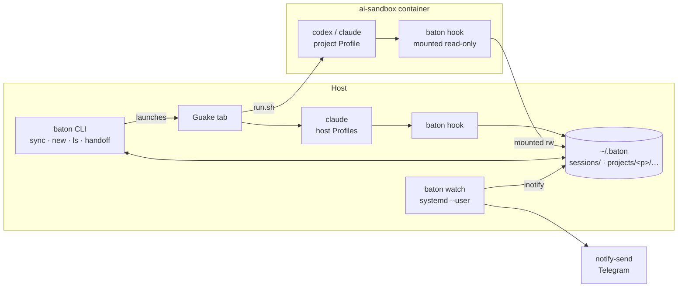

# Baton: one orchestrator for Claude Code and Codex

Oct 19, 2026 · @Paul · revised Oct 20, 2026 after the design review

Baton is a personal orchestrator on top of the official Claude Code and Codex CLIs. It keeps one set of skills and instructions for both, shows which Sessions are running or waiting for you, notifies you when an Agent needs you, and hands a Task over from one Agent to another. It never replaces the Agents themselves.

Capitalized terms (Agent, Profile, Session, Task, …) are defined in [GLOSSARY.md](GLOSSARY.md). Decisions that are hard to reverse are recorded in [docs/adr/](docs/adr/).

## Context and problem

Claude Code runs on the host under several Profiles (`~/.claude`, `~/.claude-personal`, `~/.claude-work`). Codex runs only inside the per-project Docker sandbox [`ai-sandbox`](https://github.com/loadkpi/ai-sandbox), where every project has its own home directory, login and history (`.ai-sandbox/home`). So every Agent × Profile × Project is a separate world.

What hurts today:

- Skills, instructions, hooks and MCP servers are maintained in several formats and places. Skills already come from three sources: plain directories, Claude's own synced skills, and a third-party installer (`~/.agents/.skill-lock.json`).
- It is unclear which Session is working, which is waiting for approval, and which has finished.
- A Task cannot move from Claude to Codex and back without copying context by hand.
- Terminal tabs in Guake are not tied to Projects or Tasks.

## Goals and non-goals

**Goals for v1**

1. One source of instructions, skills, MCP servers and hooks, rendered into every Profile on the host, in project sandboxes and in projects' Compose dev containers (`baton sync`).
2. Start Sessions of either Agent in any Runtime (`host`, `sandbox`, `compose`) in a named Guake tab.
3. A live list of Sessions and their statuses across all Profiles and Projects (`baton ls`), including Sessions started by hand outside Baton.
4. Desktop notifications when an Agent waits for approval or for input; one-way Telegram messages while you are away.
5. Manual Handoff of a Task from one Session to another, across Agents and Profiles.

**Non-goals**

- An own agent loop, own tools, or direct model calls: the official CLIs do that.
- Multiple users or access for other people.
- Replacing the Agents' native TUI.
- Exact limit accounting that matches the vendor's numbers.
- Resuming a native Session from Baton's own archive.
- A decision log as a Baton feature. ADRs, a glossary and a `/decide`-style skill delivered by `baton sync` cover it.

Everything else from the first draft (web dashboard, two-way Telegram, queue and night runs, per-turn checkpoints, limits) is in [v2 and later](#v2-and-later).

## Constraints

The main rule: Baton only works through the official CLIs and SDKs under your own login and never touches tokens directly.

| Vendor | Allowed | Not allowed |
| --- | --- | --- |
| Anthropic | Run `claude` (interactive or `claude -p`) and the Agent SDK under your subscription. Per the [Anthropic help article](https://support.claude.com/en/articles/15036540-use-the-claude-agent-sdk-with-your-claude-plan) (updated Oct 7, 2026) they draw on subscription limits | Extracting the OAuth token, spoofing the client, calling the API with a subscription token, sharing access. Per [Legal and compliance](https://code.claude.com/docs/en/legal-and-compliance), products for others need an API key |
| OpenAI | `codex`, `codex exec` and the Codex SDK under a ChatGPT plan, listed on the [pricing page](https://developers.openai.com/codex/pricing) | Calling the undocumented `chatgpt.com/backend-api/codex`, sharing your session with others |

Technical constraints:

- CLI flags, hook events and session file formats change between versions without compatibility guarantees.
- Neither vendor has a stable API for subscription limits.
- `ANTHROPIC_API_KEY` in the environment overrides the subscription login and switches to API billing; the OpenAI key behaves similarly for Codex. Baton clears these variables explicitly when it launches an Agent on the host.
- Codex inside the sandbox only passes an allow-listed set of environment variables to the commands it runs (`shell_environment_policy.include_only` in the rendered `config.toml`). Baton must not rely on environment variables reaching anything the Agent runs.

Vendor rules change often; re-read the terms before each major stage.

## Build or reuse

Existing session managers (Agent Deck, Agent of Empires, CCManager, kage, git-paw, RCFlow) mostly sit on top of tmux and know nothing about `ai-sandbox` [unverified, based on their descriptions]. v1 does not need tmux (see [D8](#d8-terminal-guake-now-tmux-as-an-experiment)), and its scope is small, so **Baton is built from scratch**. Session managers are worth another look in v2, after the tmux experiment.

[agent-cli-starter](https://github.com/youngjin39/agent-cli-starter) syncs `CLAUDE.md`/`.claude/` with `AGENTS.md`/`.codex/`, but it is a template for one repository, not a multi-Profile sync.

## Architecture

v1 has no stateful daemon. All truth lives in files under `~/.baton`; the CLI, the hooks and a stateless watcher read and write those files.



- **`baton hook <agent> --profile <name> --runtime <host|sandbox|compose>`** is the only thing Agents call. `baton sync` writes the flags into each Profile's hook definitions, because it knows which Profile it renders; no environment variables are involved. The hook reads the payload from stdin and appends one line to the Session's Event file under a file lock: schema version `v`, `ts`, `agent`, `profile`, `runtime`, `host` (the container id inside a container Runtime), `agent_pid` and `agent_start` (the Agent's process and its start time from `/proc/<pid>/stat`, so a reused PID never makes a dead Session look alive), `session_id`, `event` and `cwd` copied from the payload, and the raw `payload`. It does not call git, resolve the Project or interpret the payload, so it is fast enough even for Codex's 1-second `SessionEnd` budget.
- **Where Events go.** On the host: `~/.baton/sessions/<agent>-<session_id>.jsonl`, keyed by the Session only. In a sandbox or a Compose container: the mounted `~/.baton/projects/<project>/sessions/`, where the Project is known. Readers (`ls`, `watch`, `new`, `handoff`) resolve Project, Working copy and Task from `cwd` and register unknown Projects (D1).
- **`baton ls`** and **`baton watch`** derive Session statuses from Events. `baton watch` is a stateless Daemon under `systemd --user` that sends notifications (D6). `lost` is always computed on read, so neither command depends on the other. If it is down, Sessions and `baton ls` keep working; you only lose notifications.
- **One Go binary** (`CGO_ENABLED=0`) in `~/.baton/bin` provides all commands. The sandbox image has `python3`, `bash` and `jq` but no Go; the static binary is mounted read-only, so the same code runs on both sides.
- A Daemon with an API, state and push updates arrives in v2 with the web dashboard.

### Files

```
~/.config/baton/
  config.toml                 # source repository path, host Profiles (and their tags, ticket 03)
  secrets.env                 # values for ${VAR} placeholders, mode 0600
~/.baton/
  bin/baton                   # mounted read-only into sandboxes
  manifests/<profile>.json    # per Profile: files sync created, its blocks/keys in shared files
  backups/<profile>/<ts>/     # copies of shared files taken before sync first changed them
  sessions/<agent>-<session>.jsonl   # raw Events of host Sessions, mode 0600
  mounts/<project>.json       # the bind mounts of the Project's last sandbox container, for mapping paths (ticket 09)
  projects/<project>/         # mounted read-write into this project's sandbox only
    project.toml              # path, default Runtime
    tasks/<id>.toml           # name (optional), status, created (ticket 07)
    current.jsonl             # journal: Working copy, Task, since when it is current
    .lock                     # serializes changes to tasks/ and current.jsonl
    sessions/<agent>-<session>.jsonl # raw Events of sandbox Sessions, mode 0600
    handoffs/<task>/<n>.md
    handoffs/<task>/draft.md  # narrative part saved before the Handoff is assembled
```

## Key decisions

### D1. Domain model

Project → Working copy → Task → Session → Event. A Session also has an Agent, a Profile and a Runtime.

- **A Session is one native conversation.** `/clear` or switching conversations inside the same Terminal starts a new Session of the same Task.
- **At most one active Session per Working copy.** Parallel work means separate Tasks in separate Working copies. This also makes it unambiguous whose turn changed the files.
- **The Working copy determines the Task.** `baton new` appends "from time t, the current Task of Working copy X is T" to the Project's journal (`current.jsonl`). Every Session in X belongs to the Task that was current at its first Event, whether Baton started it or you ran `claude-personal` by hand. Because the journal keeps history, the answer does not depend on when a reader first looks at the Session. Without a record, an unnamed Task is created and becomes current. The current Task of a Working copy can change only when no Session is active there. No environment variables are involved, so it works inside the sandbox too.
- **A git worktree is a Working copy, not a Project.** The Project is found from the main checkout, `git rev-parse --git-common-dir` (the `.git` directory the worktrees share) with `.git` cut off, and the Working copy from `git rev-parse --show-toplevel` of the directory in question. See "Tasks and Working copies" below.
- **Unknown repositories register themselves on read.** The hook knows nothing about Projects. The first reader (`ls`, `watch`, `new`, `handoff`) that sees a Session in a git repository Baton does not know yet registers that Project by the root of its main checkout (see the worktree rule above) under a lock; a name clash gets a suffix. Sessions started by hand are never lost. Sessions outside any git repository are listed with Project `-`.
- **Tasks are cheap.** `baton new <project>` without a name creates an unnamed Task that can be named later (id `2026-10-20-1`, shown as `<project>/2026-10-20-1`).
- **Task status is what a human decides:** `open`, `done`, `dropped`. Whether a Task is "running" or "waiting" is derived from its active Session, never stored.

#### Tasks and Working copies (ticket 07)

Decided while building the Task side of `baton new` and `baton ls`.

**Worktrees.** For a directory `d`, `git -C d rev-parse --path-format=absolute --show-toplevel --git-common-dir` gives the Working copy (the first line, the work tree that holds `d`) and the common git directory (the second). When the common directory is named `.git`, the Project's path is its parent: the main checkout, the same for the main checkout itself and for every worktree made from it. Anything else (a submodule's `.git/modules/...`) has no main checkout to derive, so the work tree is its own Project and Working copy. A bare repository or the inside of a `.git` directory is not in a work tree and has no Project, like a directory outside git. The test makes a real `git worktree add` in the temporary repository, and meets the worktree before the main checkout, so the Project must come out right whichever is seen first. `--path-format=absolute` needs git 2.31 or newer; git 2.43 is what was run, older versions are [unverified]. Git resolves symbolic links in both paths (checked by hand with a linked directory), so a Working copy is always a real path. Records written by ticket 05 for a worktree as a Project of its own stay as they are.

**Tasks.** A Task is identified by a generated id `<date>-<n>` (`2026-10-20-1`): the UTC date of the command or of the Session's first Event, and the next free number of that day within the Project. D1's `<project>/<date>-<n>` format is kept, but it is the id, not the name: a Task has an optional **name** on top of it, so naming (and renaming) an unnamed Task never changes what the journal, `handoffs/<task>/` and the tab titles refer to. The record `tasks/<id>.toml` is `name` (left out while unnamed), `status` (`open`, `done`, `dropped`) and `created` (RFC 3339, UTC). A name follows the rules of a Project name, is unique within the Project, and may not look like an id, so a word typed by a user (`<project>/<task>`, here and in `baton new`) means one Task: a word shaped like an id is an id, any other is a name. UTC is used for the date so that the id does not depend on the machine's time zone, at the price that a Task made shortly after local midnight may carry the neighbouring day. `baton ls` and the tab title show the name, or the id while there is none; after naming, tabs that are already open keep their old title.

**The journal.** `current.jsonl` has one line per change, `{"v":1,"ts":"2026-10-20T10:15:00Z","working_copy":"/home/me/app","task":"2026-10-20-1"}`, appended under the Project's `.lock` by `baton new` (with `ts` of the command) and by readers that adopt a Session (with `ts` of the Session's first Event). The Task current in a Working copy at time `t` is the line for it with the greatest `ts` not after `t` (the later line wins a tie); the order of lines does not matter. That is what lets a reader write a line dated in the past: when `baton new` switched Tasks before anyone read an earlier Session, that Session gets an unnamed Task dated at its first Event and the Working copy's current Task stays the newer one. Readers adopt Sessions oldest first, so a later Session of a Working copy finds the Task an earlier one got instead of making its own, and a Session after `/clear` [unverified: that Claude Code gives it a new session id] lands in the same Task. The Session's Working copy is that of the `cwd` of its first Event.

**`baton new <project> [task]`** with a name Baton has no Task for makes a named Task; with a name or an id it does have, it continues that Task, whatever its status (status is not changed); with an id nobody has it refuses; with no argument it makes a new unnamed Task every time. Each run appends a journal line, even when the Task is already current. The check, the Task record and the journal line happen under one lock, before the tab is opened; if Guake then fails, the Working copy has a current Task and no Session, which does no harm. A Project whose Runtime cannot be started yet is refused before anything is written.

**Active Session.** A Session is active when `baton ls` would show it neither `ended` nor `lost`, that is when the last Event Baton knows is not `SessionEnd` and its Agent has not been found gone (ticket 11, [below](#lost-detection-ticket-11)). A Session that crashed without `SessionEnd` therefore blocks its Working copy only until the next read finds it `lost`; one whose liveness could not be checked (docker is down) stays active. The refusal names the Session so that the user can judge: `baton: working copy <path> of project <p> already has an active session: claude, profile <profile>, session <id>, last event <ts> (<status>); end it, or hand the Task over with baton handoff`. The suggested `baton handoff` is not built yet (ticket 14). Events of host Sessions (`~/.baton/sessions`) and of sandbox Sessions (`~/.baton/projects/<project>/sessions`, mapped to host paths as described under ticket 09) are looked at; those of Compose Sessions arrive with their Runtime. The same check guards the current Task: it changes only through `baton new`, so it cannot change while a Session is active in the Working copy.

**Commands to name and close a Task.** `baton task name <project>/<task> <name>` names a Task (or renames it) and prints `<project>/<name>`. `baton task status <project>/<task> <open|done|dropped>` prints `<project>/<task> <status>`. `<task>` is a name or an id. There is no command to list Tasks yet; `baton ls` shows those that have Sessions.

**Code layout.** `business/domain/taskbus` owns Tasks and the journal (`stores/taskfile`); `business/domain/workbus` joins Sessions, Projects and Tasks (placing each Session in its Working copy and Task, and the one-active-Session guard) and is what `baton ls` and `launchbus` use. New strong types: `taskid`, `taskstatus`, `taskref` (a name or an id, as typed).

### D2. Session statuses

Five statuses, all derived from the last Event. Hook names below were checked against the [Claude Code](https://code.claude.com/docs/en/hooks) and [Codex](https://learn.chatgpt.com/docs/hooks) documentation on Oct 20, 2026.

| Status | Claude Code | Codex | Meaning |
| --- | --- | --- | --- |
| `running` | `UserPromptSubmit`, `PreToolUse`, `PostToolUse`, `PostToolUseFailure` | `UserPromptSubmit`, `PreToolUse`, `PostToolUse` | The Agent is working |
| `waiting_approval` | `PermissionRequest` | `PermissionRequest` | The Agent needs your approval |
| `waiting_input` | `SessionStart`, `Stop` | `SessionStart`, `Stop`, `Interrupt` | It is your turn |
| `ended` | `SessionEnd` | `SessionEnd` | The conversation is over |
| `lost` | — | — | The process or container is gone without `SessionEnd`; found out on every read by the shared status code (see [Lost detection](#lost-detection-ticket-11)), never written to an Event file |

The first draft also had `starting`, `idle`, `done` and `failed`. `idle` is the same as `waiting_input`; "done" belongs to the Task (D1); `starting` cannot be observed reliably; `failed` returns in v2 with headless Sessions. Codex has no "waiting for input" hook, which is why `Stop` is the common signal.

#### Event files and `baton ls` (ticket 05)

Decided while building `baton hook` and `baton ls`. Codex (ticket 10) and the other Runtimes add to these formats, they do not change them.

**The Event line.** One JSON object per line, written by `baton hook <agent> --profile <name> --runtime <host|sandbox|compose>`, which reads the payload from standard input:

```json
{"v":1,"ts":"2026-10-20T10:15:00.123456789Z","agent":"claude","profile":"claude-personal","runtime":"host","host":"laptop","agent_pid":4242,"agent_start":9876543,"session_id":"abc123","event":"Stop","cwd":"/home/me/app","payload":{...}}
```

- `ts` is UTC, RFC 3339 with nanoseconds. `host` is the host name, which in a container is the container id. `agent_start` is the Agent's start time in clock ticks since boot (field 22 of `/proc/<pid>/stat`): an integer that is only ever compared for equality, so it needs no conversion to wall-clock time and survives the `CLK_TCK` of the machine. `agent_pid_fallback: true` is present, only then, when no ancestor was recognized as the Agent (below).
- `session_id`, `event` (`hook_event_name`) and `cwd` are copied from the payload; `payload` is the payload itself, compacted to one line and otherwise as the Agent wrote it (no HTML escaping). Nothing else is read from it. A payload that is not a JSON object, or has no `hook_event_name`, or whose `session_id` cannot be a file name (`[A-Za-z0-9][A-Za-z0-9._-]{0,127}`; Claude uses UUIDs) is refused: nothing is written and the exit code is 1. The hook never exits with 2, because for Claude Code an exit code of 2 from a hook blocks the action it is about. On success it prints nothing.
- The file is `~/.baton/sessions/<agent>-<session_id>.jsonl`, created with mode 0600 in a 0700 directory. The hook opens it with `O_APPEND`, takes an exclusive `flock` on it, writes the whole line (with its newline) in one `write` and closes it. The lock is on the Event file itself, so there is no lock file to list or clean up. Readers take no lock: they read only lines that end in a newline, and skip lines that are not Events, so a line that is half written is never seen.
- The hook calls no git and registers no Project. Claude Code gives `SessionEnd` hooks 1.5 seconds by default ([Claude Code: Hooks](https://code.claude.com/docs/en/hooks), checked Oct 20, 2026), which a process that reads stdin and appends one line fits easily; Baton writes no `timeout` into its hooks.

**The parent chain [unverified].** Whether Claude Code starts a hook command directly or through `sh -c` was not checked under a live Claude. The documentation says the command string of a hook is run through `sh -c` on Linux and that a hook with `args` is spawned directly, and nothing about the processes in between, and the dash that `sh` is here may or may not leave a shell process behind. So `agent_pid` does not assume anything: starting at the hook's parent, `baton hook` walks up for at most 8 processes and takes the nearest one whose `comm` or executable name is the Agent's binary (`claude`). If it finds none, `agent_pid` is the direct parent, `agent_pid_fallback` is true and `agent_start` is that process's. A process that cannot be read gives its PID and a start time of 0. One thing was observed, not about hooks: the live Claude Code that built this ticket (2.1.303, native install) has `comm` `claude` while its executable is `.../versions/2.1.303`, so matching the executable name alone would not find it; `comm` is why both are checked. The ticket's acceptance asks for the finding to be recorded: it is still open until someone runs the recorder (a hook that writes the payload and the chain of ancestors into a directory, used with a throwaway Profile) under a live Claude and copies the answer here. The tests cover the walk with a `claude` stub that starts the hook directly and through an inner shell, and the fallback with ten nested shells. Observed once since (ticket 09's real-Docker check): a real Claude 2.1.296 in a container ran the guarded sandbox hook through `sh -c ... exec`, and the walk found the `claude` process without the fallback; the plain host form under a live Session is still unrecorded.

**Payload fixtures are from the documentation.** `test/testdata/claude-hooks/` holds the example payloads printed in the Claude Code hooks reference, one per Event of the status table, copied verbatim (checked Oct 20, 2026); their README says "from docs, replace with recordings". Nothing in them was recorded from a live Claude. `PostToolUse` carries no exit code in the documented example (`tool_response` of the `Write` tool); `PostToolUseFailure` has it inside the text of `error` (`"Exit code 1\n..."`). Both are facts about the documentation, not about what Claude sends; the Handoff ticket still has to check.

**Status derivation.** One table in `business/types/status` maps an Agent's Event name to a status; `baton hook` installation (sync) and `baton ls` both take their Event list from it. A Session's status is the one of its newest Event that the table knows, so an Event outside the table (such as `Notification`) changes nothing. A Session whose Events are all unknown is `unknown`, a sixth status that only exists as a defensive fallback; Baton installs hooks only for known Events. `lost` is not in the table: it is what the reader makes of a Session that is not `ended` once its Runtime says the Agent is gone (ticket 11).

**Projects register on read.** `baton ls` (and, later, the other readers) resolve each Session's Project from the `cwd` of its first Event with `git rev-parse` (ticket 07 below), so a Session that wandered into another repository stays in its Project. Unknown git roots are registered as `~/.baton/projects/<name>/project.toml`:

```toml
path = "/home/me/app"
runtime = "host"
```

`runtime` is the Project's default Runtime: `sandbox` if `<root>/.ai-sandbox/run.sh` is a file, `host` otherwise (it is not the Runtime of a Session, which the hook reports). The name is the directory name lower-cased, with every run of other characters turned into `-` and leading and trailing `.`, `_`, `-` cut off (`project` if nothing is left); a name another Project has gets `-2`, `-3`, ... The lookup, the choice of the name and the write happen under an exclusive `flock` on `~/.baton/projects/.lock`, and the lookup is repeated after taking the lock, so readers running in parallel register a repository once. A `cwd` outside git, or one that no longer exists, has Project `-` and registers nothing. The Project is looked up by the root of its main checkout, so a git worktree belongs to the Project of the repository it was made from (ticket 07; ticket 05 registered a worktree as a Project of its own, and such records are not migrated).

**`baton ls`.** A table with the header `PROJECT TASK AGENT PROFILE RUNTIME STATUS` (columns padded by two spaces), one row per Session, the most recently active first (by the time of the Event that decided the status). `TASK` is the Task's name, or its id while it has none; a Session outside git has `-` for both Project and Task. Ended Sessions stay in the list. With no Sessions it prints `no sessions`.

### D3. Runtimes: host, sandbox and compose

The `sandbox` Runtime is `ai-sandbox`, not a custom image. `ai-sandbox` knows nothing about Baton ([ADR 0001](docs/adr/0001-ai-sandbox-knows-nothing-about-baton.md)): Baton uses generic mechanisms that make sense without it (extra mounts, config fragments), or wraps `run.sh` through `AI_SANDBOX_PRINT_ARGS`.

- The default Runtime is `sandbox` if the Project has `.ai-sandbox/run.sh`, otherwise `host`.
- Each Project's sandbox keeps its own Profiles (own login and history). Baton unifies history through Events, not through shared config directories.
- Two directories are mounted into the sandbox: `~/.baton/projects/<project>` read-write and `~/.baton/bin` read-only. Nothing else from `~/.baton`, so a sandbox never sees other Projects.
- **v1 sandbox Sessions run only in the main checkout.** A git worktree stores the absolute host path to `.git/worktrees/<name>`, which does not exist inside the container (the Project is mounted at `/workspace`), and `.ai-sandbox/` is gitignored, so a worktree has no sandbox at all. The one-active-Session rule (D1) makes this safe.
- Codex in every sandbox asks once to trust user hooks (`/hooks`). Baton does not bypass that review; `baton ls` marks a Codex Session that reports nothing with `no_events` and a hint to run `/hooks` (see [Codex Sessions](#codex-sessions-ticket-10)).

**A Runtime is a replaceable part** with one interface (declared in ticket 08, [below](#sandbox-profiles-and-the-runtime-interface-ticket-08)): start an Agent in it, locate and write its Profiles, map a path inside it to a host path, and tell whether a Session's Agent is still alive. Paths inside containers are never assumed equal to host paths: they are mapped through the container's mounts (`docker inspect`; for the sandbox, the mounts Baton itself passed to `docker run`, see ticket 09). In container Runtimes a Session is alive while its container runs and its `agent_pid` (in the container's PID namespace, with the same start time) still runs there, checked with one `docker exec` per running container.

**`compose`** is a long-lived service of the Project's own Docker Compose setup with the Agents installed, typically a dev container with the application. It differs from `sandbox` in three ways: the container outlives Sessions (Agents are started with `docker compose exec`), its Profiles often live in named volumes that several Compose setups share, and nothing regenerates their configs, so they are full Profiles.

- Configured per Project in the Baton config: Compose files, service, and the Profiles inside the container with their tags.
- The Project's Compose files know nothing about Baton, as `ai-sandbox` does not (ADR 0001). Baton never edits them; it checks its two mounts with `docker inspect` and, when they are missing, prints the snippet for the user's untracked override file. Adding mounts needs one recreate of the container, so the user picks the moment.
- Baton writes Profiles through Docker (into the running service, or through a one-shot container with the volume when it is stopped), resolves the real config directory inside the container instead of trusting documentation, and depends on no tools in the image.
- Compose Sessions run only in the main checkout, like sandbox Sessions.
- Lessons from an earlier shell-based attempt at the same setup: hooks written to the volume root instead of the symlinked config subdirectory never ran; status by timestamps alone left crashed Sessions looking alive for a day; a registry inside the volume avoided recreating the container but had to be read through Docker on every poll.

#### Starting an Agent in the sandbox (ticket 09)

**What was checked** (Oct 20, 2026). `ai-sandbox` was read at commit `ddaec7d` (`run.sh`, `build.sh`, `entrypoint.sh`, `Dockerfile`) and never run. The tests run the copy of `run.sh` in `test/testdata/ai-sandbox/` in print-args mode with the `docker` stub. Docker, Codex and a live Claude Code in a container were never run by the tests.

**Checked on real Docker** (Oct 20, 2026; baton `93ef074`, image `ai-sandbox:codex-0.162.1_claude-2.1.296`, Docker 27.3.1). A throwaway Project with ai-sandbox installed, an isolated `HOME`, `baton sync`, `baton new` with a `guake` stub, then the exact `docker run` line from the stub with the Agent replaced by a check script (and `-it` by `-i`):
- the two Baton bind mounts work together with `--read-only`: `/baton/bin` rejects writes, `/baton/project` accepts them;
- `ANTHROPIC_API_KEY` and `OPENAI_API_KEY` set in the host environment of `docker` did not reach the container;
- the synced skill is in `/home/sandbox/.claude/skills` and `/home/sandbox/.agents/skills`;
- the guarded hook command writes the Event into `/baton/project/sessions/` (mode 0600, owned by the host user on the host), and `baton ls` on the host shows the Session with Runtime `sandbox`;
- without the Baton mounts, the guarded command exits 0 and prints nothing;
- `codex` 0.162.1 parses `config.toml` with Baton's merged block (`codex mcp list` shows the synced server), and `claude` 2.1.296 reads `mcpServers` from the sandbox's `~/.claude.json`;
- a real Claude process (`claude mcp list` fires `SessionEnd`) ran the guarded `sh -c '... exec /baton/bin/baton hook ...'` command; `baton hook` found `agent_pid` by the walk, without the fallback.
Not checked: a full interactive Session of either Agent (it needs a login in the throwaway Profile).

**The wrapper.** There is no generic mechanism in `ai-sandbox` yet, so Baton uses the `AI_SANDBOX_PRINT_ARGS` wrapper of ADR 0001. `baton new` for a Project whose Runtime is `sandbox` does this in `Start` (`runtimebus/stores/runtimesandbox`), then opens the tab:

1. Runs the Project's own `bash .ai-sandbox/run.sh -- env -u ANTHROPIC_API_KEY -u OPENAI_API_KEY <agent>` with `AI_SANDBOX_PRINT_ARGS=1` in the main checkout. `run.sh` renders its Codex config, Codex instructions and the project-level Claude settings, as on every launch, and prints one word per line: `docker`, `run` and its options, the image tag, and the command. The output is checked: it must start with `docker run` and end with the command Baton passed, otherwise the launch fails and says so (the format is a contract with `ai-sandbox`, ADR 0001). `run.sh`'s own notes on stderr go to Baton's stderr. Its modes and `--with-host-skills` are not passed on; v1 uses the default mode.
2. Print-args mode skips the check for the image, so Baton does it: `docker image inspect <tag>`, and when that fails `bash .ai-sandbox/build.sh`, which is what `run.sh` itself does. The build output goes to Baton's stderr (`run.sh` hides it; here someone is waiting at a prompt). A Project without `build.sh` and without the image is an error.
3. Merges the fragments (below).
4. Adds the two Baton mounts to the options, just before the image: `-v ~/.baton/bin:/baton/bin:ro` and `-v ~/.baton/projects/<project>:/baton/project:rw`, and nothing else of `~/.baton`. Both sources must exist, because Docker would make a missing one as root: the project directory is made if needed, and a missing `~/.baton/bin/baton` is an error that says to run `make install`.
5. Records every `-v` mount of the final command in `~/.baton/mounts/<project>.json` (see "Paths" below).
6. The tab is `cd <main checkout> && docker run ... <image> env -u ... <agent>`, titled `<project>/<task>:<agent>`, typed into Guake by the same Terminal as for the host. The container name `run.sh` chose uses the PID of the print-args process, which is unique among live processes.

The Profile of a sandbox Session is the Project's own `<project>.<agent>` (its hooks name it), so `--profile` is refused for such a Project, and no host Profile has to exist for it.

**Story 30 (clear API keys), for the sandbox.** Keys of the host's environment cannot reach the container through the arguments `run.sh` builds: every `-e` it passes has a value, none is a bare `-e NAME` that docker would fill from the environment of the `docker` client, and the client's own environment is not the container's. What can bring a key in is the credentials file `run.sh` passes with `--env-file` (the user's own choice) or a changed `run.sh`. So the Agent is started as `env -u ANTHROPIC_API_KEY -u OPENAI_API_KEY <agent>` inside the container, which clears the two variables whatever their source; `env` is `coreutils` and the entrypoint ends in `exec "$@"` [the image was not run, so that `env` is on its `PATH` is unverified]. The same two variables as on the host; whether other billing variables matter is still [unverified] (see the host note above). The key stays in the environment of the container's first process; only the Agent's is cleared. The tests assert this on the arguments the `docker` stub records, with keys in Baton's environment and in a credentials file.

**Fragments.** After `run.sh` rendered `.ai-sandbox/home/.codex/config.toml` and `AGENTS.md`, `config.d/baton.toml` is put between `# baton:begin` and `# baton:end` lines in the first, and `AGENTS.d/baton.md` between `<!-- baton:begin -->` and `<!-- baton:end -->` in the second. Rules: no block yet means it is appended (after a blank line); one block means its body is replaced in place, so a file the user took over (removed the `managed-by` marker, so `run.sh` preserves it) never gets a second block and keeps what is around the block; a missing or empty fragment removes the block; a broken pair of markers (one without the other, or two blocks) fails the launch and names the file; a file that does not exist is left alone; a launch writes nothing when the merged file would be the file as it is. A `config.toml` that carries a block is made mode 0600, because the MCP fragment holds secrets substituted by sync. The merge happens on every launch, also for Claude, because `run.sh` renders the Codex files whatever it starts. `baton sync` still never touches `config.toml` or `AGENTS.md`. Whether Codex accepts the merged file is [unverified]; Codex was not run.

**Paths.** The Event files of a sandbox Session are in `~/.baton/projects/<project>/sessions/`, written by `baton hook` inside the container into `/baton/project/sessions/` with the same `flock` and modes as on the host (`sessionfile.NewMounted`). Readers list the host directory and the `sessions` directory of every Project. The container's `cwd` of a Session's first Event is mapped by `HostPath(project, path)`: the longest container path among the mounts recorded at the last start of that Project's container that is the path or a parent of it, with the rest appended to its host path (a cleaned path, so `/workspace/../tmp` is `/tmp`). The mounts are those Baton passed to `docker run`, not `docker inspect` (which would need a running container and one more process on every `baton ls`). The record is outside the project directory because the container can write that. A path under no mount (`/tmp` of the container, say), a Session of a container Baton did not start, or a mount record that is gone gives the Session no place: it is listed with Project `-`, like a Session outside git. Which Project a file is mapped for is decided by the directory the file is in, not by what the Event says. A sandbox Session counts as active in its Working copy, so it blocks `baton new` there like a host Session, until `SessionEnd`. Containers are checked for `lost` as described under ticket 11. A restart with other paths (the Project moved) replaces the record, so Sessions of the earlier container map by the new mounts.

**Main checkout only.** `baton new` refuses a Working copy that is not the Project's main checkout for a Runtime other than `host`, before it writes a Task or opens anything: `project app runs in the sandbox Runtime, whose Sessions run only in the main checkout <path>, not in the worktree <path>`.

**A test-only knob.** `baton hook --runtime sandbox` reads one environment variable, `BATON_CONTAINER_ROOT`, the directory that stands for `/` of the container (default `/`): the mount is `$BATON_CONTAINER_ROOT/baton/project`. Tests cannot write to `/baton`, and the seam of the project is the `baton` executable, so they put a symbolic link where the bind mount would be. It is read only for `--runtime sandbox`, nothing else reads it, and it has no effect on a host hook. Without a directory at the mount point the hook exits 0 and prints nothing, before it reads its input: that is an `ai-sandbox` started without Baton (ADR 0001). A container started without Baton has no `/baton/bin/baton` either, so the hook command itself is guarded (spec story 40): Claude's is `[ -x /baton/bin/baton ] || exit 0; exec /baton/bin/baton hook <agent> --profile <p>.<agent> --runtime sandbox`, which exits 0 and prints nothing without the binary. `exec` leaves no shell between the Agent and `baton hook`, so the walk up the parent chain to `agent_pid` is unchanged (a test runs the written command from a `claude` stub through `sh -c` and finds the stub's PID). Whether Codex runs a hook's `command` through a shell is **not documented**: the hooks page (checked Oct 20, 2026) says only that commands run with the session `cwd` as their working directory and has no `args` field; its examples use `$(...)` and `~`, which suggests a shell but does not say so. So the Codex command is wrapped explicitly, `sh -c '<the same guarded line>'`, which is correct whether or not Codex adds a shell of its own; Claude's form stays unwrapped because its documentation says `sh -c`. The wrapper changed the hooks of every sandbox Profile, which Codex asks to trust again; no Codex Session had trusted them yet, because `codex` was refused until ticket 10. Host hooks are not guarded: `baton sync` already warns when the host binary is missing. The tests cannot create `/baton/bin/baton`, so they take the command sync wrote, replace the path `/baton/bin/baton` in the string by a missing path (nothing happens, exit 0, no output) or by the built `baton` (the Event is written, with `BATON_CONTAINER_ROOT` for the mount), and run it with `sh -c`.

**What would replace the wrapper** (a change to `ai-sandbox`, not made here; each part can be described in its README without Baton):

- Extra mounts: repeatable `--mount host:container[:ro]` for `run.sh`, appended to its `DOCKER_ARGS`. This replaces adding the Baton mounts by editing the printed command.
- Fragments for the files it renders: after `render_codex_config` and `render_codex_agents`, append the files of `home/.codex/config.d/*.toml` and `home/.codex/AGENTS.d/*.md` (in name order) to the rendered file, between its own marker lines, replacing an earlier block, which would also make them survive a user-edited file the way Baton's blocks do now. This replaces the merge.
- Ensuring the image in print-args mode too (or a `--build-if-missing` flag that the wrapper can use). This replaces the `docker image inspect` and `build.sh` steps.

With those, `Start` would run `run.sh --mount ~/.baton/bin:/baton/bin:ro --mount ... -- env -u ... <agent>` itself and keep only the mount record and the tab; print-args mode would stay for tests.

#### Lost detection (ticket 11)

**What counts as lost.** A Session is `lost` when its newest Event is not `SessionEnd` and the Runtime named in its Events says the Agent process is gone. It is computed on every read, inside `sessionbus.List` (the one place `baton ls`, `baton new`'s active-Session check and the later `watch` and `handoff` read Sessions through), by asking each Runtime once about all of its Sessions that have not ended. Nothing is written to Event files; `lost` is not an Event name, and a `SessionEnd` that arrives later (a hook that fired after all) simply wins, because the newest Event decides. A `lost` Session is not active (D1), so its Working copy is free again. Its `Since` stays the time of its last status-bearing Event.

**The process that is checked** is the one the newest Event of the Session names (`host`, `agent_pid`, `agent_start`), so a conversation resumed in a new process is judged by the new one. An Event is not judged, and the Session keeps the status of its Events, when it has no PID or start time (`0`: the hook could not read the process), or has `agent_pid_fallback: true` (the PID is only the hook's parent, which says nothing about the Agent and is often a shell that exited long ago; judging it would mark live Sessions `lost`).

**The Runtime interface** changed to be batched, because one `docker ps` and one `docker exec` per container are only possible if the Runtime sees all the Processes of a check: `Alive(ctx, []Process) ([]Liveness, error)`. `Liveness` is `ProcessUnknown` (the zero value, never taken for dead), `ProcessAlive` or `ProcessGone`; the answers are valid whatever the error is, and the error says why some are unknown. The caller turns an error into one warning per Runtime on stderr, `baton: warning: cannot tell whether sandbox sessions are still running, showing what their events say: <why>`, and leaves those Sessions with their Event-derived status.

- **host.** The Process is judged only if its `host` equals this machine's host name: an Event from another machine, or from a container (its host name is the container id), says nothing about this machine's `/proc` and stays unjudged. Then `/proc/<pid>/stat` must exist (else gone) with a start time (field 22) equal to `agent_start` (else gone, a reused PID). A stat file that cannot be read for another reason is unknown. A zombie still has a stat file and counts as running until its parent reaps it.
- **sandbox**, and in the same code **compose** later: `runtimebus.AliveInContainers` over a small `Containers` interface (`Running`, `ProcessStarts`) that `foundation/docker` implements with the docker CLI. One `docker ps --no-trunc --format '{{.ID}}'` lists the running containers. A Process finds its container by its `host` as a prefix of the container id (the host name inside a container is the first 12 characters of its id unless the container is given a `hostname`; `ai-sandbox`'s `run.sh` at `ddaec7d` passes none). A container that is not in the list is gone, so its Sessions are `lost` (this covers an exited container too, because `docker ps` shows only running ones). For a running container, one `docker exec <id> sh -c 'for p in "$@"; do cat "/proc/$p/stat" 2>/dev/null; done; exit 0' sh <pid>...` prints the stat lines of the PIDs that run, whatever their number; the start times are compared with `agent_start`, and a PID with no line is gone. The script ends in `exit 0` so that only a failure of docker itself gives a non-zero status; it needs `sh` and `cat` in the container and is run as the container's default user. Containers are asked in order of id; each is asked once per read, however many Sessions it holds. A `host` that is not 12 to 64 lower-case hex digits (a container with a hostname of its own, or an Event written outside a container) is not judged, so it can never be called `lost` by mistake, and when no Process names a container docker is not called at all. A `host` that is a prefix of two running containers is not judged either.
- **docker failing.** `docker ps` failing (not installed, daemon down, a 20-second timeout per call) makes every container Process unknown with one warning; `docker exec` failing for a container (it stopped between the two calls, is paused) makes only that container's Processes unknown, and the other containers are still judged. The warnings of all of them are joined into the one warning of the Runtime.

**Where it is wired.** `sessionbus.Bus.WithRuntimes` takes the Runtimes; `baton hook` does not, so a hook never touches `/proc` of others or docker. `baton new` calls `List` too (its active-Session check), so it can run `docker ps` and `docker exec` as well, and ignores the warnings there.

**What the tests do.** A real dead PID (a short process the test starts and waits for), a real running PID with a start time off by one (a reused PID), Events with other host names, and a `docker` stub that answers `ps` from a file of running ids and runs the very script Baton passes to `docker exec` against fixture `/proc` trees (the stub swaps `/proc/` for the container's fixture directory), so the shell command is exercised and not only its arguments. No clock control. The test of ticket 05 that ran a `claude` stub through the written hook now sees `lost`, because the stub has exited: that is the new behavior.

**Checked, and not.** On this machine (Docker 27.3.1) `docker ps --no-trunc --format '{{.ID}}'` printed the full 64-hex ids, one per line, and the exec script was run in a local shell against real `/proc` (it prints the stat lines of the PIDs that run, nothing for a missing one, and exits 0). Not checked: `docker exec` into a real container (nothing was started for it), that `sh` and `cat` exist in the `ai-sandbox` image [unverified; the image has `bash`, `python3` and `jq` per the spec, which says nothing about `sh` and `cat`], and that the host name in a real `ai-sandbox` container is the 12-character id (Docker's documented default; `run.sh` sets no `--hostname`) [unverified, no container was started]. Compose containers may set `hostname:`; ticket 18 has to decide how to find those.

### D4. One source for instructions, skills, MCP and hooks (`baton sync`)

The source is a separate private git repository (for example `~/github/my/agent-config`), set in `~/.config/baton/config.toml`. Baton itself holds no personal content.

| What | Source | Claude Code | Codex |
| --- | --- | --- | --- |
| Instructions | `AGENTS.md` | `CLAUDE.md` in the Profile | `AGENTS.md` in the Profile (sandbox: a fragment, see below) |
| Skills | `skills/*/SKILL.md` | `<profile>/skills/` | `$HOME/.agents/skills/` (sandbox: `.ai-sandbox/home/.agents/skills/`) |
| MCP | `mcp.json` | Profile MCP configuration (`.claude.json`, see [MCP and secrets](#mcp-and-secrets-ticket-04)) | `config.toml` (sandbox: a fragment) |
| Status hooks | generated | `<profile>/settings.json` | `<profile>/hooks.json` |

Rules:

- **Targets are Profiles only:** host Profiles and the Profiles inside each Project's `.ai-sandbox/home`. Sync never writes files that git tracks, so team repositories stay untouched.
- **Sync owns only what it created.** A manifest lists every file sync wrote; it updates or deletes only those. Claude's own `skills/synced/`, existing work skills and third-party installs stay as they are.
- **Shared files are changed carefully.** Some targets already exist and belong to someone else: `CLAUDE.md`, `settings.json`, the Claude MCP configuration, Codex `hooks.json`. Baton owns only its part of them: a block between `<!-- baton:begin -->` and `<!-- baton:end -->` in Markdown, named keys (its `hooks` entries, its `mcpServers` names) in JSON and TOML; the manifest records which. The first time sync adds its part to such a file, it shows the diff and asks; on yes it copies the file to `~/.baton/backups/<profile>/<ts>/` and writes atomically (temp file and rename), leaving everything outside its part as it was. Later syncs update Baton's part without asking, unless someone edited inside it, which brings the question back. A foreign skill directory with the same name as a source skill gets the same question and backup before it is replaced. Without a terminal to ask in, sync stops with an error naming the path.
- **Tags decide what reaches each Profile.** Every source item may carry tags (`work`, `personal`, …); every Profile accepts a list of tags. Untagged instructions and skills go everywhere.
- **Baton's own skills are named `baton-*`.** Built-in items that Baton ships (in v1 only `/baton-handoff`) carry the `baton-` prefix, so they never collide with the user's skills, Claude's synced skills or third-party installs. The prefix is reserved: a source skill named `baton-*` makes sync stop with an error.
- **No secrets in the source.** Manifests use `${VAR}` placeholders; values come from `~/.config/baton/secrets.env` (0600). A Profile receives only the secrets of the items its tags accept.
- **Inside the sandbox, `ai-sandbox` owns security and Baton owns content.** `run.sh` regenerates `.codex/config.toml` and `.codex/AGENTS.md` on every run (unless you removed its marker), and these are exactly the files where Codex keeps MCP servers and global instructions. Baton writes only fragments (`config.d/*.toml`, `AGENTS.d/*.md`); a generic fragments mechanism in `ai-sandbox`, or the print-args wrapper, merges them (ADR 0001). Ticket 08 writes the fragments; ticket 09 merges them on `baton new`. See [Sandbox Profiles](#sandbox-profiles-and-the-runtime-interface-ticket-08).

#### Codex Sessions (ticket 10)

**What was checked** (Oct 20, 2026). The [Codex hooks page](https://learn.chatgpt.com/docs/hooks) was read with WebFetch; Codex was never run, and no payload was recorded.

- *Payload field names are Claude's.* Every command hook gets one JSON object on stdin with `session_id`, `transcript_path` (or null), `cwd`, `hook_event_name` and `model` (a Codex extension); turn-scoped Events add `turn_id`, and `SessionStart`, `PreToolUse`, `PermissionRequest`, `PostToolUse`, `UserPromptSubmit`, `SubagentStart`, `SubagentStop`, `Stop` and `Interrupt` add `permission_mode`. So the hook needed no field mapping: `Record` copies `session_id`, `hook_event_name` and `cwd` for both Agents, and `agent.Parse` accepting `codex` was the only change `baton hook` needed. The Event file of a Codex Session is `codex-<session_id>.jsonl`. The page's one example session id is `thr_123`, which the session id pattern allows; whether real Codex ids are file-name safe is [unverified], a hook that gets one that is not exits 1 as for Claude.
- *Fixtures are mostly constructed.* The page prints exactly one stdin example (`SessionEnd`). `test/testdata/codex-hooks/` holds that one verbatim and, for the other Events of the status table, objects built from the page's field tables with made-up values; the README there says "from docs, replace with recordings" and which is which. `tool_input` and `tool_response` have no documented example, so their shape is a guess. The ticket asked for recorded payloads; none exist.
- *Statuses* come from the Codex column of the status table in D2 (`Stop` and `Interrupt` mean `waiting_input`, `PermissionRequest` means `waiting_approval`, ...); the table was already in `business/types/status`, and `baton ls` uses it as soon as the Event file says `codex`. `Interrupt` fires "when you interrupt an active turn on the main thread" and not for idle threads or subagents (the page). Subagent Events (`SubagentStart`, `SubagentStop`) are not in the table and not installed.
- *Timeouts.* `SessionEnd` and `Interrupt` get 1 second by default and accept up to 3 (the page); Baton writes no `timeout`, as for Claude. Hooks run with the session `cwd` as working directory; whether through a shell is still not documented (hence the `sh -c` wrapper of ticket 09).
- *The Agent's process.* `agent_pid` is found by the walk of ticket 05, looking for a process whose `comm` or executable name is `codex`. Whether the Codex process is called that (it may be a `node` wrapper, or the native binary) is [unverified]; if not, the walk falls back to the hook's direct parent (`agent_pid_fallback`), as for Claude, and the liveness check of ticket 11 ignores a fallback PID (see there).

**Where Codex runs.** Only in a sandbox. `agent.Parse` accepts `codex` (it also parses Event lines and hook arguments), and the two places where a Codex on the host would be meaningless refuse it: a `[profiles.*]` table of the config with `agent = "codex"` is an error at load (`profile <name>: agent "codex" runs only in a sandbox, whose Profiles are not listed in the config`), and `baton new <host project> --agent codex` fails with `project <name> runs in the host Runtime; codex runs only in a sandbox (a Project with .ai-sandbox/run.sh)`. In a sandbox `baton new <project> [task] --agent codex` is ticket 09's start with `codex` as the command (`env -u ANTHROPIC_API_KEY -u OPENAI_API_KEY codex`); the Profile is `<project>.codex`.

**The launch marker (the `/hooks` hint).** Baton can know that a Codex Session exists without Events only if it started it, so `baton new` leaves a record of the start. Decided:

- *Where and what.* `~/.baton/projects/<project>/launches/<agent>.json`, mode 0600, written atomically: `{"v":1,"ts":...,"agent":"codex","profile":"app.codex","runtime":"sandbox","task":"<task label>","title":"app/<task>:codex"}`. One file per Project and Agent: a newer launch replaces the older, so only the latest launch of a Project is ever flagged and nothing piles up. The directory is inside the Project's mount (read-write for the container, like `sessions/`); it holds no secret. `ts` is taken before the tab is opened and the file is written after the tab opened, so a launch that failed leaves no record and every Event of the Session is at or after `ts`.
- *Only for Codex.* A Claude whose hooks are written runs them without any review, so silence from Claude means something else (not synced, or a Session that did not start) and is not flagged. `launchbus` records the launch when the Agent is `codex`; it is a general record (it has an `agent`), so another Agent that needs a review step can use it.
- *When it counts as silent.* A launch is silent while no Event of the same Project and Agent has `ts` at or after the launch's `ts`, from any Session (an old Session resumed inside the container counts: its hooks work). Events from before the launch never hide it. This is evaluated on every `baton ls`, with no state besides the file.
- *What `baton ls` shows.* A row with Project, the Task label, Agent, Profile, Runtime and the status `no_events` (not one of the five statuses: it is about the launch, not about a Session), sorted among the others by the time of the launch, and under the table, after a blank line, one line per silent launch: `<title> has reported no events. Codex runs Baton's status hooks only after you trust them: run /hooks in that session.` `baton ls` prints `no sessions` only when there are no Sessions and no silent launches. A launch whose tab was closed before Codex was trusted stays flagged until a newer launch replaces it or an Event arrives; there is no expiry (`lost` detection, ticket 11, is about Sessions that had Events). The Task label of the row is the one `baton new` made current; nothing resolves it again.
- *Baton never writes Codex's trust state.* `baton sync` writes hook definitions into `hooks.json` and nothing else for hooks; `baton new` merges only the fragments between its markers. A test checks that the Codex Profile has no file or text about trust after a sync and a launch. Where Codex keeps the trust record is [unverified], so the test is a guard, not a proof.

**Hook speed.** `baton hook codex` is the same code as Claude's: read stdin, one `/proc` walk, one append under a lock; no git, no Project lookup, no network. A test (`TestCodexHook_OneAppendFitsFarInsideTheSessionEndBudget`) runs it seven times as a subprocess and requires the median, process start to exit, to be under 300 ms (Codex gives `SessionEnd` 1 second). Measured on the development machine: about 2 to 4 ms per call. The bound is generous on purpose, so a loaded machine does not fail it, while a hook that started doing real work would.

#### Config, source and manifest formats

Decided while building the first `baton sync` (ticket 01). Later tickets add keys and sections to these formats; they do not change the existing ones.

**Baton config: `~/.config/baton/config.toml`.** `~` is `$HOME`; `XDG_CONFIG_HOME` is not consulted, so the location is the one in [Files](#files). TOML, read with `github.com/BurntSushi/toml` (the standard library has no TOML; later tickets also write Codex's TOML, so the dependency pays for itself).

```toml
source = "~/github/my/agent-config"     # the private source repository

[profiles.claude-personal]              # the table key is the Profile name
agent = "claude"                        # the only supported value in v1 for host Profiles
dir   = "~/.claude-personal"            # the Agent's config directory
tags  = ["personal"]                    # optional: the tags this Profile accepts (ticket 03)
```

A top-level `default_profile = "claude-personal"` (before the first table) names the Profile `baton new` uses when `--profile` is not given (ticket 06); it must be a configured Profile.

- `source`, `agent` and `dir` are required. Paths are absolute or start with `~/`; anything else is an error. At least one Profile is required.
- A Profile name matches `[a-z0-9][a-z0-9._-]*`, because Baton uses it as a file name (manifests, backups).
- Unknown keys are errors, so a misspelled key is never silently ignored.
- A missing or invalid config stops `baton` with `baton: <path>: <reason>` on stderr and exit code 1. Usage errors exit with 2.
- `tags` is an optional list of tags (below). Without it, or empty, the Profile accepts only untagged items. A tag matches `[a-z0-9][a-z0-9._-]*`; anything else is an error naming the Profile. The same `tags` key is what every other kind of Profile entry uses (the sandbox Profiles of a Project in ticket 08, below; Profiles inside a Compose container in ticket 16), because tags are matched on the host while sync plans a Profile and never depend on where the Profile lives.
- Growth: other settings (Telegram, ...) get their own top-level tables. Sandbox Profiles are not listed here, they are derived from the registered Projects. Secrets stay out of this file (`secrets.env`).

**Source repository layout.** The source is read from its working tree, not from git history: uncommitted edits sync too, and sync runs no git commands on it.

```
<source>/
  skills/<name>/SKILL.md      # a skill is a directory with SKILL.md; any other files travel with it
  AGENTS.md                   # instructions: Baton's block in CLAUDE.md; parts can carry tags (below)
  mcp.json                    # MCP servers, with ${VAR} placeholders and optional tags (ticket 04)
```

- A skill's whole directory is copied verbatim to `<profile dir>/skills/<name>/`, the layout Claude Code reads for user skills ([Claude Code: Skills](https://code.claude.com/docs/en/skills), checked Oct 20, 2026; that page does not say whether the directory follows `CLAUDE_CONFIG_DIR`, so this is [unverified] for relocated Profiles).
- Entries starting with `.` and plain files directly under `skills/` are ignored. A directory without `SKILL.md` is not a skill: it is skipped with a warning on stderr.
- File modes are normalized to `0755` (owner-executable in the source) or `0644`, so results do not depend on the umask of the checkout. Symbolic links and special files inside a skill are an error.
- A source without `skills/` has no skills; a `source` that is not a directory is an error.

**Tags** (ticket 03). Tags sit inside the items, not in a second file, so an item and its tags cannot drift apart and a skill is still copied verbatim.

- *Skills.* A top-level key `tags` in the YAML front matter of `SKILL.md`: `tags: [work, personal]`, a single value `tags: work`, or a block list (`tags:` and `- work` lines). Front matter is read only when `---` is the first line, as Claude Code does. No second YAML dependency: sync reads just this one key, only at column 0, so text inside a multi-line value is never taken for it. An empty list, an invalid tag, an unclosed front matter or a repeated key stops sync with an error naming the skill, because a skill whose tags cannot be read must not be sent anywhere. The key stays in the copied `SKILL.md`. Claude Code ignores front matter fields it does not know ([Claude Code: Skills](https://code.claude.com/docs/en/skills), checked Oct 20, 2026); whether Codex does is [unverified] (the Codex skills page names only `name` and `description`), so copies for Codex lose the key (ticket 08, below).
- *Instructions.* `AGENTS.md` is one file, so tags wrap parts of it in two whole lines that are HTML comments (invisible when rendered, and a plain `AGENTS.md` stays valid for anything else that reads it):

  ```markdown
  <!-- baton:tags work, family -->
  ...for Profiles that accept work or family...
  <!-- /baton:tags -->
  ```

  Text outside any part is untagged. Parts do not nest; an unclosed or unmatched marker, a part without tags or an invalid tag stops sync with an error naming `AGENTS.md` and the line. Each Profile gets the file with the parts it does not accept cut out and the marker lines of the parts it accepts removed; when a cut-out part sits between two blank lines, one of them goes too. If nothing is left, the Profile has no block (an existing one is removed by the usual rules). Untagged text is copied byte for byte. The tag markers are never written into a Profile, so `<!-- baton:begin -->` blocks and their checksums are those of the rendered text.
- *Matching.* An item reaches a Profile when it has no tags, or at least one of its tags is among the Profile's `tags`. Tags are plain words with no hierarchy or negation.
- *Changing tags* needs no special case: an item a Profile no longer accepts is just a file the source no longer wants for it. Owned files are removed through the manifest, and the block is updated or removed under the rules of ticket 02 (silently while its body is unchanged). Foreign files and hand-edited blocks are never touched without a question.
- *Containers.* Filtering happens on the host while a Profile is planned, from the Profile's own `tags`, and only the filtered result is written. A Profile inside a container (tickets 08 and 16) therefore needs nothing but its `tags` in the config; for a sandbox they are the `tags` of the Project's table.

**Manifest: `~/.baton/manifests/<profile>.json`**, one per Profile, mode 0600, written atomically (temp file and rename), and not rewritten when nothing changed.

```json
{
  "version": 1,
  "profile": "claude-personal",
  "files": [
    { "path": "skills/greet/SKILL.md" },
    { "path": "skills/greet/scripts/hello.sh" }
  ]
}
```

- `files` are the files sync created, as slash-separated paths relative to the Profile directory, sorted. Entries are objects so fields can be added. Owned blocks and keys of shared files (ticket 02) go into further top-level arrays next to `files`; an unknown `version` is refused instead of guessed at.
- The manifest is saved before the files are written, so a sync that dies half-way has already recorded everything it may have created.
- Sync never creates a Profile directory: a `dir` that does not exist is an error.
- Entries of files no longer in the source are removed from the manifest together with their files, and the directories that leaves empty inside `skills/` (never `skills/` itself). A manifest path that is absolute or leaves the Profile (`..`) is refused when the manifest is read, because sync deletes what the manifest lists.

**Shared files, questions and backups** (ticket 02). The rules above, as built:

- *What counts as "not owned".* A skill directory (or file, or symbolic link) at `skills/<name>` when the manifest has no file under it; a file at a path the source skill wants when the manifest does not list it (inside a skill that is otherwise owned); the instructions file when it exists and has no Baton block, or when the block was edited. A file that does not exist yet is nobody's: it is created without a question.
- *Foreign skill directory.* It is replaced as a whole, not merged: the directory is copied to the backup, removed, and the source skill written. A symbolic link at the skill's path (third-party installers link skills in) is replaced by a real directory; the link is backed up as a link and its target is never touched or followed.
- *Instructions block (the Markdown mechanism).* The source `AGENTS.md` is rendered as the block `<!-- baton:begin -->` / `<!-- baton:end -->` in `CLAUDE.md` of every host Claude Profile (filtered by the Profile's tags, see above). A marker counts only as a whole line. The block is appended after one blank line; when the block is later removed the blank line goes too, so a file that got a block and lost it is byte-for-byte what it was (a file that did not end with a newline gets one). A file whose markers do not form exactly one block (a lone marker, two blocks, end before begin) stops sync with an error naming the file: nothing can be said about which part is whose. `AGENTS.md` itself must not contain a marker line.
- *Manifest `blocks`.* `{ "path": "CLAUDE.md", "sha256": "<hex>" }` per owned block: the checksum of the body between the markers as sync last wrote it. A body with a different checksum was edited by hand, so the next sync asks again, and so does one where the block was cut out of the file. The array is omitted when empty; `version` stays 1.
- *Updates without a question.* The block is updated or removed silently when the file still has it and its body matches the recorded checksum. An `AGENTS.md` removed from the source takes the block out; a file that is empty afterwards (sync created it) is deleted.
- *Symbolic links.* If a shared file is a symbolic link, sync reads and changes the file behind it and keeps the link; the git check and the backup use the file behind the link too. An empty result is written, not deleted.
- *JSON keys.* Built with ticket 04, see [MCP and secrets](#mcp-and-secrets-ticket-04); hooks use the same flow, see [Status hooks](#status-hooks-in-settingsjson-ticket-05). TOML keys have no user yet: the host has only Claude Profiles, and Codex in a sandbox gets fragments (above), so a TOML editor waits for a ticket that needs one.
- *The question.* All questions are asked before anything is written: first plan every Profile, refuse tracked files, then ask. Any answer other than `y` or `yes` (including end of input) stops sync with an error naming the path; nothing is written, backed up or recorded, not even for the things already agreed to. The prompt, with a unified diff (3 lines of context; for a replaced directory one diff per file), goes to standard error and the answer is read from standard input, so standard output keeps only results. "A terminal to ask in" means standard input and standard error are both terminals (`TCGETS`, so `/dev/null` is not one). Otherwise sync stops with `<path> is not owned by Baton and there is no terminal to ask ...` and exit code 1.
- *Backups.* After the last yes, each thing is copied to `~/.baton/backups/<profile>/<UTC time, e.g. 20261020T101500.123Z>/<path relative to the Profile>` (directories 0700, file modes kept); a copy never overwrites an older one. The run prints `<profile>: backed up <path> to <copy>` per copy. Silent updates of Baton's own part make no backup.
- *Git.* Before the questions, sync asks `git ls-files` (run in the nearest existing directory of each path, with `GIT_DIR` and friends removed) about every path it would write, remove or replace, and stops with `refusing to change <paths>: git tracks it` if there is any. Unchanged files are not asked about, a Profile in a repository with untracked files works, and a tracked foreign file gets this error instead of a question. Git must be installed.
- *Atomic write.* Files, shared files and manifests are written to a temporary file in the same directory and renamed over the target.

#### MCP and secrets (ticket 04)

**What was checked, and what was not** (Claude Code 2.1.304; vendor docs read on Oct 20, 2026; no `claude` command other than `--help` was run).

- *Verified in the docs.* User-scope MCP servers live in `~/.claude.json` ([MCP](https://code.claude.com/docs/en/mcp)). That file is "App state, OAuth, UI toggles, personal MCP servers" that Claude Code "writes back to" when settings change in `/config` or a trust prompt is approved, and it copies earlier versions to `backups/` "when Claude Code rewrites the file" ([The .claude directory](https://code.claude.com/docs/en/claude-directory)). `claude mcp add`/`add-json`/`remove`, toggling a server in `/mcp` and finishing OAuth write it too. `claude mcp add-json [options] <name> <json>` with `-s, --scope <local|user|project>` exists (`claude mcp add-json --help`).
- *Answer to the open question, partly.* Claude **does rewrite** `.claude.json` while it is used. The docs do not say whether it re-reads the file before each write, so an edit made by sync while a Session of that Profile is open may be overwritten by Claude's next write [unverified]. Sync writes atomically and only when something changed, which makes the window small, not zero. If it turns out to bite, the cure is to run `baton sync` with no Session open in that Profile.
- *Decision: edit the file, do not call `claude mcp add-json`.* The ticket proposes the CLI if the file is rewritten. Not done, for three reasons: `add-json` takes the whole server, secret included, as a command-line argument, which other users can read in `/proc/<pid>/cmdline` while it runs; the same shared-file flow (question, diff, backup, hand-edit check, git check) has to exist for `settings.json` hooks (ticket 05), which have no CLI; and the CLI's behavior could not be tried here (only `--help` was allowed), whereas the editor is tested at the one seam. Revisit if lost updates show up in practice.
- *Observed, not documented.* Where `.claude.json` lives (checked by file existence only, Claude Code 2.1.304, on the author's machine): a relocated Profile used with `CLAUDE_CONFIG_DIR=<dir>` keeps it at `<dir>/.claude.json`; the default Profile, `~/.claude` used without `CLAUDE_CONFIG_DIR`, keeps it at `$HOME/.claude.json`, and `~/.claude/.claude.json` does not exist. The vendor docs say only that settings, history and plugins move with `CLAUDE_CONFIG_DIR`, and `~/.claude.json` is outside `~/.claude`. Baton's rule: a Profile whose `dir` is exactly `$HOME/.claude` uses `$HOME/.claude.json`, every other Profile uses `<dir>/.claude.json`. In the manifest the first is `"../.claude.json"` (the only path allowed to leave the Profile directory; keys are edited, the file is never deleted). Other versions may differ [unverified].
- *Not verified.* Whether Claude expands `${VAR}` in user-scope entries (documented only for `.mcp.json`); it does not matter, because sync substitutes the values itself.

**Source: `<source>/mcp.json`.** The shape of Claude's own `.mcp.json`, so the entries can be copied from `claude mcp get`/docs unchanged:

```json
{
  "mcpServers": {
    "tracker": {
      "tags": ["work"],
      "type": "http",
      "url": "https://tracker.example/mcp",
      "headers": { "Authorization": "Bearer ${TRACKER_TOKEN}" }
    }
  }
}
```

- `tags` is Baton's: a non-empty list of tags (the tag type of ticket 03), removed before the server is written. No `tags` means every Profile. An unknown top-level member, a server that is not an object, or bad tags stop sync with an error naming `mcp.json` (and the server).
- A placeholder is `${NAME}` (`[A-Za-z_][A-Za-z0-9_]*`) inside any string value; anything else, such as Claude's `${NAME:-default}`, is left as it is. Keys are never substituted.
- A server is rendered as canonical JSON (keys sorted, no white space; shown indented): the source order of keys is not kept.

**Secrets: `~/.config/baton/secrets.env`.** `NAME=value` lines; blank lines and lines starting with `#` are ignored; the value is everything after the first `=`, trimmed, with one pair of matching single or double quotes removed (no escapes). A line that is neither is an error naming the file and line number, never the line. A missing file holds no values. A file with any group or other permission bit makes sync refuse to run (`chmod 600 <path>`), whether or not any server uses it. A variable missing for a server a Profile accepts stops sync while planning, before anything is written, naming the variable, the server and the file. A variable used only by servers that no Profile accepts is not needed. Values are substituted per Profile, after the tags are applied, so a Profile never receives a secret of a server it does not accept.

**Where it goes.** The Profile's `.claude.json` (rule above), key `mcpServers.<name>` per server. The first sync creates the file with mode 0600 (it holds secrets) and no question, as for any file that does not exist; an existing file keeps its mode, and Baton never chmods a file it does not own. If the existing file has any group or other permission bit and the servers the Profile receives contain at least one substituted secret, sync refuses before writing anything: `<path> is accessible by others (mode ...) and would receive secrets; run: chmod 600 <path>`. Servers without secrets are written into such a file as usual. Backups keep the mode and sit in 0700 directories.

**What a question shows.** Not the file: `.claude.json` also holds Claude's sign-in state, and a unified diff with context would print it. The question shows only Baton's keys, as a diff of two small texts: for every key that changes, `mcpServers.<name> = <pretty JSON>` before (`(absent)` if new) and after (`(removed)` if it goes). Secrets are masked in three layers: the "after" side is the source template, so it holds `${NAME}`; on the "before" side every string sitting where the template has a placeholder is replaced by the template's text (so an older or hand-pasted token is hidden too, which matters once the secrets file was rotated); and every value in the secrets file is replaced by `${NAME}` anywhere else in what is shown. When nothing visible differs, the question says `only secret values differ in <keys>`. Errors never include secret values or the lines of the secrets file.

**Manifest `keys`.** `{ "path": ".claude.json", "key": ["mcpServers", "tracker"], "sha256": "<hex>" }` per owned key, next to `files` and `blocks`; the array is omitted when empty and `version` stays 1. `sha256` is of the canonical JSON of the value as sync last wrote it, secrets substituted, so the check does not depend on formatting; the manifest is 0600. `key` is a path from the top of the document. An entry with an `item` owns one element of the array at `key` (the hooks of ticket 05, below), not the member. The rules are those of blocks: a key is added, updated or removed without a question while the file's value still has the recorded checksum; a key that is in the file but not recorded, or whose value differs from the record, or that was cut out by hand, is a question; one question per file, with one backup. A key removed from the source (or a tag the Profile no longer accepts) is deleted the same way. The file is never deleted by sync, and an `mcpServers` object left empty stays (`"mcpServers": {}`).

**The editor: `foundation/jsonkeys`.** `Get`, `Set` and `Delete` by key path. It parses the document once to find the byte span of every value and then splices: every byte outside the span it changes stays, including key order, number spellings, escapes and white space. A new member is written like its neighbours: one per line with the neighbours' indentation, or on the same line with the neighbours' separators when the object is on one line; an empty object is opened up with the document's own indentation step; missing objects on the path are created. A document that is not valid JSON, whose top level is not an object, or whose `mcpServers` is not an object stops sync with an error naming the file. Not handled: a byte-order mark, comments (not JSON), CRLF line endings inside newly written members (they get `\n`).

#### Status hooks in `settings.json` (ticket 05)

**What sync installs.** Into `settings.json` of every host Claude Profile, one hook for each Event of the status table (`PermissionRequest`, `PostToolUse`, `PostToolUseFailure`, `PreToolUse`, `SessionEnd`, `SessionStart`, `Stop`, `UserPromptSubmit`), whatever the Profile's tags. Each is a matcher group without a matcher (all tools), with one handler:

```json
{"hooks": [{"command": "/home/me/.baton/bin/baton hook claude --profile claude-personal --runtime host", "type": "command"}]}
```

The command names the binary by its path in `~/.baton/bin` (the place the same file is mounted from into sandboxes later), quoted for `sh -c` when the path needs it, and the Profile by the name in the config. Nothing puts the binary there yet: `make install` copies `bin/baton` to `~/.baton/bin/baton`. Until then the hooks fail with "not found" and the Session simply does not show up; sync warns about it (below). A missing `settings.json` is created with mode 0644; there is no `timeout`, `async` or `matcher`.

**What Baton owns in `settings.json`.** `hooks.<Event>` is an array that also holds the user's own hooks, so Baton owns neither the key nor the array but exactly one element of it: the matcher group that has a handler with Baton's command. The manifest records it as a key with an extra field, `{ "path": "settings.json", "key": ["hooks", "Stop"], "item": "<command>", "sha256": "<hex>" }`, where `item` is the command that identifies the element and `sha256` is the checksum of the canonical JSON of the whole group. Nothing else in `settings.json` is read for ownership or changed: not the other elements of the arrays, not other Events, not other settings. Appending to an array that is not there creates it; an element is replaced, or removed, only if it is found by its recorded command; an array left empty stays as `[]` [unverified: that Claude Code accepts an empty list, which is valid JSON and a valid empty list of matcher groups].

**One mechanism, two users.** The flow of ticket 04 (plan, question, backup, atomic write, manifest first) moved from `planMCP` into `planJSONKeys` in `business/domain/syncbus/jsonfile.go`; MCP servers and hooks are both a list of wanted keys handed to it, with a few parameters (the file, the mode of a new file, whether secrets are inside). `foundation/jsonkeys` learned `Elements`, `SetElement`, `AppendElement` and `DeleteElement` next to `Get`, `Set` and `Delete`, with the same promise: every byte outside the element stays, and a new element is written like its neighbours (one per line with their indentation, or on the line with their separators; an empty array is opened up). A hook changed by hand is found by its command: if Baton's group has gained a matcher, the checksum differs and sync asks; if the command itself was edited, the group is no longer found, which is treated as "cut out by hand" and asks too, and leaves the edited group where it is as the user's.

**One rule changed with it.** A key that is absent from the file and not in the manifest used to be a question even when Baton already owned other keys in that file, so adding a second MCP server, or a new hook Event in a later Baton, asked again. Now it asks only the first time Baton adds its part to a file (the manifest records no key in it); once Baton owns something there, adding more of its own is an update of its own part and needs no question. Found-but-foreign, edited and cut-out keys still ask, and removal still asks only when the value no longer matches the record.

**What is not covered.** Hooks in `.claude/settings.json` of a Project or in `settings.local.json` are not read, so a Project can still define hooks that run next to Baton's. Two messages go with the hooks. The first time sync adds its hooks to a Profile (the manifest records no key in its `settings.json`), it prints on stdout `<profile>: status hooks installed; Sessions of this Profile that are already running keep their old hooks and must be restarted to report Events`, and not again on later syncs; ticket 17 extends the same rule to the other Runtimes. Whenever sync installs hooks and `~/.baton/bin/baton` is missing, is not a regular file or has no execute bit, it prints a warning on stderr that names the path and says to run `make install` or copy the binary there, on every such sync until the binary is there; sync still succeeds.

Slash commands, subagents and a unified permission policy (`policy.yaml`) are v2: their formats differ more between the Agents, and Codex prompts can only live at the user level.

#### Sandbox Profiles and the Runtime interface (ticket 08)

**What was checked** (Oct 20, 2026). Vendor docs were read with WebFetch: [Codex: Hooks](https://learn.chatgpt.com/docs/hooks), [Codex: Build skills](https://learn.chatgpt.com/docs/build-skills) and the [config reference](https://learn.chatgpt.com/docs/config-file/config-reference), plus a search result for the [AGENTS.md guide](https://developers.openai.com/codex/guides/agents-md) (its own page was not fetched; `learn.chatgpt.com/docs/agents-md` is a 404). `ai-sandbox` was read at commit `ddaec7d` (`run.sh`, `entrypoint.sh`, `docs/ARCHITECTURE.md`, `docs/DECISIONS.md`, `test/run-args.test.sh`) and never run; the tests run a copy of `run.sh` (`test/testdata/ai-sandbox/`) in its print-args mode with a `docker` stub. Codex itself was never run.

- *Verified in the docs.* Codex reads user skills from `$HOME/.agents/skills` (and `.agents/skills` from the working directory up to the repository root, and `/etc/codex/skills`). The page does not mention `$CODEX_HOME/skills`; the sandbox's `.codex/skills/.system` is the directory Codex made for its bundled skills, which says nothing about user skills. Hooks come from `~/.codex/hooks.json` or an inline `[hooks]` table in `config.toml`, from several sources at once, merged, not replaced; the JSON is `{"hooks": {"<Event>": [{"matcher"?, "hooks": [{"type": "command", "command", "timeout"?}]}]}}`, the shape of Claude's, so the same editor writes both. The Events of the status table exist (`SessionStart`, `SessionEnd`, `PreToolUse`, `PermissionRequest`, `PostToolUse`, `UserPromptSubmit`, `Stop`, `Interrupt`); `SessionEnd` and `Interrupt` get 1 second by default. Non-managed hooks must be reviewed and trusted with `/hooks` before they run, and trust is recorded against each hook's hash, so **a changed hook (its command, so also a renamed Profile or a moved binary) is skipped until trusted again.** MCP servers are `[mcp_servers.<id>]` tables in `config.toml` with `command`/`args`/`env` (stdio) or `url`/`http_headers`/`bearer_token_env_var` (streamable HTTP).
- *Codex has no fragments.* The docs show no `include`, `config.d` or `AGENTS.d`. Global instructions are the first non-empty of `AGENTS.override.md` and `AGENTS.md` in `$CODEX_HOME` (default `~/.codex`) [from a search result, not the page itself]. So `config.d/*.toml` and `AGENTS.d/*.md` are Baton's own convention: files Baton owns, which someone merges into the files `run.sh` renders (ticket 09, between Baton's markers, ADR 0001). Ticket 08 only writes them. The empty `AGENTS.d` or `config.d` that is left when a fragment is removed stays.
- *`tags` in `SKILL.md` for Codex: stripped.* The Codex skills page lists `name` and `description` and is silent on other keys [unverified whether Codex tolerates them], so rather than rely on it the copy for Codex has the `tags` key removed from its front matter (all three forms, the comment and blank lines inside a block list with it; everything else, including a `tags:` in the body, stays byte for byte). The manifest and the question compare the copy, not the source file. Claude's copies stay verbatim.
- *`run.sh` at `ddaec7d` regenerates two files in the Codex Profile, nothing more.* `.ai-sandbox/home/.codex/config.toml` and `.codex/AGENTS.md`, each unless its `managed-by` marker was removed; it also rewrites the project's `.claude/settings.local.json`, which is a project file, not a Profile. It does not touch `hooks.json`, `skills/` or anything in `home/.claude`. `entrypoint.sh` makes `.nss_wrapper`, `.local/bin` and `.config` in the home and nothing else. So Codex hooks and skills are written directly, and instructions and MCP servers as fragments. The `ai-sandbox` HOME in the container is `/home/sandbox`, a bind mount of `<project>/.ai-sandbox/home`, and `CLAUDE_CONFIG_DIR` is not set, so Claude's Profile there is `~/.claude` and its MCP file `~/.claude.json`.

**The Runtime interface** (`business/domain/runtimebus`):

```go
type Runtime interface {
    Name() runtime.Runtime
    Start(ctx, StartRequest) (Tab, error)      // how to start an Agent: the tab to open
    Targets(ctx, configbus.Config) ([]syncbus.Target, []string, error) // Profiles to sync, with the means to write
    HostPath(ctx, projectname.Name, string) (string, error) // a path inside the Project's container, as a host path
    Alive(ctx, []Process) ([]Liveness, error)  // do the Agent processes of these Sessions still run (batched since ticket 11)
}
```

`host` implements `Start` (moved from `launchbus`) and `Targets` (the Profiles of the config); `sandbox` implements `Targets` and, since ticket 09, `Start` and `HostPath`. `Alive` is filled in by ticket 11 (below; its signature became batched there), and `host` has no `HostPath` until a ticket needs it. `HostPath` takes the Project whose container the path is seen from, because every Project's container has its own mounts. `baton sync` asks both Runtimes for their targets; `baton new` starts Sessions through `Start` of the Project's Runtime.

**Writing into a Profile is not a host file write.** Sync reads and writes a Profile only through `syncbus.ProfileFiles` (`Check`, `Path`, `QueryEntry`, `QueryShared`, `WriteFile`, `WriteShared`, `RemoveFile`, `RemoveShared`, `RemoveAll`, `QueryTracked`), which a `Target` carries. `syncfile.ProfileDir` implements it for a directory of the host (host Profiles and sandbox Profiles); the `compose` Runtime (ticket 16) brings an implementation that goes through Docker and plugs into the same `Targets`. Everything the planning code needs from the Profile is in the values it returns: backups are written from the content that was read (`SaveBackup` takes the `Entry`, not a path), so they do not need the Profile's file system at all. A `Target` also names the Runtime (written into the hook command), the HOME the Agent sees (where `.claude.json` is) and the path of the Baton binary as the Agent's hooks must call it.

**Sandbox Profiles.** Every registered Project whose Runtime is `sandbox` and whose `.ai-sandbox/home` exists contributes two Profiles, `<project>.claude` and `<project>.codex`, in `.ai-sandbox/home/.claude` and `.ai-sandbox/home/.codex` (their directories are made on the first write; only the home must exist, which `run.sh` makes on its first run; a Project without it is skipped with a warning). The names are unique because Project names are; a configured host Profile with the same name is an error, so a manifest is never shared by two Profiles. Their manifests and backups are in `~/.baton/manifests/` and `~/.baton/backups/` on the host like any other; the container never sees them.

- *Default tags: none.* A sandbox Profile accepts only untagged items until the config says otherwise, because a sandbox is where least privilege matters most (spec stories 7 and 10): a work skill or a work token never reaches a Project's sandbox by accident. The tags are set per Project, for both its Agents, in the config:

  ```toml
  [projects.my-app]          # the Project's name, as `baton ls` shows it
  tags = ["work"]            # the tags the Profiles in this Project's sandbox accept
  ```

  A table that names no registered Project with a sandbox is a warning (a typo would otherwise silently count for nothing). Unknown keys are errors, as everywhere; ticket 16 adds the Compose keys to the same table.
- *Claude in the sandbox* is a full Profile: skills in `skills/`, the instructions block in `CLAUDE.md`, MCP servers in `~/.claude.json` of the sandbox home (the `$HOME/.claude` rule above, with the sandbox home as HOME; manifest path `../.claude.json`), status hooks in `settings.json`; the flow, the question and the backup are those of a host Profile. `ai-sandbox` owns the project-level `.claude/settings.json` and `.claude/settings.local.json`, which hold the permissions and the network rules and are not in a Profile, so sync never reads them. `--with-host-skills` of `run.sh` mounts the host's `~/.claude/skills` read-only over `/home/sandbox/.claude/skills`, which hides the skills sync wrote there; that is a property of the flag [not run], so a sandbox that uses it gets Claude's skills from the host.
- *Codex in the sandbox.* Skills go to `$HOME/.agents/skills/<name>/`, which sits next to the Profile directory: in the manifest `../.agents/skills/<name>/...` (the second place where a manifest path may begin with `..`, only for this prefix; ownership, questions, backups (kept inside the backup directory, without the `..`) and removal work as for `skills/`, and removal never removes `.agents/skills` itself). Status hooks go to `hooks.json` with the Events of the Codex column of the status table, by the same editor and rules as Claude's (`item` is the command). The instructions go to the owned file `AGENTS.d/baton.md` (the rendered `AGENTS.md` for this Profile's tags, no markers) and the MCP servers to the owned file `config.d/baton.toml`; sync never touches `config.toml` or `AGENTS.md`. A fragment is a normal owned file: a foreign file at its path is a question, and an `AGENTS.md` or a server that goes away from the source removes the file.
- *MCP servers for Codex.* The Claude shape of `mcp.json` is converted: `command`, `args`, `env` for a stdio server; `url` and `headers` (as `http_headers`) for `"type": "http"`. A server of another type (`sse`), or without `command` or `url`, is left out with a warning; members with no Codex equivalent are left out with a warning. Secrets are substituted into the fragment as everywhere (not through `bearer_token_env_var`, because Codex passes only an allow-list of environment variables), so the fragment is created with mode 0600, and a question about a foreign file at its path hides secret values like every other. The encoder drops the empty `[mcp_servers]` header, so that a config with its own table can take the fragment without defining it twice.
- *Status hooks in a sandbox.* The command is `/baton/bin/baton hook <agent> --profile <project>.<agent> --runtime sandbox`, guarded since ticket 09 (see there): `[ -x /baton/bin/baton ] || exit 0; exec /baton/bin/baton hook ...`, and for Codex wrapped in `sh -c '...'`. `/baton/bin/baton` is where the container must mount `~/.baton/bin` read-only and `/baton/project` where it must mount `~/.baton/projects/<project>` read-write (ticket 09 adds both mounts by the `AI_SANDBOX_PRINT_ARGS` wrapper; neither path exists in the image, and `docker run` makes the mount points, which `--read-only` does not prevent [unverified, not run with Docker]). Writing the Events of `--runtime sandbox` into `/baton/project/sessions/`, and doing nothing without that directory, is done by `baton hook` since ticket 09. The first sync also prints that Codex runs the hooks only after `/hooks`. (`agent.Parse` refused `codex` until ticket 10, so `baton hook codex` exited 1 until then; it no longer does.)
- *The same ownership rules.* The questions, the backups, the refusal of tracked files, the manifest-first order and "no terminal, no write" apply unchanged, because the planning code is the same; what differs per Agent and Runtime is a `layout` (skills directory, instructions form, MCP form, hooks file, whether `tags` is stripped).

### D5. Handoff

A Handoff lives in `~/.baton/projects/<project>/handoffs/<task>/<n>.md`, never in the Working copy.

- **Automatic part** (`baton handoff`): Task, Working copy, branch, HEAD, `git status`, `git diff --stat`, the last 10 commands with exit codes taken from Events, a link to the Session's Event file.
- **Narrative part** (the `/baton-handoff` skill, shipped with Baton as a built-in item that `baton sync` installs into every Profile; it pipes Markdown into `baton handoff save`): goal; what is done; decisions and why; rejected options and why; the next step (one, concrete); open questions; how to verify the result. `baton handoff save` finds the Task from the current directory (D1).
- **The order does not matter; the Handoff is assembled when the old Session ends.** `baton handoff save` writes the narrative part to `handoffs/<task>/draft.md` (a later save replaces it). `baton handoff <task> --to <agent>[@<profile>]`, if the Task's Session is still active, prints "waiting for Session X to end" and waits until it gets `SessionEnd` or becomes `lost`. Only then it takes the automatic part, so git state and the command list are fresh, joins it with the draft into `<n>.md`, removes the draft and opens a new Session whose first message is "continue the Task from Handoff `<path>`". In practice you run `/baton-handoff` and `/exit` in the old tab, before or after starting `baton handoff`, and the new tab opens. This keeps the one-active-Session rule (D1).
- **If the handing-over Session could not write the narrative part** (for example, its limit ran out), the first message also asks the receiving Session to write it from the automatic part and the Event tail and save it with `baton handoff save`. `save` fills the Task's latest `<n>.md` when it has no narrative part, and writes a draft for the next Handoff otherwise.
- **The header records who wrote the narrative part:** `narrative: handing-over`, `receiving` or `missing`. Known edge, accepted for v1: if a receiver never filled its Handoff, the next `/baton-handoff` fills that old one instead of starting a draft.
- A Handoff to a sandbox Agent from a Working copy other than the main checkout is refused (D3).

Collecting failed tests (first draft D5) is dropped for v1: parsing test output of different projects costs more than exit codes give.

### D6. Notifications

| Event | Notify |
| --- | --- |
| `waiting_approval` | Always |
| `waiting_input` | Only if the turn took longer than 30 seconds; otherwise you are watching anyway |
| `lost` | Always |

The channel is the desktop (`notify-send`) by default. `baton away` switches to Telegram until `baton back`. Without a stateful Daemon, "no keyboard activity for N minutes" is not reliable, so the switch is explicit.

Notifications are sent by `baton watch` on the host, never by hooks: the sandbox has neither `notify-send` nor your desktop D-Bus, and mounting the D-Bus socket would give the container control over desktop apps. As a side effect the Telegram token never enters a sandbox. Telegram messages carry only the status and the Task name, never command output.

**What `baton watch` remembers.** In v1, nothing on disk. At start it reads the current statuses and sends nothing; afterwards it notifies only transitions it sees itself. `lost` has no Event, so it polls every few seconds: the recorded `agent_pid`/`agent_start` of host Sessions, and one `docker ps` per tick for sandbox Sessions. Whatever happens while `baton watch` is down is not notified. In v2 a cursor file (offset per Event file and the last notified status) lets it notify, after a restart, what is still true, for example a Session that is still `waiting_approval`.

### D7. Event archive

The Event files are the archive. v1 stores raw Events as JSONL with mode 0600, without normalization, without parsing the Agents' native session files, and without a retention limit; search is `rg`. Raw `PostToolUse` payloads may contain secrets from command output; masking and retention come in v2 together with real search.

### D8. Terminal: Guake now, tmux as an experiment

`baton new` opens a Guake tab that runs the Agent directly. The tab title is static; live status is in `baton ls` and notifications. Clicking a notification does not switch tabs: Guake addresses tabs by index, which shifts as tabs close.

tmux is not installed today. It is tried for a week inside Guake with an "invisible" config (`mouse on`, `status off`, large `history-limit`). The Terminal is a replaceable part of `baton new`: "the tab runs the command directly" or "the tab attaches to tmux". tmux, or `dtach`/`abduco`, becomes necessary only for the v2 web terminal.

#### Guake and `baton new` (ticket 06)

**What `guake -n NEW_TAB` and `-e` mean.** Checked Oct 20, 2026 against `guake --help` of the installed Guake 3.10 (the only Guake command run, because a real Guake is running here) and against the raw source of the `3.10` tag (`guake/main.py`, `dbusiface.py`, `guake_app.py`, `notebook.py`, downloaded and read; Guake itself was not driven):

- `-n NEW_TAB` is "Add a new tab (with current directory set to NEW_TAB)": the argument is the **working directory** of the new tab (`main.py`: `if options.new_tab and not options.command: remote_object.add_tab(options.new_tab)`). It is **ignored when `-e` is given**.
- `-e COMMAND` **opens a new tab** and types the command into it, as `--help` says ("Execute an arbitrary command in a new tab"): `dbusiface.py`, `execute_command` calls `self.guake.add_tab()` and then `self.guake.execute_command(command)`, which does `terminal.feed_child(command + "\n")` on the current terminal (`guake_app.py`, `execute_command`). The new tab starts in Guake's default directory, not the caller's, and the line is run by the tab's own interactive shell; the tab stays open when the command ends. An earlier reading of this section, that `-e` types into the current tab, was wrong.
- `-r TITLE` renames the **current** tab and runs after `-e` in `main()` (`main.py`: the `options.command` branch comes before the `options.rename_current_tab` branch). `add_tab` makes the new tab current: `guake_app.py` `add_tab` calls `notebook.py` `new_page_with_focus`, which calls `self.set_current_page(page_num)`. The rename comes in through D-Bus with `user_set=True` (`dbusiface.py` `rename_current_tab`), so `rename_page` marks the label as custom and the shell's own title changes (`on_terminal_title_changed`) do not override it.
- So Baton makes **one call**: `guake -e '<line>' -r '<title>'`, with `<line>` = `cd <quoted project path> && env -u ... claude`. The `cd` is needed because `-n` cannot be combined with `-e`. One call also leaves no window for a race between a tab call and a command call.
- Still [unverified], since no Guake was driven: that the installed 3.10 binary behaves like the tag's source (the version was matched by number, not by checksum); what happens when Guake is not running (`guake` starts it, per its help, but the first call may then be lost); that the command typed while the new tab's shell is still starting is not lost (it is written to the pty, so the shell should read it when it is ready); that `-e` raises the window (`--show` is not passed).

**The environment of the tab.** The command is typed into a shell that Guake's server process started, so the environment of the tab is the server's, never `baton new`'s, and an `unset` in `baton new` would change nothing. The line therefore clears the variables itself with `env(1)`: `env -u ANTHROPIC_API_KEY -u OPENAI_API_KEY [-u CLAUDE_CONFIG_DIR | CLAUDE_CONFIG_DIR=<dir>] claude`. Tests type this line into `sh` with the keys set and read the environment a `claude` stub receives. Only `ANTHROPIC_API_KEY` and `OPENAI_API_KEY` are cleared; whether Codex or Claude read other billing variables (`CODEX_API_KEY`, `ANTHROPIC_AUTH_TOKEN`, ...) is [unverified] (ticket 10 looked: the Codex authentication page names `OPENAI_API_KEY` only as input to `codex login --with-api-key` and does not mention `CODEX_API_KEY`, so nothing changed). The line is quoted for a POSIX shell (single quotes); if the tab's shell is fish or another non-POSIX shell, a Profile directory with unusual characters may be read differently [unverified]. The line also ends up in the shell history.

**Profile of a host Session.** `--profile <name>` chooses a configured Claude Profile; without it `default_profile` of the config (a top-level key naming a Profile table, checked at load) is used; without that, the only Claude Profile; with several and no default `baton new` refuses and lists them. A Profile whose directory is `~/.claude` gets `-u CLAUDE_CONFIG_DIR` (the Agent then uses `~/.claude`, even if Guake's server has the variable); every other Profile gets `CLAUDE_CONFIG_DIR=<dir>`. That Claude Code reads its Profile from `CLAUDE_CONFIG_DIR` is the premise of the whole Profile design; it was not run here.

**`baton new <project> [task] --agent <agent> [--profile <name>]`.** Flags may stand anywhere. `<project>` is a registered Project name, or a path (it contains `/`, or is `.` or `..`) inside a git repository, which registers the Project when it is not known (the same registration as the readers of D1/D2). The tab opens in the Working copy: the Project's main checkout for a name, the work tree that holds the directory (a git worktree included) for a path. A name Baton does not know is refused. A Project whose default Runtime is `sandbox` is started by the sandbox Runtime (ticket 09); `compose` is refused until ticket 17; there is no `--runtime` flag yet. `--agent` is required; `claude` and `codex` are supported, `codex` only for a Project that runs in a sandbox. The optional Task name or id picks the Task (ticket 07 below); the tab is titled `<project>/<task>:<agent>`.

**Code layout.** `business/domain/launchbus` decides what to run (the host Runtime, `runtimebus/stores/runtimehost`, is the one place that knows how an Agent starts on the host: the environment, the Profile, the title; ticket 08 moved it there from `launchbus`) and talks to a `Terminal` interface with one method, `OpenTab(Tab{Dir, Title, Command []string})`. `launchbus/stores/launchguake` is the Guake implementation (the one call, the `cd` and the quoting, `foundation/shellquote`). A tmux Terminal would implement the same method.

## Risks

| Risk | Likelihood | Mitigation |
| --- | --- | --- |
| A CLI update renames hook events or changes payloads | High | Hooks only append raw Events; all mapping lives in one Go table (D2) with tests on recorded payloads. Pinned CLI versions in `ai-sandbox` |
| Scope creep into an "IDE for agents" | High | v1 is five goals; everything else is listed in v2 with no design work until v1 is used daily |
| `AI_SANDBOX_PRINT_ARGS` format changes | Low | It is covered by `ai-sandbox`'s own tests; ADR 0001 marks it as a contract |
| An Agent in a sandbox tampers with Baton files of its Project | Low | Only that Project's directory is mounted; the binary is read-only; Events are an audit trail, not a security boundary |
| Secrets in the Event archive or in Profiles | Medium | 0600 files, no command output in Telegram, secrets reach a Profile only through its tags |
| Sync overwrites something it does not own | Medium | Manifest of owned files and of owned parts of shared files; diff, question and backup before the first change to a shared file; stop when there is no terminal to ask in |
| Codex Sessions in a new sandbox stay invisible | Medium | `baton ls` flags Codex Sessions without Events and points to `/hooks` |
| Terms-of-use violation | Low while personal | Official CLIs only, no tokens in code, API keys removed from the environment, everything for one user |

## v1 plan

Four stages; each is usable on its own.

1. **`baton sync`.** Source repository, Profiles with tags, secrets, manifest of owned files; instructions, skills, MCP and status hooks for host Profiles and sandbox Profiles; config fragments for the sandbox.
   - Done when one skill and one MCP server added to the source show up, after `baton sync`, in the right host Profiles according to tags and in Codex inside a Project's sandbox.
2. **Sessions and statuses.** `baton hook`, Event files, Projects, Tasks and Working copies, `baton new` with a Guake tab in both Runtimes, `baton ls`.
   - Done when `baton new <project> --agent codex` opens a Guake tab with Codex in the sandbox, and `baton ls` shows live statuses of that Session and of a `claude-personal` Session started by hand.
3. **Watcher and notifications.** `baton watch` under `systemd --user`, desktop notifications, `lost` detection, `baton away`/`baton back` with one-way Telegram.
   - Done when an approval request from Codex in the sandbox produces a desktop notification, and a Telegram message after `baton away`.
4. **Handoff.** `baton handoff`, the `/baton-handoff` skill, `baton handoff save`, start of the receiving Session with the Handoff as its first message.
   - Done when a Task started in Claude continues in Codex with one command and no manual copying.
5. **Compose Runtime.** Sync into Profiles inside a Project's Compose dev container, `baton new` and `baton ls` there, `lost` for an Agent that died in a running container, Handoff to and from it.
   - Done when a Task moves from a host Claude Session to Claude in the dev container with one command, and killing that Agent inside the running container produces a `lost` notification.

## v2 and later

| What | Why it waits |
| --- | --- |
| Daemon with API and state; web dashboard with an embedded terminal | Needs attachable Terminals (tmux or `dtach`) and a frontend stack |
| Two-way Telegram bot: approvals, new Tasks | Remote control of the machine; needs the approval flow and `policy.yaml` first |
| Unified permission policy (`policy.yaml`) with a shared `PreToolUse` hook | The Agents' permission models differ; inside the sandbox `ai-sandbox` modes already act as the Policy |
| Slash commands and subagents in `baton sync` | Formats diverge; Codex prompts are user-level only |
| Headless Sessions, queue, scheduler, night runs with a `night` Policy and budget | Unattended irreversible actions; first prove the daytime Policy. Until then, a cron script with `claude -p` if a night job is needed |
| Per-turn checkpoints in `refs/baton/…` and `baton undo` | Claude Code has its own checkpoints; cross-Agent undo matters mostly at Handoff time |
| Worktrees inside the sandbox | Needs `ai-sandbox` to mount the Project at its host path (generic mechanism), so git worktree paths resolve |
| Shared vs per-Project sandbox Profiles | One login and history everywhere vs isolation between Projects; to be discussed |
| Limit snapshots and automatic Agent/Profile switch on limit | No reliable source of limits; manual Handoff first shows whether switching is frequent |
| Normalized archive, search, secret masking, retention | `rg` over raw Events may be enough |
| Jump to the Guake tab from a notification; live status in tab titles | Needs a stable tab ↔ Session link |
| Cursor file for `baton watch`: after a restart, notify what is still true | v1 accepts losing notifications while the watcher is down |
| Re-evaluate Agent Deck and similar tools | After the tmux experiment |
| Quality gates and cross-review, full worktree lifecycle, cost per Task, evals, integrations, several machines | Unchanged from the first draft |

## Open questions

- [ ] Does `codex` accept an initial prompt as a positional argument in interactive mode? Needed for D5. [unverified]
- [x] What does the `NEW_TAB` argument of `guake -n` mean exactly? The working directory of the new tab, and `-n` does nothing when `-e` is given (D8, ticket 06). Guake itself was not driven, so how it behaves live is still [unverified].
- [ ] Is the hook's parent process the Agent or a `sh -c` wrapper? Ticket 05 finds the Agent by walking up the chain, so it works either way, and records when it had to fall back to the direct parent (`agent_pid_fallback`). The question stays open until the chain is recorded under a live Agent. [unverified]
- [x] Do Codex hook payloads use the same field names as Claude's (`session_id`, `hook_event_name`, `cwd`)? Yes, per the Codex hooks page (ticket 10); what Codex really sends is still [unverified] (no recording).
- [ ] Do `PostToolUse` payloads of both Agents carry the command's exit code? Needed for the automatic part of a Handoff (D5). [unverified]
- [ ] Does Claude rewrite its MCP configuration (`.claude.json`) while running? Yes, per the docs; whether a merge by sync can be lost is still [unverified]; the file location was observed (see [MCP and secrets](#mcp-and-secrets-ticket-04)). `claude mcp add-json --scope user` was not tried.
- [x] Does `run.sh` regenerate Codex `hooks.json` or the skills directory in the sandbox, as it does `config.toml` and `AGENTS.md`? No (ticket 08, commit `ddaec7d` of `ai-sandbox`; a test runs a copy of `run.sh` to show it). Only those two files, and the project's `.claude/settings.local.json`, which is not part of a Profile.
- [ ] tmux experiment result: does it stay as the default Terminal?
- [ ] Shared vs per-Project sandbox Profiles in v2.
- [ ] Support for other Agents (Gemini CLI, OpenCode)?

## Sources

- [Claude Code: Hooks reference](https://code.claude.com/docs/en/hooks)
- [Codex: Hooks](https://learn.chatgpt.com/docs/hooks)
- [Claude Code: MCP](https://code.claude.com/docs/en/mcp), [The .claude directory](https://code.claude.com/docs/en/claude-directory), [Environment variables](https://code.claude.com/docs/en/env-vars)
- [Claude Code: Legal and compliance](https://code.claude.com/docs/en/legal-and-compliance)
- [Use the Claude Agent SDK with your Claude plan](https://support.claude.com/en/articles/15036540-use-the-claude-agent-sdk-with-your-claude-plan)
- [Codex: Pricing](https://developers.openai.com/codex/pricing)
- [openai/codex issue #36886: subscription and the internal endpoint](https://github.com/openai/codex/issues/36886)
- [Agent Session Managers for Codex CLI](https://codex.danielvaughan.com/2026/05/05/codex-cli-session-managers-ccmanager-agent-deck-parallel-agent-orchestration/)
- [kage](https://pkg.go.dev/github.com/Sean0628/kage)
- [git-paw](https://docs.rs/crate/git-paw/latest)
- [agent-cli-starter](https://github.com/youngjin39/agent-cli-starter)
- [Agent Skills Open Standard](https://codex.danielvaughan.com/2026/05/05/agent-skills-open-standard-portable-skills-codex-cli-cross-agent/)
- [loadkpi/ai-sandbox](https://github.com/loadkpi/ai-sandbox)
