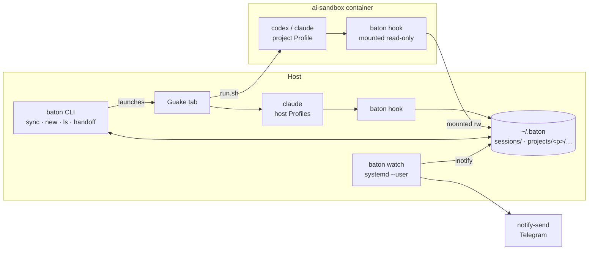

# Baton: one orchestrator for Claude Code and Codex

Oct 19, 2026 · @Paul · revised Oct 20, 2026 after the design review

Baton is a personal orchestrator on top of the official Claude Code and Codex CLIs. It keeps one set of skills and instructions for both, shows which Sessions are running or waiting for you, notifies you when an Agent needs you, and hands a Task over from one Agent to another. It never replaces the Agents themselves.

Capitalized terms (Agent, Profile, Session, Task, …) are defined in [GLOSSARY.md](GLOSSARY.md). Decisions that are hard to reverse are recorded in [docs/adr/](docs/adr/).

## Context and problem

Claude Code runs on the host under several Profiles (`~/.claude`, `~/.claude-personal`, `~/.claude-work`). Codex runs only inside the per-project Docker sandbox [`ai-sandbox`](https://github.com/loadkpi/ai-sandbox), where every project has its own home directory, login and history (`.ai-sandbox/home`). So every Agent × Profile × Project is a separate world.

What hurts today:

- Skills, instructions, hooks and MCP servers are maintained in several formats and places. Skills already come from three sources: plain directories, Claude's own synced skills, and a third-party installer (`~/.agents/.skill-lock.json`).
- It is unclear which Session is working, which is waiting for approval, and which has finished.
- A Task cannot move from Claude to Codex and back without copying context by hand.
- Terminal tabs in Guake are not tied to Projects or Tasks.

## Goals and non-goals

**Goals for v1**

1. One source of instructions, skills, MCP servers and hooks, rendered into every Profile on the host and in project sandboxes (`baton sync`).
2. Start Sessions of either Agent in either Runtime (`host`, `sandbox`) in a named Guake tab.
3. A live list of Sessions and their statuses across all Profiles and Projects (`baton ls`), including Sessions started by hand outside Baton.
4. Desktop notifications when an Agent waits for approval or for input; one-way Telegram messages while you are away.
5. Manual Handoff of a Task from one Session to another, across Agents and Profiles.

**Non-goals**

- An own agent loop, own tools, or direct model calls: the official CLIs do that.
- Multiple users or access for other people.
- Replacing the Agents' native TUI.
- Exact limit accounting that matches the vendor's numbers.
- Resuming a native Session from Baton's own archive.
- A decision log as a Baton feature. ADRs, a glossary and a `/decide`-style skill delivered by `baton sync` cover it.

Everything else from the first draft (web dashboard, two-way Telegram, queue and night runs, per-turn checkpoints, limits) is in [v2 and later](#v2-and-later).

## Constraints

The main rule: Baton only works through the official CLIs and SDKs under your own login and never touches tokens directly.

| Vendor | Allowed | Not allowed |
| --- | --- | --- |
| Anthropic | Run `claude` (interactive or `claude -p`) and the Agent SDK under your subscription. Per the [Anthropic help article](https://support.claude.com/en/articles/15036540-use-the-claude-agent-sdk-with-your-claude-plan) (updated Oct 7, 2026) they draw on subscription limits | Extracting the OAuth token, spoofing the client, calling the API with a subscription token, sharing access. Per [Legal and compliance](https://code.claude.com/docs/en/legal-and-compliance), products for others need an API key |
| OpenAI | `codex`, `codex exec` and the Codex SDK under a ChatGPT plan, listed on the [pricing page](https://developers.openai.com/codex/pricing) | Calling the undocumented `chatgpt.com/backend-api/codex`, sharing your session with others |

Technical constraints:

- CLI flags, hook events and session file formats change between versions without compatibility guarantees.
- Neither vendor has a stable API for subscription limits.
- `ANTHROPIC_API_KEY` in the environment overrides the subscription login and switches to API billing; the OpenAI key behaves similarly for Codex. Baton clears these variables explicitly when it launches an Agent on the host.
- Codex inside the sandbox only passes an allow-listed set of environment variables to the commands it runs (`shell_environment_policy.include_only` in the rendered `config.toml`). Baton must not rely on environment variables reaching anything the Agent runs.

Vendor rules change often; re-read the terms before each major stage.

## Build or reuse

Existing session managers (Agent Deck, Agent of Empires, CCManager, kage, git-paw, RCFlow) mostly sit on top of tmux and know nothing about `ai-sandbox` [unverified, based on their descriptions]. v1 does not need tmux (see [D8](#d8-terminal-guake-now-tmux-as-an-experiment)), and its scope is small, so **Baton is built from scratch**. Session managers are worth another look in v2, after the tmux experiment.

[agent-cli-starter](https://github.com/youngjin39/agent-cli-starter) syncs `CLAUDE.md`/`.claude/` with `AGENTS.md`/`.codex/`, but it is a template for one repository, not a multi-Profile sync.

## Architecture

v1 has no stateful daemon. All truth lives in files under `~/.baton`; the CLI, the hooks and a stateless watcher read and write those files.



- **`baton hook <agent> --profile <name> --runtime <host|sandbox>`** is the only thing Agents call. `baton sync` writes the flags into each Profile's hook definitions, because it knows which Profile it renders; no environment variables are involved. The hook reads the payload from stdin and appends one line to the Session's Event file under a file lock: schema version `v`, `ts`, `agent`, `profile`, `runtime`, `host` (the container id inside a sandbox), `agent_pid` and `agent_start` (the Agent's process and its start time from `/proc/<pid>/stat`, so a reused PID never makes a dead Session look alive), `session_id`, `event` and `cwd` copied from the payload, and the raw `payload`. It does not call git, resolve the Project or interpret the payload, so it is fast enough even for Codex's 1-second `SessionEnd` budget.
- **Where Events go.** On the host: `~/.baton/sessions/<agent>-<session_id>.jsonl`, keyed by the Session only. In a sandbox: the mounted `~/.baton/projects/<project>/sessions/`, where the Project is known. Readers (`ls`, `watch`, `new`, `handoff`) resolve Project, Working copy and Task from `cwd` and register unknown Projects (D1).
- **`baton ls`** and **`baton watch`** derive Session statuses from Events. `baton watch` is a stateless Daemon under `systemd --user` that sends notifications (D6). `lost` is always computed on read, so neither command depends on the other. If it is down, Sessions and `baton ls` keep working; you only lose notifications.
- **One Go binary** (`CGO_ENABLED=0`) in `~/.baton/bin` provides all commands. The sandbox image has `python3`, `bash` and `jq` but no Go; the static binary is mounted read-only, so the same code runs on both sides.
- A Daemon with an API, state and push updates arrives in v2 with the web dashboard.

### Files

```
~/.config/baton/
  config.toml                 # source repository path, Profiles and their tags
  secrets.env                 # values for ${VAR} placeholders, mode 0600
~/.baton/
  bin/baton                   # mounted read-only into sandboxes
  sync-manifest.json          # per Profile: files sync created, its blocks/keys in shared files
  backups/<profile>/<ts>/     # copies of shared files taken before sync first changed them
  sessions/<agent>-<session>.jsonl   # raw Events of host Sessions, mode 0600
  projects/<project>/         # mounted read-write into this project's sandbox only
    project.toml              # path, default Runtime
    tasks/<task>.toml         # title, status
    current.jsonl             # journal: Working copy, Task, since when it is current
    sessions/<agent>-<session>.jsonl # raw Events of sandbox Sessions, mode 0600
    handoffs/<task>/<n>.md
    handoffs/<task>/draft.md  # narrative part saved before the Handoff is assembled
```

## Key decisions

### D1. Domain model

Project → Working copy → Task → Session → Event. A Session also has an Agent, a Profile and a Runtime.

- **A Session is one native conversation.** `/clear` or switching conversations inside the same Terminal starts a new Session of the same Task.
- **At most one active Session per Working copy.** Parallel work means separate Tasks in separate Working copies. This also makes it unambiguous whose turn changed the files.
- **The Working copy determines the Task.** `baton new` appends "from time t, the current Task of Working copy X is T" to the Project's journal (`current.jsonl`). Every Session in X belongs to the Task that was current at its first Event, whether Baton started it or you ran `claude-personal` by hand. Because the journal keeps history, the answer does not depend on when a reader first looks at the Session. Without a record, an unnamed Task is created and becomes current. The current Task of a Working copy can change only when no Session is active there. No environment variables are involved, so it works inside the sandbox too.
- **Unknown repositories register themselves on read.** The hook knows nothing about Projects. The first reader (`ls`, `watch`, `new`, `handoff`) that sees a Session in a git repository Baton does not know yet registers that Project by its git root (`git rev-parse --show-toplevel` of the Session's `cwd`) under a lock; a name clash gets a suffix. Sessions started by hand are never lost. Sessions outside any git repository are listed with Project `-`.
- **Tasks are cheap.** `baton new <project>` without a name creates an unnamed Task (`<project>/2026-10-20-1`) that can be named later.
- **Task status is what a human decides:** `open`, `done`, `dropped`. Whether a Task is "running" or "waiting" is derived from its active Session, never stored.

### D2. Session statuses

Five statuses, all derived from the last Event. Hook names below were checked against the [Claude Code](https://code.claude.com/docs/en/hooks) and [Codex](https://learn.chatgpt.com/docs/hooks) documentation on Oct 20, 2026.

| Status | Claude Code | Codex | Meaning |
| --- | --- | --- | --- |
| `running` | `UserPromptSubmit`, `PreToolUse`, `PostToolUse`, `PostToolUseFailure` | `UserPromptSubmit`, `PreToolUse`, `PostToolUse` | The Agent is working |
| `waiting_approval` | `PermissionRequest` | `PermissionRequest` | The Agent needs your approval |
| `waiting_input` | `SessionStart`, `Stop` | `SessionStart`, `Stop`, `Interrupt` | It is your turn |
| `ended` | `SessionEnd` | `SessionEnd` | The conversation is over |
| `lost` | — | — | The process or container is gone without `SessionEnd`; detected by `baton ls` and `baton watch` |

The first draft also had `starting`, `idle`, `done` and `failed`. `idle` is the same as `waiting_input`; "done" belongs to the Task (D1); `starting` cannot be observed reliably; `failed` returns in v2 with headless Sessions. Codex has no "waiting for input" hook, which is why `Stop` is the common signal.

### D3. Runtimes: host and sandbox

The `sandbox` Runtime is `ai-sandbox`, not a custom image. `ai-sandbox` knows nothing about Baton ([ADR 0001](docs/adr/0001-ai-sandbox-knows-nothing-about-baton.md)): Baton uses generic mechanisms that make sense without it (extra mounts, config fragments), or wraps `run.sh` through `AI_SANDBOX_PRINT_ARGS`.

- The default Runtime is `sandbox` if the Project has `.ai-sandbox/run.sh`, otherwise `host`.
- Each Project's sandbox keeps its own Profiles (own login and history). Baton unifies history through Events, not through shared config directories.
- Two directories are mounted into the sandbox: `~/.baton/projects/<project>` read-write and `~/.baton/bin` read-only. Nothing else from `~/.baton`, so a sandbox never sees other Projects.
- **v1 sandbox Sessions run only in the main checkout.** A git worktree stores the absolute host path to `.git/worktrees/<name>`, which does not exist inside the container (the Project is mounted at `/workspace`), and `.ai-sandbox/` is gitignored, so a worktree has no sandbox at all. The one-active-Session rule (D1) makes this safe.
- Codex in every sandbox asks once to trust user hooks (`/hooks`). Baton does not bypass that review; `baton ls` shows "no events, check `/hooks`" for a Codex Session that reports nothing.

### D4. One source for instructions, skills, MCP and hooks (`baton sync`)

The source is a separate private git repository (for example `~/github/my/agent-config`), set in `~/.config/baton/config.toml`. Baton itself holds no personal content.

| What | Source | Claude Code | Codex |
| --- | --- | --- | --- |
| Instructions | `AGENTS.md` | `CLAUDE.md` in the Profile | `AGENTS.md` in the Profile (sandbox: a fragment, see below) |
| Skills | `skills/*/SKILL.md` | `<profile>/skills/` | `.agents/skills/` or `<profile>/skills/` |
| MCP | one manifest | Profile MCP configuration (`.claude.json` [unverified]) | `config.toml` (sandbox: a fragment) |
| Status hooks | generated | `<profile>/settings.json` | `<profile>/hooks.json` |

Rules:

- **Targets are Profiles only:** host Profiles and the Profiles inside each Project's `.ai-sandbox/home`. Sync never writes files that git tracks, so team repositories stay untouched.
- **Sync owns only what it created.** A manifest lists every file sync wrote; it updates or deletes only those. Claude's own `skills/synced/`, existing work skills and third-party installs stay as they are.
- **Shared files are changed carefully.** Some targets already exist and belong to someone else: `CLAUDE.md`, `settings.json`, the Claude MCP configuration, Codex `hooks.json`. Baton owns only its part of them: a block between `<!-- baton:begin -->` and `<!-- baton:end -->` in Markdown, named keys (its `hooks` entries, its `mcpServers` names) in JSON and TOML; the manifest records which. The first time sync adds its part to such a file, it shows the diff and asks; on yes it copies the file to `~/.baton/backups/<profile>/<ts>/` and writes atomically (temp file and rename), leaving everything outside its part as it was. Later syncs update Baton's part without asking, unless someone edited inside it, which brings the question back. A foreign skill directory with the same name as a source skill gets the same question and backup before it is replaced. Without a terminal to ask in, sync stops with an error naming the path.
- **Tags decide what reaches each Profile.** Every source item may carry tags (`work`, `personal`, …); every Profile accepts a list of tags. Untagged instructions and skills go everywhere.
- **Baton's own skills are named `baton-*`.** Built-in items that Baton ships (in v1 only `/baton-handoff`) carry the `baton-` prefix, so they never collide with the user's skills, Claude's synced skills or third-party installs. The prefix is reserved: a source skill named `baton-*` makes sync stop with an error.
- **No secrets in the source.** Manifests use `${VAR}` placeholders; values come from `~/.config/baton/secrets.env` (0600). A Profile receives only the secrets of the items its tags accept.
- **Inside the sandbox, `ai-sandbox` owns security and Baton owns content.** `run.sh` regenerates `.codex/config.toml` and `.codex/AGENTS.md` on every run (unless you removed its marker), and these are exactly the files where Codex keeps MCP servers and global instructions. Baton writes only fragments (`config.d/*.toml`, `AGENTS.d/*.md`); a generic fragments mechanism in `ai-sandbox`, or the print-args wrapper, merges them (ADR 0001).

Slash commands, subagents and a unified permission policy (`policy.yaml`) are v2: their formats differ more between the Agents, and Codex prompts can only live at the user level.

### D5. Handoff

A Handoff lives in `~/.baton/projects/<project>/handoffs/<task>/<n>.md`, never in the Working copy.

- **Automatic part** (`baton handoff`): Task, Working copy, branch, HEAD, `git status`, `git diff --stat`, the last 10 commands with exit codes taken from Events, a link to the Session's Event file.
- **Narrative part** (the `/baton-handoff` skill, shipped with Baton as a built-in item that `baton sync` installs into every Profile; it pipes Markdown into `baton handoff save`): goal; what is done; decisions and why; rejected options and why; the next step (one, concrete); open questions; how to verify the result. `baton handoff save` finds the Task from the current directory (D1).
- **The order does not matter; the Handoff is assembled when the old Session ends.** `baton handoff save` writes the narrative part to `handoffs/<task>/draft.md` (a later save replaces it). `baton handoff <task> --to <agent>[@<profile>]`, if the Task's Session is still active, prints "waiting for Session X to end" and waits until it gets `SessionEnd` or becomes `lost`. Only then it takes the automatic part, so git state and the command list are fresh, joins it with the draft into `<n>.md`, removes the draft and opens a new Session whose first message is "continue the Task from Handoff `<path>`". In practice you run `/baton-handoff` and `/exit` in the old tab, before or after starting `baton handoff`, and the new tab opens. This keeps the one-active-Session rule (D1).
- **If the handing-over Session could not write the narrative part** (for example, its limit ran out), the first message also asks the receiving Session to write it from the automatic part and the Event tail and save it with `baton handoff save`. `save` fills the Task's latest `<n>.md` when it has no narrative part, and writes a draft for the next Handoff otherwise.
- **The header records who wrote the narrative part:** `narrative: handing-over`, `receiving` or `missing`. Known edge, accepted for v1: if a receiver never filled its Handoff, the next `/baton-handoff` fills that old one instead of starting a draft.
- A Handoff to a sandbox Agent from a Working copy other than the main checkout is refused (D3).

Collecting failed tests (first draft D5) is dropped for v1: parsing test output of different projects costs more than exit codes give.

### D6. Notifications

| Event | Notify |
| --- | --- |
| `waiting_approval` | Always |
| `waiting_input` | Only if the turn took longer than 30 seconds; otherwise you are watching anyway |
| `lost` | Always |

The channel is the desktop (`notify-send`) by default. `baton away` switches to Telegram until `baton back`. Without a stateful Daemon, "no keyboard activity for N minutes" is not reliable, so the switch is explicit.

Notifications are sent by `baton watch` on the host, never by hooks: the sandbox has neither `notify-send` nor your desktop D-Bus, and mounting the D-Bus socket would give the container control over desktop apps. As a side effect the Telegram token never enters a sandbox. Telegram messages carry only the status and the Task name, never command output.

**What `baton watch` remembers.** In v1, nothing on disk. At start it reads the current statuses and sends nothing; afterwards it notifies only transitions it sees itself. `lost` has no Event, so it polls every few seconds: the recorded `agent_pid`/`agent_start` of host Sessions, and one `docker ps` per tick for sandbox Sessions. Whatever happens while `baton watch` is down is not notified. In v2 a cursor file (offset per Event file and the last notified status) lets it notify, after a restart, what is still true, for example a Session that is still `waiting_approval`.

### D7. Event archive

The Event files are the archive. v1 stores raw Events as JSONL with mode 0600, without normalization, without parsing the Agents' native session files, and without a retention limit; search is `rg`. Raw `PostToolUse` payloads may contain secrets from command output; masking and retention come in v2 together with real search.

### D8. Terminal: Guake now, tmux as an experiment

`baton new` opens a Guake tab (`guake -n … -r <project>/<task>:<agent> -e <command>`) that runs the Agent directly. The tab title is static; live status is in `baton ls` and notifications. Clicking a notification does not switch tabs: Guake addresses tabs by index, which shifts as tabs close.

tmux is not installed today. It is tried for a week inside Guake with an "invisible" config (`mouse on`, `status off`, large `history-limit`). The Terminal is a replaceable part of `baton new`: "the tab runs the command directly" or "the tab attaches to tmux". tmux, or `dtach`/`abduco`, becomes necessary only for the v2 web terminal.

## Risks

| Risk | Likelihood | Mitigation |
| --- | --- | --- |
| A CLI update renames hook events or changes payloads | High | Hooks only append raw Events; all mapping lives in one Go table (D2) with tests on recorded payloads. Pinned CLI versions in `ai-sandbox` |
| Scope creep into an "IDE for agents" | High | v1 is five goals; everything else is listed in v2 with no design work until v1 is used daily |
| `AI_SANDBOX_PRINT_ARGS` format changes | Low | It is covered by `ai-sandbox`'s own tests; ADR 0001 marks it as a contract |
| An Agent in a sandbox tampers with Baton files of its Project | Low | Only that Project's directory is mounted; the binary is read-only; Events are an audit trail, not a security boundary |
| Secrets in the Event archive or in Profiles | Medium | 0600 files, no command output in Telegram, secrets reach a Profile only through its tags |
| Sync overwrites something it does not own | Medium | Manifest of owned files and of owned parts of shared files; diff, question and backup before the first change to a shared file; stop when there is no terminal to ask in |
| Codex Sessions in a new sandbox stay invisible | Medium | `baton ls` flags Codex Sessions without Events and points to `/hooks` |
| Terms-of-use violation | Low while personal | Official CLIs only, no tokens in code, API keys removed from the environment, everything for one user |

## v1 plan

Four stages; each is usable on its own.

1. **`baton sync`.** Source repository, Profiles with tags, secrets, manifest of owned files; instructions, skills, MCP and status hooks for host Profiles and sandbox Profiles; config fragments for the sandbox.
   - Done when one skill and one MCP server added to the source show up, after `baton sync`, in the right host Profiles according to tags and in Codex inside a Project's sandbox.
2. **Sessions and statuses.** `baton hook`, Event files, Projects, Tasks and Working copies, `baton new` with a Guake tab in both Runtimes, `baton ls`.
   - Done when `baton new <project> --agent codex` opens a Guake tab with Codex in the sandbox, and `baton ls` shows live statuses of that Session and of a `claude-personal` Session started by hand.
3. **Watcher and notifications.** `baton watch` under `systemd --user`, desktop notifications, `lost` detection, `baton away`/`baton back` with one-way Telegram.
   - Done when an approval request from Codex in the sandbox produces a desktop notification, and a Telegram message after `baton away`.
4. **Handoff.** `baton handoff`, the `/baton-handoff` skill, `baton handoff save`, start of the receiving Session with the Handoff as its first message.
   - Done when a Task started in Claude continues in Codex with one command and no manual copying.

## v2 and later

| What | Why it waits |
| --- | --- |
| Daemon with API and state; web dashboard with an embedded terminal | Needs attachable Terminals (tmux or `dtach`) and a frontend stack |
| Two-way Telegram bot: approvals, new Tasks | Remote control of the machine; needs the approval flow and `policy.yaml` first |
| Unified permission policy (`policy.yaml`) with a shared `PreToolUse` hook | The Agents' permission models differ; inside the sandbox `ai-sandbox` modes already act as the Policy |
| Slash commands and subagents in `baton sync` | Formats diverge; Codex prompts are user-level only |
| Headless Sessions, queue, scheduler, night runs with a `night` Policy and budget | Unattended irreversible actions; first prove the daytime Policy. Until then, a cron script with `claude -p` if a night job is needed |
| Per-turn checkpoints in `refs/baton/…` and `baton undo` | Claude Code has its own checkpoints; cross-Agent undo matters mostly at Handoff time |
| Worktrees inside the sandbox | Needs `ai-sandbox` to mount the Project at its host path (generic mechanism), so git worktree paths resolve |
| Shared vs per-Project sandbox Profiles | One login and history everywhere vs isolation between Projects; to be discussed |
| Limit snapshots and automatic Agent/Profile switch on limit | No reliable source of limits; manual Handoff first shows whether switching is frequent |
| Normalized archive, search, secret masking, retention | `rg` over raw Events may be enough |
| Jump to the Guake tab from a notification; live status in tab titles | Needs a stable tab ↔ Session link |
| Cursor file for `baton watch`: after a restart, notify what is still true | v1 accepts losing notifications while the watcher is down |
| Re-evaluate Agent Deck and similar tools | After the tmux experiment |
| Quality gates and cross-review, full worktree lifecycle, cost per Task, evals, integrations, several machines | Unchanged from the first draft |

## Open questions

- [ ] Does `codex` accept an initial prompt as a positional argument in interactive mode? Needed for D5. [unverified]
- [ ] What does the `NEW_TAB` argument of `guake -n` mean exactly (working directory or something else)? Needed for D8. [unverified]
- [ ] Is the hook's parent process the Agent or a `sh -c` wrapper? Decides how `agent_pid` is found. Check with a stub hook that prints its parent chain under a live Agent. [unverified]
- [ ] Do Codex hook payloads use the same field names as Claude's (`session_id`, `hook_event_name`, `cwd`)? [unverified]
- [ ] Do `PostToolUse` payloads of both Agents carry the command's exit code? Needed for the automatic part of a Handoff (D5). [unverified]
- [ ] Does Claude rewrite its MCP configuration (`.claude.json`) while running, so that a merge by sync can be lost? If yes, does `claude mcp add-json --scope user` with `CLAUDE_CONFIG_DIR` work instead? [unverified]
- [ ] Does `run.sh` regenerate Codex `hooks.json` or the skills directory in the sandbox, as it does `config.toml` and `AGENTS.md`? [unverified]
- [ ] tmux experiment result: does it stay as the default Terminal?
- [ ] Shared vs per-Project sandbox Profiles in v2.
- [ ] Support for other Agents (Gemini CLI, OpenCode)?

## Sources

- [Claude Code: Hooks reference](https://code.claude.com/docs/en/hooks)
- [Codex: Hooks](https://learn.chatgpt.com/docs/hooks)
- [Claude Code: Legal and compliance](https://code.claude.com/docs/en/legal-and-compliance)
- [Use the Claude Agent SDK with your Claude plan](https://support.claude.com/en/articles/15036540-use-the-claude-agent-sdk-with-your-claude-plan)
- [Codex: Pricing](https://developers.openai.com/codex/pricing)
- [openai/codex issue #36886: subscription and the internal endpoint](https://github.com/openai/codex/issues/36886)
- [Agent Session Managers for Codex CLI](https://codex.danielvaughan.com/2026/05/05/codex-cli-session-managers-ccmanager-agent-deck-parallel-agent-orchestration/)
- [kage](https://pkg.go.dev/github.com/Sean0628/kage)
- [git-paw](https://docs.rs/crate/git-paw/latest)
- [agent-cli-starter](https://github.com/youngjin39/agent-cli-starter)
- [Agent Skills Open Standard](https://codex.danielvaughan.com/2026/05/05/agent-skills-open-standard-portable-skills-codex-cli-cross-agent/)
- [loadkpi/ai-sandbox](https://github.com/loadkpi/ai-sandbox)
