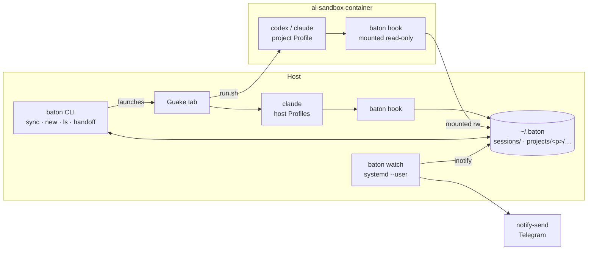

# Baton: one orchestrator for Claude Code and Codex

Oct 19, 2026 · @Paul · revised Oct 20, 2026 after the design review

Baton is a personal orchestrator on top of the official Claude Code and Codex CLIs. It keeps one set of skills and instructions for both, shows which Sessions are running or waiting for you, notifies you when an Agent needs you, and hands a Task over from one Agent to another. It never replaces the Agents themselves.

Capitalized terms (Agent, Profile, Session, Task, …) are defined in [GLOSSARY.md](GLOSSARY.md). Decisions that are hard to reverse are recorded in [docs/adr/](docs/adr/).

## Context and problem

Claude Code runs on the host under several Profiles (`~/.claude`, `~/.claude-personal`, `~/.claude-work`). Codex runs only inside the per-project Docker sandbox [`ai-sandbox`](https://github.com/loadkpi/ai-sandbox), where every project has its own home directory, login and history (`.ai-sandbox/home`). So every Agent × Profile × Project is a separate world.

What hurts today:

- Skills, instructions, hooks and MCP servers are maintained in several formats and places. Skills already come from three sources: plain directories, Claude's own synced skills, and a third-party installer (`~/.agents/.skill-lock.json`).
- It is unclear which Session is working, which is waiting for approval, and which has finished.
- A Task cannot move from Claude to Codex and back without copying context by hand.
- Terminal tabs in Guake are not tied to Projects or Tasks.

## Goals and non-goals

**Goals for v1**

1. One source of instructions, skills, MCP servers and hooks, rendered into every Profile on the host, in project sandboxes and in projects' Compose dev containers (`baton sync`).
2. Start Sessions of either Agent in any Runtime (`host`, `sandbox`, `compose`) in a named Guake tab.
3. A live list of Sessions and their statuses across all Profiles and Projects (`baton ls`), including Sessions started by hand outside Baton.
4. Desktop notifications when an Agent waits for approval or for input; one-way Telegram messages while you are away.
5. Manual Handoff of a Task from one Session to another, across Agents and Profiles.

**Non-goals**

- An own agent loop, own tools, or direct model calls: the official CLIs do that.
- Multiple users or access for other people.
- Replacing the Agents' native TUI.
- Exact limit accounting that matches the vendor's numbers.
- Resuming a native Session from Baton's own archive.
- A decision log as a Baton feature. ADRs, a glossary and a `/decide`-style skill delivered by `baton sync` cover it.

Everything else from the first draft (web dashboard, two-way Telegram, queue and night runs, per-turn checkpoints, limits) is in [v2 and later](#v2-and-later).

## Constraints

The main rule: Baton only works through the official CLIs and SDKs under your own login and never touches tokens directly.

| Vendor | Allowed | Not allowed |
| --- | --- | --- |
| Anthropic | Run `claude` (interactive or `claude -p`) and the Agent SDK under your subscription. Per the [Anthropic help article](https://support.claude.com/en/articles/15036540-use-the-claude-agent-sdk-with-your-claude-plan) (updated Oct 7, 2026) they draw on subscription limits | Extracting the OAuth token, spoofing the client, calling the API with a subscription token, sharing access. Per [Legal and compliance](https://code.claude.com/docs/en/legal-and-compliance), products for others need an API key |
| OpenAI | `codex`, `codex exec` and the Codex SDK under a ChatGPT plan, listed on the [pricing page](https://developers.openai.com/codex/pricing) | Calling the undocumented `chatgpt.com/backend-api/codex`, sharing your session with others |

Technical constraints:

- CLI flags, hook events and session file formats change between versions without compatibility guarantees.
- Neither vendor has a stable API for subscription limits.
- `ANTHROPIC_API_KEY` in the environment overrides the subscription login and switches to API billing; the OpenAI key behaves similarly for Codex. Baton clears these variables explicitly when it launches an Agent on the host.
- Codex inside the sandbox only passes an allow-listed set of environment variables to the commands it runs (`shell_environment_policy.include_only` in the rendered `config.toml`). Baton must not rely on environment variables reaching anything the Agent runs.

Vendor rules change often; re-read the terms before each major stage.

## Build or reuse

Existing session managers (Agent Deck, Agent of Empires, CCManager, kage, git-paw, RCFlow) mostly sit on top of tmux and know nothing about `ai-sandbox` [unverified, based on their descriptions]. v1 does not need tmux (see [D8](#d8-terminal-guake-now-tmux-as-an-experiment)), and its scope is small, so **Baton is built from scratch**. Session managers are worth another look in v2, after the tmux experiment.

[agent-cli-starter](https://github.com/youngjin39/agent-cli-starter) syncs `CLAUDE.md`/`.claude/` with `AGENTS.md`/`.codex/`, but it is a template for one repository, not a multi-Profile sync.

## Architecture

v1 has no stateful daemon. All truth lives in files under `~/.baton`; the CLI, the hooks and a stateless watcher read and write those files.



- **`baton hook <agent> --profile <name> --runtime <host|sandbox|compose>`** is the only thing Agents call. `baton sync` writes the flags into each Profile's hook definitions, because it knows which Profile it renders; no environment variables are involved. The hook reads the payload from stdin and appends one line to the Session's Event file under a file lock: schema version `v`, `ts`, `agent`, `profile`, `runtime`, `host` (the container id inside a container Runtime), `agent_pid` and `agent_start` (the Agent's process and its start time from `/proc/<pid>/stat`, so a reused PID never makes a dead Session look alive), `session_id`, `event` and `cwd` copied from the payload, and the `payload` with its secrets masked (D7). It does not call git, resolve the Project or interpret the payload, so it is fast enough even for Codex's 1-second `SessionEnd` budget.
- **Where Events go.** On the host: `~/.baton/sessions/<agent>-<session_id>.jsonl`, keyed by the Session only. In a sandbox or a Compose container: the mounted `~/.baton/projects/<project>/sessions/`, where the Project is known. Readers (`ls`, `watch`, `new`, `handoff`) resolve Project, Working copy and Task from `cwd` and register unknown Projects (D1).
- **`baton ls`** and **`baton watch`** derive Session statuses from Events. `baton watch` is a stateless Daemon under `systemd --user` that sends notifications (D6). `lost` is always computed on read, so neither command depends on the other. If it is down, Sessions and `baton ls` keep working; you only lose notifications.
- **One Go binary** (`CGO_ENABLED=0`) in `~/.baton/bin` provides all commands. The sandbox image has `python3`, `bash` and `jq` but no Go; the static binary is mounted read-only, so the same code runs on both sides.
- A Daemon with an API, state and push updates arrives in v2 with the web dashboard.

### Files

```
~/.config/baton/
  config.toml                 # source repository path, host Profiles (and their tags, ticket 03)
  secrets.env                 # values for ${VAR} placeholders and the Telegram bot token, mode 0600; `baton hook` masks them in Events (ticket 21)
~/.baton/
  away                        # exists while `baton away` is in force (ticket 13)
  bin/baton                   # mounted read-only into sandboxes
  manifests/<profile>.json    # per Profile: files sync created, its blocks/keys in shared files
  backups/<profile>/<ts>/     # copies of shared files taken before sync first changed them
  sessions/<agent>-<session>.jsonl   # raw Events of host Sessions, mode 0600
  mounts/<project>.json       # the bind mounts of the Project's last sandbox container, for mapping paths (ticket 09)
  projects/<project>/         # mounted read-write into this project's sandbox only
    project.toml              # path, default Runtime
    tasks/<id>.toml           # name (optional), status, created (ticket 07)
    current.jsonl             # journal: Working copy, Task, since when it is current
    .lock                     # serializes changes to tasks/ and current.jsonl
    sessions/<agent>-<session>.jsonl # raw Events of sandbox Sessions, mode 0600
    handoffs/<task-id>/<n>.md # the Task's id, not its name (ticket 14)
    handoffs/<task-id>/draft.md  # narrative part saved before the Handoff is assembled
    handoffs/<task-id>/.lock  # serializes the writers of one Task's Handoffs
```

## Key decisions

### D1. Domain model

Project → Working copy → Task → Session → Event. A Session also has an Agent, a Profile and a Runtime.

- **A Session is one native conversation.** `/clear` or switching conversations inside the same Terminal starts a new Session of the same Task.
- **At most one active Session per Working copy.** Parallel work means separate Tasks in separate Working copies. This also makes it unambiguous whose turn changed the files.
- **The Working copy determines the Task.** `baton new` appends "from time t, the current Task of Working copy X is T" to the Project's journal (`current.jsonl`). Every Session in X belongs to the Task that was current at its first Event, whether Baton started it or you ran `claude-personal` by hand. Because the journal keeps history, the answer does not depend on when a reader first looks at the Session. Without a record, an unnamed Task is created and becomes current. The current Task of a Working copy can change only when no Session is active there. No environment variables are involved, so it works inside the sandbox too.
- **A git worktree is a Working copy, not a Project.** The Project is found from the main checkout, `git rev-parse --git-common-dir` (the `.git` directory the worktrees share) with `.git` cut off, and the Working copy from `git rev-parse --show-toplevel` of the directory in question. See "Tasks and Working copies" below.
- **Unknown repositories register themselves on read.** The hook knows nothing about Projects. The first reader (`ls`, `watch`, `new`, `handoff`) that sees a Session in a git repository Baton does not know yet registers that Project by the root of its main checkout (see the worktree rule above) under a lock; a name clash gets a suffix. Sessions started by hand are never lost. Sessions outside any git repository are listed with Project `-`.
- **Tasks are cheap.** `baton new <project>` without a name creates an unnamed Task that can be named later (id `2026-10-20-1`, shown as `<project>/2026-10-20-1`).
- **Task status is what a human decides:** `open`, `done`, `dropped`. Whether a Task is "running" or "waiting" is derived from its active Session, never stored.

#### Tasks and Working copies (ticket 07)

Decided while building the Task side of `baton new` and `baton ls`.

**Worktrees.** For a directory `d`, `git -C d rev-parse --path-format=absolute --show-toplevel --git-common-dir` gives the Working copy (the first line, the work tree that holds `d`) and the common git directory (the second). When the common directory is named `.git`, the Project's path is its parent: the main checkout, the same for the main checkout itself and for every worktree made from it. Anything else (a submodule's `.git/modules/...`) has no main checkout to derive, so the work tree is its own Project and Working copy. A bare repository or the inside of a `.git` directory is not in a work tree and has no Project, like a directory outside git. The test makes a real `git worktree add` in the temporary repository, and meets the worktree before the main checkout, so the Project must come out right whichever is seen first. `--path-format=absolute` needs git 2.31 or newer; git 2.43 is what was run, older versions are [unverified]. Git resolves symbolic links in both paths (checked by hand with a linked directory), so a Working copy is always a real path. Records written by ticket 05 for a worktree as a Project of its own stay as they are.

**Tasks.** A Task is identified by a generated id `<date>-<n>` (`2026-10-20-1`): the UTC date of the command or of the Session's first Event, and the next free number of that day within the Project. D1's `<project>/<date>-<n>` format is kept, but it is the id, not the name: a Task has an optional **name** on top of it, so naming (and renaming) an unnamed Task never changes what the journal, `handoffs/<task>/` and the tab titles refer to. The record `tasks/<id>.toml` is `name` (left out while unnamed), `status` (`open`, `done`, `dropped`) and `created` (RFC 3339, UTC). A name follows the rules of a Project name, is unique within the Project, and may not look like an id, so a word typed by a user (`<project>/<task>`, here and in `baton new`) means one Task: a word shaped like an id is an id, any other is a name. UTC is used for the date so that the id does not depend on the machine's time zone, at the price that a Task made shortly after local midnight may carry the neighbouring day. `baton ls` and the tab title show the name, or the id while there is none; after naming, tabs that are already open keep their old title.

**The journal.** `current.jsonl` has one line per change, `{"v":1,"ts":"2026-10-20T10:15:00Z","working_copy":"/home/me/app","task":"2026-10-20-1"}`, appended under the Project's `.lock` by `baton new` (with `ts` of the command) and by readers that adopt a Session (with `ts` of the Session's first Event). The Task current in a Working copy at time `t` is the line for it with the greatest `ts` not after `t` (the later line wins a tie); the order of lines does not matter. That is what lets a reader write a line dated in the past: when `baton new` switched Tasks before anyone read an earlier Session, that Session gets an unnamed Task dated at its first Event and the Working copy's current Task stays the newer one. Readers adopt Sessions oldest first, so a later Session of a Working copy finds the Task an earlier one got instead of making its own, and a Session after `/clear` [unverified: that Claude Code gives it a new session id] lands in the same Task. The Session's Working copy is that of the `cwd` of its first Event.

**`baton new <project> [task]`** with a name Baton has no Task for makes a named Task; with a name or an id it does have, it continues that Task, whatever its status (status is not changed); with an id nobody has it refuses; with no argument it makes a new unnamed Task every time. Each run appends a journal line, even when the Task is already current. The check, the Task record and the journal line happen under one lock, before the tab is opened; if Guake then fails, the Working copy has a current Task and no Session, which does no harm. A Project whose Runtime cannot be started yet is refused before anything is written.

**Active Session.** A Session is active when `baton ls` would show it neither `ended` nor `lost`, that is when the last Event Baton knows is not `SessionEnd` and its Agent has not been found gone (ticket 11; a Codex gone while waiting for input counts as `ended`, ticket 30, [below](#lost-detection-ticket-11)). A Session that crashed without `SessionEnd` therefore blocks its Working copy only until the next read finds it `lost`; one whose liveness could not be checked (docker is down) stays active. The refusal names the Session so that the user can judge: `baton: working copy <path> of project <p> already has an active session: claude, profile <profile>, session <id>, last event <ts> (<status>); end it, or hand the Task over with baton handoff`. The suggested `baton handoff` is not built yet (ticket 14). Events of host Sessions (`~/.baton/sessions`) and of sandbox Sessions (`~/.baton/projects/<project>/sessions`, mapped to host paths as described under ticket 09) are looked at; those of Compose Sessions (`~/.baton/projects/<project>/sessions`, mapped through the container's `docker inspect` mounts, ticket 17) too. The same check guards the current Task: it changes only through `baton new`, so it cannot change while a Session is active in the Working copy.

**Commands to name and close a Task.** `baton task name <project>/<task> <name>` names a Task (or renames it) and prints `<project>/<name>`. `baton task status <project>/<task> <open|done|dropped>` prints `<project>/<task> <status>`. `<task>` is a name or an id. There is no command to list Tasks yet; `baton ls` shows those that have Sessions.

**Code layout.** `business/domain/taskbus` owns Tasks and the journal (`stores/taskfile`); `business/domain/workbus` joins Sessions, Projects and Tasks (placing each Session in its Working copy and Task, and the one-active-Session guard) and is what `baton ls` and `launchbus` use. New strong types: `taskid`, `taskstatus`, `taskref` (a name or an id, as typed).

### D2. Session statuses

Five statuses, all derived from the last Event. Hook names below were checked against the [Claude Code](https://code.claude.com/docs/en/hooks) and [Codex](https://learn.chatgpt.com/docs/hooks) documentation on Oct 20, 2026.

| Status | Claude Code | Codex | Meaning |
| --- | --- | --- | --- |
| `running` | `UserPromptSubmit`, `PreToolUse`, `PostToolUse`, `PostToolUseFailure` | `UserPromptSubmit`, `PreToolUse`, `PostToolUse` | The Agent is working |
| `waiting_approval` | `PermissionRequest` | `PermissionRequest` | The Agent needs your approval |
| `waiting_input` | `SessionStart`, `Stop` | `SessionStart`, `Stop`, `Interrupt` | It is your turn |
| `ended` | `SessionEnd` | `SessionEnd` | The conversation is over |
| `lost` | — | — | The process or container is gone without `SessionEnd` (except a Codex that was waiting for input, which is `ended`: Lost detection, ticket 30); found out on every read by the shared status code (see [Lost detection](#lost-detection-ticket-11)), never written to an Event file |

The first draft also had `starting`, `idle`, `done` and `failed`. `idle` is the same as `waiting_input`; "done" belongs to the Task (D1); `starting` cannot be observed reliably; `failed` returns in v2 with headless Sessions. Codex has no "waiting for input" hook, which is why `Stop` is the common signal.

#### Event files and `baton ls` (ticket 05)

Decided while building `baton hook` and `baton ls`. Codex (ticket 10) and the other Runtimes add to these formats, they do not change them.

**The Event line.** One JSON object per line, written by `baton hook <agent> --profile <name> --runtime <host|sandbox|compose>`, which reads the payload from standard input:

```json
{"v":1,"ts":"2026-10-20T10:15:00.123456789Z","agent":"claude","profile":"claude-personal","runtime":"host","host":"laptop","agent_pid":4242,"agent_start":9876543,"session_id":"abc123","event":"Stop","cwd":"/home/me/app","payload":{...}}
```

- `ts` is UTC, RFC 3339 with nanoseconds. `host` is the host name, which in a container is the container id. `agent_start` is the Agent's start time in clock ticks since boot (field 22 of `/proc/<pid>/stat`): an integer that is only ever compared for equality, so it needs no conversion to wall-clock time and survives the `CLK_TCK` of the machine. `agent_pid_fallback: true` is present, only then, when no ancestor was recognized as the Agent (below). `container` (ticket 18, below) is the full id of the container the hook ran in, present only when the hook runs in a container and could find it; `v` stays 1, because a reader that does not know the field ignores it, and one that does treats its absence as "not known". `source` (ticket 20, below) is present, only then, on an Event that Baton wrote itself and not the Agent's hook; `masked: true` (ticket 21, D7) is present, only then, when a secret was masked in the payload; `host`, `agent_pid` and `agent_start` are left out of a line when they are zero (a hook always has a host name and a PID, so its lines are unchanged).
- `session_id`, `event` (`hook_event_name`) and `cwd` are copied from the payload; `payload` is the payload itself, compacted to one line and otherwise as the Agent wrote it (no HTML escaping), except that secrets are masked (D7; a payload with a masked secret is encoded again, so its keys may be in another order). Nothing else is read from it. A payload that is not a JSON object, or has no `hook_event_name`, or whose `session_id` cannot be a file name (`[A-Za-z0-9][A-Za-z0-9._-]{0,127}`; Claude uses UUIDs) is refused: nothing is written and the exit code is 1. The hook never exits with 2, because for Claude Code an exit code of 2 from a hook blocks the action it is about. On success it prints nothing.
- The file is `~/.baton/sessions/<agent>-<session_id>.jsonl`, created with mode 0600 in a 0700 directory. The hook opens it with `O_APPEND`, takes an exclusive `flock` on it, writes the whole line (with its newline) in one `write` and closes it. The lock is on the Event file itself, so there is no lock file to list or clean up. Readers take no lock: they read only lines that end in a newline, and skip lines that are not Events, so a line that is half written is never seen.
- The hook calls no git and registers no Project. Claude Code gives `SessionEnd` hooks 1.5 seconds by default ([Claude Code: Hooks](https://code.claude.com/docs/en/hooks), checked Oct 20, 2026), which a process that reads stdin and appends one line fits easily; Baton writes no `timeout` into its hooks.

**The parent chain.** Whether Claude Code starts a hook command directly or through `sh -c` was not checked under a live Claude when this ticket was built (answered in ticket 27, see the end of this paragraph). The documentation says the command string of a hook is run through `sh -c` on Linux and that a hook with `args` is spawned directly, and nothing about the processes in between, and the dash that `sh` is here may or may not leave a shell process behind. So `agent_pid` does not assume anything: starting at the hook's parent, `baton hook` walks up for at most 8 processes and takes the nearest one whose `comm` or executable name is the Agent's binary (`claude`). If it finds none, `agent_pid` is the direct parent, `agent_pid_fallback` is true and `agent_start` is that process's. A process that cannot be read gives its PID and a start time of 0. One thing was observed, not about hooks: the live Claude Code that built this ticket (2.1.303, native install) has `comm` `claude` while its executable is `.../versions/2.1.303`, so matching the executable name alone would not find it; `comm` is why both are checked. The ticket's acceptance asks for the finding to be recorded: it is still open until someone runs the recorder (a hook that writes the payload and the chain of ancestors into a directory, used with a throwaway Profile) under a live Claude and copies the answer here. The tests cover the walk with a `claude` stub that starts the hook directly and through an inner shell, and the fallback with ten nested shells. Observed once since (ticket 09's real-Docker check): a real Claude 2.1.296 in a container ran the guarded sandbox hook through `sh -c ... exec`, and the walk found the `claude` process without the fallback. The plain host form was recorded in ticket 27: under a live Claude Code 2.1.311 the chain was hook → `/bin/sh -c <hook command>` → `claude`, and no Event had `agent_pid_fallback`.

**Payload fixtures are from the documentation.** `test/testdata/claude-hooks/` holds the example payloads printed in the Claude Code hooks reference, one per Event of the status table, copied verbatim (checked Oct 20, 2026); their README says "from docs, replace with recordings". Nothing in them was recorded from a live Claude. `PostToolUse` carries no exit code in the documented example (`tool_response` of the `Write` tool); `PostToolUseFailure` has it inside the text of `error` (`"Exit code 1\n..."`). Both are facts about the documentation, not about what Claude sends; the Handoff ticket still has to check.

**Status derivation.** One table in `business/types/status` maps an Agent's Event name to a status; `baton hook` installation (sync) and `baton ls` both take their Event list from it. A Session's status is the one of its newest Event that the table knows, so an Event outside the table (such as `Notification`) changes nothing. A Session whose Events are all unknown is `unknown`, a sixth status that only exists as a defensive fallback; Baton installs hooks only for known Events. `lost` is not in the table: it is what the reader makes of a Session that is not `ended` once its Runtime says the Agent is gone (ticket 11).

**Projects register on read.** `baton ls` (and, later, the other readers) resolve each Session's Project from the `cwd` of its first Event with `git rev-parse` (ticket 07 below), so a Session that wandered into another repository stays in its Project. Unknown git roots are registered as `~/.baton/projects/<name>/project.toml`:

```toml
path = "/home/me/app"
runtime = "host"
```

`runtime` is the Project's default Runtime: `sandbox` if `<root>/.ai-sandbox/run.sh` is a file, `host` otherwise (it is not the Runtime of a Session, which the hook reports). The name is the directory name lower-cased, with every run of other characters turned into `-` and leading and trailing `.`, `_`, `-` cut off (`project` if nothing is left); a name another Project has gets `-2`, `-3`, ... The lookup, the choice of the name and the write happen under an exclusive `flock` on `~/.baton/projects/.lock`, and the lookup is repeated after taking the lock, so readers running in parallel register a repository once. A `cwd` outside git, or one that no longer exists, has Project `-` and registers nothing. The Project is looked up by the root of its main checkout, so a git worktree belongs to the Project of the repository it was made from (ticket 07; ticket 05 registered a worktree as a Project of its own, and such records are not migrated).

**`baton ls`.** A table with the header `PROJECT TASK AGENT SESSION PROFILE RUNTIME STATUS` (columns padded by two spaces), one row per Session, the most recently active first (by the time of the Event that decided the status). `TASK` is the Task's name, or its id while it has none; a Session outside git has `-` for both Project and Task. `SESSION` is the first 8 characters of the Agent's native session id (all of it when shorter), so that the rows of one Task can be told apart; if two Sessions in the listing share those 8 characters, the whole column is lengthened by one character at a time until the shown starts are unique. A Codex launch that no Event has followed has no id yet and shows `-`. The refusal of `baton new` and the wait line of `baton handoff` print the full id, which starts with what `SESSION` shows. Ended Sessions stay in the list. With no Sessions it prints `no sessions`.

### D3. Runtimes: host, sandbox and compose

The `sandbox` Runtime is `ai-sandbox`, not a custom image. `ai-sandbox` knows nothing about Baton ([ADR 0001](docs/adr/0001-ai-sandbox-knows-nothing-about-baton.md)): Baton uses generic mechanisms that make sense without it (extra mounts, config fragments), or wraps `run.sh` through `AI_SANDBOX_PRINT_ARGS`.

- The default Runtime is `sandbox` if the Project has `.ai-sandbox/run.sh`, otherwise `host`.
- Each Project's sandbox keeps its own Profiles (own login and history). Baton unifies history through Events, not through shared config directories.
- Two directories are mounted into the sandbox: `~/.baton/projects/<project>` read-write and `~/.baton/bin` read-only. Nothing else from `~/.baton`, so a sandbox never sees other Projects.
- **v1 sandbox Sessions run only in the main checkout.** A git worktree stores the absolute host path to `.git/worktrees/<name>`, which does not exist inside the container (the Project is mounted at `/workspace`), and `.ai-sandbox/` is gitignored, so a worktree has no sandbox at all. The one-active-Session rule (D1) makes this safe.
- Codex in every sandbox asks once to trust user hooks (`/hooks`). Baton does not bypass that review; `baton ls` marks a Codex Session that reports nothing with `no_events` and a hint to run `/hooks` (see [Codex Sessions](#codex-sessions-ticket-10)).

**A Runtime is a replaceable part** with one interface (declared in ticket 08, [below](#sandbox-profiles-and-the-runtime-interface-ticket-08)): start an Agent in it, locate and write its Profiles, map a path inside it to a host path, and tell whether a Session's Agent is still alive. Paths inside containers are never assumed equal to host paths: they are mapped through the container's mounts (`docker inspect`; for the sandbox, the mounts Baton itself passed to `docker run`, see ticket 09). In container Runtimes a Session is alive while its container runs and its `agent_pid` (in the container's PID namespace, with the same start time) still runs there, checked with one `docker exec` per running container.

**`compose`** is a long-lived service of the Project's own Docker Compose setup with the Agents installed, typically a dev container with the application. It differs from `sandbox` in three ways: the container outlives Sessions (Agents are started with `docker compose exec`), its Profiles often live in named volumes that several Compose setups share, and nothing regenerates their configs, so they are full Profiles.

- Configured per Project in the Baton config: Compose files, service, and the Profiles inside the container with their tags (ticket 16, [below](#compose-profiles-and-sync-ticket-16)).
- The Project's Compose files know nothing about Baton, as `ai-sandbox` does not (ADR 0001). Baton never edits them; it checks its two mounts with `docker inspect` and, when they are missing, prints the snippet for the user's untracked override file. Adding mounts needs one recreate of the container, so the user picks the moment.
- Baton writes Profiles through Docker (into the running service, or through a one-shot container with the volume when it is stopped), resolves the real config directory inside the container instead of trusting documentation, and depends on no tools in the image.
- Compose Sessions run only in the main checkout, like sandbox Sessions.
- Lessons from an earlier shell-based attempt at the same setup: hooks written to the volume root instead of the symlinked config subdirectory never ran; status by timestamps alone left crashed Sessions looking alive for a day; a registry inside the volume avoided recreating the container but had to be read through Docker on every poll.

#### Starting an Agent in the sandbox (ticket 09)

**What was checked** (Oct 20, 2026). `ai-sandbox` was read at commit `ddaec7d` (`run.sh`, `build.sh`, `entrypoint.sh`, `Dockerfile`) and never run. The tests run the copy of `run.sh` in `test/testdata/ai-sandbox/` in print-args mode with the `docker` stub. Docker, Codex and a live Claude Code in a container were never run by the tests.

**Checked on real Docker** (Oct 20, 2026; baton `93ef074`, image `ai-sandbox:codex-0.162.1_claude-2.1.296`, Docker 27.3.1). A throwaway Project with ai-sandbox installed, an isolated `HOME`, `baton sync`, `baton new` with a `guake` stub, then the exact `docker run` line from the stub with the Agent replaced by a check script (and `-it` by `-i`):
- the two Baton bind mounts work together with `--read-only`: `/baton/bin` rejects writes, `/baton/project` accepts them;
- `ANTHROPIC_API_KEY` and `OPENAI_API_KEY` set in the host environment of `docker` did not reach the container;
- the synced skill is in `/home/sandbox/.claude/skills` and `/home/sandbox/.agents/skills`;
- the guarded hook command writes the Event into `/baton/project/sessions/` (mode 0600, owned by the host user on the host), and `baton ls` on the host shows the Session with Runtime `sandbox`;
- without the Baton mounts, the guarded command exits 0 and prints nothing;
- `codex` 0.162.1 parses `config.toml` with Baton's merged block (`codex mcp list` shows the synced server), and `claude` 2.1.296 reads `mcpServers` from the sandbox's `~/.claude.json`;
- a real Claude process (`claude mcp list` fires `SessionEnd`) ran the guarded `sh -c '... exec /baton/bin/baton hook ...'` command; `baton hook` found `agent_pid` by the walk, without the fallback.
Not checked: a full interactive Session of either Agent (it needs a login in the throwaway Profile).

**The wrapper.** There is no generic mechanism in `ai-sandbox` yet, so Baton uses the `AI_SANDBOX_PRINT_ARGS` wrapper of ADR 0001. `baton new` for a Project whose Runtime is `sandbox` does this in `Start` (`runtimebus/stores/runtimesandbox`), then opens the tab:

1. Runs the Project's own `bash .ai-sandbox/run.sh -- env -u ANTHROPIC_API_KEY -u OPENAI_API_KEY <agent>` with `AI_SANDBOX_PRINT_ARGS=1` in the main checkout. `run.sh` renders its Codex config, Codex instructions and the project-level Claude settings, as on every launch, and prints one word per line: `docker`, `run` and its options, the image tag, and the command. The output is checked: it must start with `docker run` and end with the command Baton passed, otherwise the launch fails and says so (the format is a contract with `ai-sandbox`, ADR 0001). `run.sh`'s own notes on stderr go to Baton's stderr. Its modes and `--with-host-skills` are not passed on; v1 uses the default mode.
2. Print-args mode skips the check for the image, so Baton does it: `docker image inspect <tag>`, and when that fails `bash .ai-sandbox/build.sh`, which is what `run.sh` itself does. The build output goes to Baton's stderr (`run.sh` hides it; here someone is waiting at a prompt). A Project without `build.sh` and without the image is an error.
3. Merges the fragments (below).
4. Adds the two Baton mounts to the options, just before the image: `-v ~/.baton/bin:/baton/bin:ro` and `-v ~/.baton/projects/<project>:/baton/project:rw`, and nothing else of `~/.baton`. Both sources must exist, because Docker would make a missing one as root: the project directory is made if needed, and a missing `~/.baton/bin/baton` is an error that says to run `make install`.
5. Records every `-v` mount of the final command in `~/.baton/mounts/<project>.json` (see "Paths" below).
6. The tab is `cd <main checkout> && docker run ... <image> env -u ... <agent>`, titled `<project>/<task>:<agent>`, typed into Guake by the same Terminal as for the host. The container name `run.sh` chose uses the PID of the print-args process, which is unique among live processes.

The Profile of a sandbox Session is the Project's own `<project>.<agent>` (its hooks name it), so `--profile` is refused for such a Project, and no host Profile has to exist for it.

**Story 30 (clear API keys), for the sandbox.** Keys of the host's environment cannot reach the container through the arguments `run.sh` builds: every `-e` it passes has a value, none is a bare `-e NAME` that docker would fill from the environment of the `docker` client, and the client's own environment is not the container's. What can bring a key in is the credentials file `run.sh` passes with `--env-file` (the user's own choice) or a changed `run.sh`. So the Agent is started as `env -u ANTHROPIC_API_KEY -u OPENAI_API_KEY <agent>` inside the container, which clears the two variables whatever their source; `env` is `coreutils` and the entrypoint ends in `exec "$@"` [the image was not run, so that `env` is on its `PATH` is unverified]. The same two variables as on the host; whether other billing variables matter is still [unverified] (see the host note above). The key stays in the environment of the container's first process; only the Agent's is cleared. The tests assert this on the arguments the `docker` stub records, with keys in Baton's environment and in a credentials file.

**Fragments.** After `run.sh` rendered `.ai-sandbox/home/.codex/config.toml` and `AGENTS.md`, `config.d/baton.toml` is put between `# baton:begin` and `# baton:end` lines in the first, and `AGENTS.d/baton.md` between `<!-- baton:begin -->` and `<!-- baton:end -->` in the second. Rules: no block yet means it is appended (after a blank line); one block means its body is replaced in place, so a file the user took over (removed the `managed-by` marker, so `run.sh` preserves it) never gets a second block and keeps what is around the block; a missing or empty fragment removes the block; a broken pair of markers (one without the other, or two blocks) fails the launch and names the file; a file that does not exist is left alone; a launch writes nothing when the merged file would be the file as it is. A `config.toml` that carries a block is made mode 0600, because the MCP fragment holds secrets substituted by sync. The merge happens on every launch, also for Claude, because `run.sh` renders the Codex files whatever it starts. `baton sync` still never touches `config.toml` or `AGENTS.md`. Whether Codex accepts the merged file is [unverified]; Codex was not run.

**Paths.** The Event files of a sandbox Session are in `~/.baton/projects/<project>/sessions/`, written by `baton hook` inside the container into `/baton/project/sessions/` with the same `flock` and modes as on the host (`sessionfile.NewMounted`). Readers list the host directory and the `sessions` directory of every Project. The container's `cwd` of a Session's first Event is mapped by `HostPath(project, path)`: the longest container path among the mounts recorded at the last start of that Project's container that is the path or a parent of it, with the rest appended to its host path (a cleaned path, so `/workspace/../tmp` is `/tmp`). The mounts are those Baton passed to `docker run`, not `docker inspect` (which would need a running container and one more process on every `baton ls`). The record is outside the project directory because the container can write that. A path under no mount (`/tmp` of the container, say), a Session of a container Baton did not start, or a mount record that is gone gives the Session no place: it is listed with Project `-`, like a Session outside git. Which Project a file is mapped for is decided by the directory the file is in, not by what the Event says. A sandbox Session counts as active in its Working copy, so it blocks `baton new` there like a host Session, until `SessionEnd`. Containers are checked for `lost` as described under ticket 11. A restart with other paths (the Project moved) replaces the record, so Sessions of the earlier container map by the new mounts.

**Main checkout only.** `baton new` refuses a Working copy that is not the Project's main checkout for a Runtime other than `host`, before it writes a Task or opens anything: `project app runs in the sandbox Runtime, whose Sessions run only in the main checkout <path>, not in the worktree <path>`.

**A test-only knob.** `baton hook --runtime sandbox` reads one environment variable, `BATON_CONTAINER_ROOT`, the directory that stands for `/` of the container (default `/`): the mount is `$BATON_CONTAINER_ROOT/baton/project`. Tests cannot write to `/baton`, and the seam of the project is the `baton` executable, so they put a symbolic link where the bind mount would be. It is read by two commands: `baton hook --runtime sandbox`, where it has no effect on a host hook, and `baton handoff save` (ticket 15, below), which is in a sandbox when the mount is there. Nothing else reads it. Without a directory at the mount point the hook exits 0 and prints nothing, before it reads its input: that is an `ai-sandbox` started without Baton (ADR 0001). A container started without Baton has no `/baton/bin/baton` either, so the hook command itself is guarded (spec story 40): Claude's is `[ -x /baton/bin/baton ] || exit 0; exec /baton/bin/baton hook <agent> --profile <p>.<agent> --runtime sandbox`, which exits 0 and prints nothing without the binary. `exec` leaves no shell between the Agent and `baton hook`, so the walk up the parent chain to `agent_pid` is unchanged (a test runs the written command from a `claude` stub through `sh -c` and finds the stub's PID). Whether Codex runs a hook's `command` through a shell is **not documented**: the hooks page (checked Oct 20, 2026) says only that commands run with the session `cwd` as their working directory and has no `args` field; its examples use `$(...)` and `~`, which suggests a shell but does not say so. So the Codex command is wrapped explicitly, `sh -c '<the same guarded line>'`, which is correct whether or not Codex adds a shell of its own; Claude's form stays unwrapped because its documentation says `sh -c`. The wrapper changed the hooks of every sandbox Profile, which Codex asks to trust again; no Codex Session had trusted them yet, because `codex` was refused until ticket 10. Host hooks are not guarded: `baton sync` already warns when the host binary is missing. The tests cannot create `/baton/bin/baton`, so they take the command sync wrote, replace the path `/baton/bin/baton` in the string by a missing path (nothing happens, exit 0, no output) or by the built `baton` (the Event is written, with `BATON_CONTAINER_ROOT` for the mount), and run it with `sh -c`.

**What would replace the wrapper** (a change to `ai-sandbox`, not made here; each part can be described in its README without Baton):

- Extra mounts: repeatable `--mount host:container[:ro]` for `run.sh`, appended to its `DOCKER_ARGS`. This replaces adding the Baton mounts by editing the printed command.
- Fragments for the files it renders: after `render_codex_config` and `render_codex_agents`, append the files of `home/.codex/config.d/*.toml` and `home/.codex/AGENTS.d/*.md` (in name order) to the rendered file, between its own marker lines, replacing an earlier block, which would also make them survive a user-edited file the way Baton's blocks do now. This replaces the merge.
- Ensuring the image in print-args mode too (or a `--build-if-missing` flag that the wrapper can use). This replaces the `docker image inspect` and `build.sh` steps.

With those, `Start` would run `run.sh --mount ~/.baton/bin:/baton/bin:ro --mount ... -- env -u ... <agent>` itself and keep only the mount record and the tab; print-args mode would stay for tests.

#### Lost detection (ticket 11)

**What counts as lost.** A Session is `lost` when its newest Event is not `SessionEnd` and the Runtime named in its Events says the Agent process is gone. It is computed on every read, inside `sessionbus.List` (the one place `baton ls`, `baton new`'s active-Session check and the later `watch` and `handoff` read Sessions through), by asking each Runtime once about all of its Sessions that have not ended. Nothing is written to Event files; `lost` is not an Event name, and a `SessionEnd` that arrives later (a hook that fired after all) simply wins, because the newest Event decides. A `lost` Session is not active (D1), so its Working copy is free again. Its `Since` stays the time of its last status-bearing Event.

**A Codex that left while waiting for input has `ended`, not `lost` (ticket 30).** When the Agent is found gone and the Session is a Codex one whose newest status-bearing Event is a `Stop` or an `Interrupt` (the Events that make it `waiting_input`), the status is `ended`. Same place, same moment as `lost` (`goneStatus` in `sessionbus.List`), so `baton ls`, `baton new`'s active-Session check, `baton handoff` and `baton watch` all see it; nothing is written, a `SessionEnd` that arrives later still wins (and shows the same `ended`), and `Since` stays the time of that Event. Codex gone in any other state (`running`, `waiting_approval`, or only a `SessionStart`) is still `lost`, and so is a Claude Session in every state, because Claude Code sends `SessionEnd` on `/exit`. An `ended` Session is not active and `baton watch` sends nothing for it, also when it saw the Session as `waiting_input` before (the transition is to `ended`, which D6 does not notify). Compose and sandbox go through the same code as the host. Evidence (ticket 27): Codex 0.162.1 in an `ai-sandbox` container, all eight hooks trusted, quit with `/exit`: the Event file ended with `Stop`, no `SessionEnd` came, and Codex's own log (`logs_2.sqlite`) shows no hook started after that `Stop`; seen in a sandbox only [unverified on the host]. Without the rule every normal Codex exit would be `lost` and notified. The cost: a Codex that crashes (or is killed) while idle at its prompt is shown as `ended` and not notified, and a Codex that is gone just after `SessionStart` stays `lost`.

**The process that is checked** is the one the newest Event of the Session names (`host`, `agent_pid`, `agent_start`), so a conversation resumed in a new process is judged by the new one. An Event is not judged, and the Session keeps the status of its Events, when it has no PID or start time (`0`: the hook could not read the process), or has `agent_pid_fallback: true` (the PID is only the hook's parent, which says nothing about the Agent and is often a shell that exited long ago; judging it would mark live Sessions `lost`).

**The Runtime interface** changed to be batched, because one `docker ps` and one `docker exec` per container are only possible if the Runtime sees all the Processes of a check: `Alive(ctx, []Process) ([]Liveness, error)`. `Liveness` is `ProcessUnknown` (the zero value, never taken for dead), `ProcessAlive` or `ProcessGone`; the answers are valid whatever the error is, and the error says why some are unknown. The caller turns an error into one warning per Runtime on stderr, `baton: warning: cannot tell whether sandbox sessions are still running, showing what their events say: <why>`, and leaves those Sessions with their Event-derived status.

- **host.** The Process is judged only if its `host` equals this machine's host name: an Event from another machine, or from a container (its host name is the container id), says nothing about this machine's `/proc` and stays unjudged. Then `/proc/<pid>/stat` must exist (else gone) with a start time (field 22) equal to `agent_start` (else gone, a reused PID). A stat file that cannot be read for another reason is unknown. A process in state `Z` (zombie: killed, its parent has not reaped it) or `X` (dead) is gone although its stat file exists; the state is field 3, read by the same `procfs.ParseStat` as everything else.
- **sandbox** and **compose**, the same code (compose since ticket 18, see [Lost and Handoff in a Compose container](#lost-and-handoff-in-a-compose-container-ticket-18)): `runtimebus.AliveInContainers` over a small `Containers` interface (`Running`, `ProcessStarts`) that `foundation/docker` implements with the docker CLI. One `docker ps --no-trunc --format '{{.ID}}'` lists the running containers. A Process finds its container by the `container` id its hook recorded (ticket 18: exactly that id, never a prefix or a name), else by its `host` as a prefix of the container id (the host name inside a container is the first 12 characters of its id unless the container is given a `hostname`; `ai-sandbox`'s `run.sh` at `ddaec7d` passes none). A container that is not in the list is gone, so its Sessions are `lost` (this covers an exited container too, because `docker ps` shows only running ones). For a running container, one `docker exec <id> sh -c 'for p in "$@"; do cat "/proc/$p/stat" 2>/dev/null; done; exit 0' sh <pid>...` prints the stat lines of the PIDs that run, whatever their number; a line whose state is `Z` or `X` (parsed by the same `procfs.ParseStat`, in `foundation/docker`) counts as no line; the start times of the others are compared with `agent_start`, and a PID with no line is gone. The script ends in `exit 0` so that only a failure of docker itself gives a non-zero status; it needs `sh` and `cat` in the container and is run as the container's default user. Containers are asked in order of id; each is asked once per read, however many Sessions it holds. A `host` that is not 12 to 64 lower-case hex digits (a container with a hostname of its own, or an Event written outside a container) is not judged, so it can never be called `lost` by mistake, and when no Process names a container docker is not called at all. A `host` that is a prefix of two running containers is not judged either.
- **docker failing.** `docker ps` failing (not installed, daemon down, a 20-second timeout per call) makes every container Process unknown with one warning; `docker exec` failing for a container (it stopped between the two calls, is paused) makes only that container's Processes unknown, and the other containers are still judged. The warnings of all of them are joined into the one warning of the Runtime.

**Where it is wired.** `sessionbus.Bus.WithRuntimes` takes the Runtimes; `baton hook` does not, so a hook never touches `/proc` of others or docker. `baton new` calls `List` too (its active-Session check), so it can run `docker ps` and `docker exec` as well, and ignores the warnings there.

**What the tests do.** A real dead PID (a short process the test starts and waits for), a real running PID with a start time off by one (a reused PID), Events with other host names, and a `docker` stub that answers `ps` from a file of running ids and runs the very script Baton passes to `docker exec` against fixture `/proc` trees (the stub swaps `/proc/` for the container's fixture directory), so the shell command is exercised and not only its arguments. No clock control. The test of ticket 05 that ran a `claude` stub through the written hook now sees `lost`, because the stub has exited: that is the new behavior.

**Checked, and not.** On this machine (Docker 27.3.1) `docker ps --no-trunc --format '{{.ID}}'` printed the full 64-hex ids, one per line, and the exec script was run in a local shell against real `/proc` (it prints the stat lines of the PIDs that run, nothing for a missing one, and exits 0).

Real-Docker check, Oct 20, 2026, baton acacc49, image ai-sandbox:codex-0.162.1_claude-2.1.296 (a fake agent script named `claude` in a real `ai-sandbox` container):

- Verified: inside the container `host` is the 12-character container id (so the prefix match on the full id works), `sh` and `cat` exist (so the exec script runs), and the hook's walk-up found the process named `claude` without the fallback.
- Verified: a running container with a live Agent shows `running`, with one `docker exec` per container.
- Verified: killing the Agent stops the whole container (tini is PID 1 and the Agent its child), so the Session is `lost` by the container being gone.
- Verified: with the container alive and the Agent killed and reaped, the Session is `lost` (`docker exec` into a real container works).
- Found: a killed Agent whose parent had not reaped it was a zombie, with `/proc/<pid>/stat` in state `Z`, and was taken for alive. Hence the zombie rule above (`Z` and `X` are gone, in the host and in the container check). Tests: a real zombie on the host (`sh -c 'sleep 0.1 & exec sleep 300'`), and `Z` and `X` stat lines in the `docker` stub's fixture `/proc`. The zombie case itself was not run again in real Docker after the fix.
- Compose containers: see ticket 18 below. Their `hostname:` made the prefix match above fail, which ticket 18 solved with the recorded container id.

### D4. One source for instructions, skills, MCP and hooks (`baton sync`)

The source is a separate private git repository (for example `~/github/my/agent-config`), set in `~/.config/baton/config.toml`. Baton itself holds no personal content.

| What | Source | Claude Code | Codex |
| --- | --- | --- | --- |
| Instructions | `AGENTS.md` | `CLAUDE.md` in the Profile | `AGENTS.md` in the Profile (sandbox: a fragment, see below; Compose: a marked block) |
| Skills | `skills/*/SKILL.md` | `<profile>/skills/` | `$HOME/.agents/skills/` (sandbox: `.ai-sandbox/home/.agents/skills/`) |
| MCP | `mcp.json` | Profile MCP configuration (`.claude.json`, see [MCP and secrets](#mcp-and-secrets-ticket-04)) | `config.toml` (sandbox: a fragment; Compose: `[mcp_servers.<name>]` tables, see [ticket 19](#codex-in-a-compose-container-ticket-19)) |
| Status hooks | generated | `<profile>/settings.json` | `<profile>/hooks.json` |

Rules:

- **Targets are Profiles only:** host Profiles and the Profiles inside each Project's `.ai-sandbox/home`. Sync never writes files that git tracks, so team repositories stay untouched.
- **Sync owns only what it created.** A manifest lists every file sync wrote; it updates or deletes only those. Claude's own `skills/synced/`, existing work skills and third-party installs stay as they are.
- **Shared files are changed carefully.** Some targets already exist and belong to someone else: `CLAUDE.md`, `settings.json`, the Claude MCP configuration, Codex `hooks.json`. Baton owns only its part of them: a block between `<!-- baton:begin -->` and `<!-- baton:end -->` in Markdown, named keys (its `hooks` entries, its `mcpServers` names) in JSON and TOML; the manifest records which. The first time sync adds its part to such a file, it shows the diff and asks; on yes it copies the file to `~/.baton/backups/<profile>/<ts>/` and writes atomically (temp file and rename), leaving everything outside its part as it was. Later syncs update Baton's part without asking, unless someone edited inside it, which brings the question back. A foreign skill directory with the same name as a source skill gets the same question and backup before it is replaced. Without a terminal to ask in, sync stops with an error naming the path.
- **Tags decide what reaches each Profile.** Every source item may carry tags (`work`, `personal`, …); every Profile accepts a list of tags. Untagged instructions and skills go everywhere.
- **Baton's own skills are named `baton-*`.** Built-in items that Baton ships (in v1 only `/baton-handoff`) carry the `baton-` prefix, so they never collide with the user's skills, Claude's synced skills or third-party installs. The prefix is reserved: a source skill named `baton-*` makes sync stop with an error.
- **No secrets in the source.** Manifests use `${VAR}` placeholders; values come from `~/.config/baton/secrets.env` (0600). A Profile receives only the secrets of the items its tags accept.
- **Inside the sandbox, `ai-sandbox` owns security and Baton owns content.** `run.sh` regenerates `.codex/config.toml` and `.codex/AGENTS.md` on every run (unless you removed its marker), and these are exactly the files where Codex keeps MCP servers and global instructions. Baton writes only fragments (`config.d/*.toml`, `AGENTS.d/*.md`); a generic fragments mechanism in `ai-sandbox`, or the print-args wrapper, merges them (ADR 0001). Ticket 08 writes the fragments; ticket 09 merges them on `baton new`. See [Sandbox Profiles](#sandbox-profiles-and-the-runtime-interface-ticket-08).

#### Codex Sessions (ticket 10)

**What was checked** (Oct 20, 2026). The [Codex hooks page](https://learn.chatgpt.com/docs/hooks) was read with WebFetch; Codex was never run, and no payload was recorded.

- *Payload field names are Claude's.* Every command hook gets one JSON object on stdin with `session_id`, `transcript_path` (or null), `cwd`, `hook_event_name` and `model` (a Codex extension); turn-scoped Events add `turn_id`, and `SessionStart`, `PreToolUse`, `PermissionRequest`, `PostToolUse`, `UserPromptSubmit`, `SubagentStart`, `SubagentStop`, `Stop` and `Interrupt` add `permission_mode`. So the hook needed no field mapping: `Record` copies `session_id`, `hook_event_name` and `cwd` for both Agents, and `agent.Parse` accepting `codex` was the only change `baton hook` needed. The Event file of a Codex Session is `codex-<session_id>.jsonl`. The page's one example session id is `thr_123`, which the session id pattern allows; whether real Codex ids are file-name safe is [unverified], a hook that gets one that is not exits 1 as for Claude.
- *Fixtures are mostly constructed.* The page prints exactly one stdin example (`SessionEnd`). `test/testdata/codex-hooks/` holds that one verbatim and, for the other Events of the status table, objects built from the page's field tables with made-up values; the README there says "from docs, replace with recordings" and which is which. `tool_input` and `tool_response` have no documented example, so their shape is a guess. The ticket asked for recorded payloads; none exist.
- *Statuses* come from the Codex column of the status table in D2 (`Stop` and `Interrupt` mean `waiting_input`, `PermissionRequest` means `waiting_approval`, ...); the table was already in `business/types/status`, and `baton ls` uses it as soon as the Event file says `codex`. `Interrupt` fires "when you interrupt an active turn on the main thread" and not for idle threads or subagents (the page). Subagent Events (`SubagentStart`, `SubagentStop`) are not in the table and not installed.
- *Timeouts.* `SessionEnd` and `Interrupt` get 1 second by default and accept up to 3 (the page); Baton writes no `timeout`, as for Claude. Hooks run with the session `cwd` as working directory; whether through a shell is still not documented (hence the `sh -c` wrapper of ticket 09).
- *The Agent's process.* `agent_pid` is found by the walk of ticket 05, looking for a process whose `comm` or executable name is `codex`. Whether the Codex process is called that (it may be a `node` wrapper, or the native binary) is [unverified]; if not, the walk falls back to the hook's direct parent (`agent_pid_fallback`), as for Claude, and the liveness check of ticket 11 ignores a fallback PID (see there).

**Where Codex runs.** Only in a sandbox. `agent.Parse` accepts `codex` (it also parses Event lines and hook arguments), and the two places where a Codex on the host would be meaningless refuse it: a `[profiles.*]` table of the config with `agent = "codex"` is an error at load (`profile <name>: agent "codex" runs only in a sandbox, whose Profiles are not listed in the config`), and `baton new <host project> --agent codex` fails with `project <name> runs in the host Runtime; codex runs only in a sandbox (a Project with .ai-sandbox/run.sh)`. In a sandbox `baton new <project> [task] --agent codex` is ticket 09's start with `codex` as the command (`env -u ANTHROPIC_API_KEY -u OPENAI_API_KEY codex`); the Profile is `<project>.codex`.

**The launch marker (the `/hooks` hint).** Baton can know that a Codex Session exists without Events only if it started it, so `baton new` leaves a record of the start. Decided:

- *Where and what.* `~/.baton/projects/<project>/launches/<agent>.json`, mode 0600, written atomically: `{"v":1,"ts":...,"agent":"codex","profile":"app.codex","runtime":"sandbox","task":"<task label>","title":"app/<task>:codex"}`. One file per Project and Agent: a newer launch replaces the older, so only the latest launch of a Project is ever flagged and nothing piles up. The directory is inside the Project's mount (read-write for the container, like `sessions/`); it holds no secret. `ts` is taken before the tab is opened and the file is written after the tab opened, so a launch that failed leaves no record and every Event of the Session is at or after `ts`.
- *Only for Codex.* A Claude whose hooks are written runs them without any review, so silence from Claude means something else (not synced, or a Session that did not start) and is not flagged. `launchbus` records the launch when the Agent is `codex`; it is a general record (it has an `agent`), so another Agent that needs a review step can use it.
- *When it counts as silent.* A launch is silent while no Event of the same Project and Agent has `ts` at or after the launch's `ts`, from any Session (an old Session resumed inside the container counts: its hooks work). Events from before the launch never hide it. This is evaluated on every `baton ls`, with no state besides the file.
- *What `baton ls` shows.* A row with Project, the Task label, Agent, Profile, Runtime and the status `no_events` (not one of the five statuses: it is about the launch, not about a Session), sorted among the others by the time of the launch, and under the table, after a blank line, one line per silent launch: `<title> has reported no events. Codex runs Baton's status hooks only after you trust them: run /hooks in that session.` `baton ls` prints `no sessions` only when there are no Sessions and no silent launches. A launch whose tab was closed before Codex was trusted stays flagged until a newer launch replaces it or an Event arrives; there is no expiry, and `baton prune` never removes a launch that is still silent (it removes only one it would otherwise turn from heard-from to silent, ticket 24, D7) (`lost` detection, ticket 11, is about Sessions that had Events). The Task label of the row is the one `baton new` made current; nothing resolves it again.
- *Baton never writes Codex's trust state.* `baton sync` writes hook definitions into `hooks.json` and nothing else for hooks; `baton new` merges only the fragments between its markers. A test checks that the Codex Profile has no file or text about trust after a sync and a launch. Where Codex keeps the trust record is [unverified], so the test is a guard, not a proof.

**Hook speed.** `baton hook codex` is the same code as Claude's: read stdin, one `/proc` walk, one append under a lock; no git, no Project lookup, no network. A test (`TestCodexHook_OneAppendFitsFarInsideTheSessionEndBudget`) runs it seven times as a subprocess and requires the median, process start to exit, to be under 300 ms (Codex gives `SessionEnd` 1 second). Measured on the development machine: about 2 to 4 ms per call. The bound is generous on purpose, so a loaded machine does not fail it, while a hook that started doing real work would.

#### Config, source and manifest formats

Decided while building the first `baton sync` (ticket 01). Later tickets add keys and sections to these formats; they do not change the existing ones.

**Baton config: `~/.config/baton/config.toml`.** `~` is `$HOME`; `XDG_CONFIG_HOME` is not consulted, so the location is the one in [Files](#files). TOML, read with `github.com/BurntSushi/toml` (the standard library has no TOML; later tickets also write Codex's TOML, so the dependency pays for itself).

```toml
source = "~/github/my/agent-config"     # the private source repository

[profiles.claude-personal]              # the table key is the Profile name
agent = "claude"                        # the only supported value in v1 for host Profiles
dir   = "~/.claude-personal"            # the Agent's config directory
tags  = ["personal"]                    # optional: the tags this Profile accepts (ticket 03)
```

A top-level `default_profile = "claude-personal"` (before the first table) names the Profile `baton new` uses when `--profile` is not given (ticket 06); it must be a configured Profile.

- `source`, `agent` and `dir` are required. Paths are absolute or start with `~/`; anything else is an error. At least one Profile is required.
- A Profile name matches `[a-z0-9][a-z0-9._-]*`, because Baton uses it as a file name (manifests, backups).
- Unknown keys are errors, so a misspelled key is never silently ignored.
- A missing or invalid config stops `baton` with `baton: <path>: <reason>` on stderr and exit code 1. Usage errors exit with 2.
- `tags` is an optional list of tags (below). Without it, or empty, the Profile accepts only untagged items. A tag matches `[a-z0-9][a-z0-9._-]*`; anything else is an error naming the Profile. The same `tags` key is what every other kind of Profile entry uses (the sandbox Profiles of a Project in ticket 08, below; Profiles inside a Compose container in ticket 16), because tags are matched on the host while sync plans a Profile and never depend on where the Profile lives.
- `[terminal] start_timeout = "10s"` (optional, ticket 28): how long `baton new` and `baton handoff` wait for the program of a new Guake tab to show up (D8). A Go duration string, positive; anything else (zero, negative, unparsable, a number) is an error `terminal.start_timeout ...` when the config loads. It is there for tests and slow machines.
- Growth: other settings (Telegram, `[watch]`, ...) get their own top-level tables. Sandbox Profiles are not listed here, they are derived from the registered Projects. Secrets stay out of this file (`secrets.env`).

**Source repository layout.** The source is read from its working tree, not from git history: uncommitted edits sync too, and sync runs no git commands on it.

```
<source>/
  skills/<name>/SKILL.md      # a skill is a directory with SKILL.md; any other files travel with it
  AGENTS.md                   # instructions: Baton's block in CLAUDE.md; parts can carry tags (below)
  mcp.json                    # MCP servers, with ${VAR} placeholders and optional tags (ticket 04)
```

- A skill's whole directory is copied verbatim to `<profile dir>/skills/<name>/`, the layout Claude Code reads for user skills ([Claude Code: Skills](https://code.claude.com/docs/en/skills), checked Oct 20, 2026; that page does not say whether the directory follows `CLAUDE_CONFIG_DIR`). It does: on Oct 28, 2026 a Claude Code 2.1.312 started with `CLAUDE_CONFIG_DIR` set to a relocated Profile listed the skills of `<that dir>/skills` and none of those found only in `~/.claude/skills`.
- Entries starting with `.` and plain files directly under `skills/` are ignored. A directory without `SKILL.md` is not a skill: it is skipped with a warning on stderr.
- File modes are normalized to `0755` (owner-executable in the source) or `0644`, so results do not depend on the umask of the checkout. Symbolic links and special files inside a skill are an error.
- A source without `skills/` has no skills; a `source` that is not a directory is an error.

**Tags** (ticket 03). Tags sit inside the items, not in a second file, so an item and its tags cannot drift apart and a skill is still copied verbatim.

- *Skills.* A top-level key `tags` in the YAML front matter of `SKILL.md`: `tags: [work, personal]`, a single value `tags: work`, or a block list (`tags:` and `- work` lines). Front matter is read only when `---` is the first line, as Claude Code does. No second YAML dependency: sync reads just this one key, only at column 0, so text inside a multi-line value is never taken for it. An empty list, an invalid tag, an unclosed front matter or a repeated key stops sync with an error naming the skill, because a skill whose tags cannot be read must not be sent anywhere. The key stays in the copied `SKILL.md`. Claude Code ignores front matter fields it does not know ([Claude Code: Skills](https://code.claude.com/docs/en/skills), checked Oct 20, 2026); whether Codex does is [unverified] (the Codex skills page names only `name` and `description`), so copies for Codex lose the key (ticket 08, below).
- *Instructions.* `AGENTS.md` is one file, so tags wrap parts of it in two whole lines that are HTML comments (invisible when rendered, and a plain `AGENTS.md` stays valid for anything else that reads it):

  ```markdown
  <!-- baton:tags work, family -->
  ...for Profiles that accept work or family...
  <!-- /baton:tags -->
  ```

  Text outside any part is untagged. Parts do not nest; an unclosed or unmatched marker, a part without tags or an invalid tag stops sync with an error naming `AGENTS.md` and the line. Each Profile gets the file with the parts it does not accept cut out and the marker lines of the parts it accepts removed; when a cut-out part sits between two blank lines, one of them goes too. If nothing is left, the Profile has no block (an existing one is removed by the usual rules). Untagged text is copied byte for byte. The tag markers are never written into a Profile, so `<!-- baton:begin -->` blocks and their checksums are those of the rendered text.
- *Matching.* An item reaches a Profile when it has no tags, or at least one of its tags is among the Profile's `tags`. Tags are plain words with no hierarchy or negation.
- *Changing tags* needs no special case: an item a Profile no longer accepts is just a file the source no longer wants for it. Owned files are removed through the manifest, and the block is updated or removed under the rules of ticket 02 (silently while its body is unchanged). Foreign files and hand-edited blocks are never touched without a question.
- *Containers.* Filtering happens on the host while a Profile is planned, from the Profile's own `tags`, and only the filtered result is written. A Profile inside a container (tickets 08 and 16) therefore needs nothing but its `tags` in the config; for a sandbox they are the `tags` of the Project's table.

**Manifest: `~/.baton/manifests/<profile>.json`**, one per Profile, mode 0600, written atomically (temp file and rename), and not rewritten when nothing changed.

```json
{
  "version": 1,
  "profile": "claude-personal",
  "files": [
    { "path": "skills/greet/SKILL.md" },
    { "path": "skills/greet/scripts/hello.sh" }
  ]
}
```

- `files` are the files sync created, as slash-separated paths relative to the Profile directory, sorted. Entries are objects so fields can be added. Owned blocks and keys of shared files (ticket 02) go into further top-level arrays next to `files`; an unknown `version` is refused instead of guessed at.
- The manifest is saved before the files are written, so a sync that dies half-way has already recorded everything it may have created.
- Sync never creates a Profile directory: a `dir` that does not exist is an error.
- Entries of files no longer in the source are removed from the manifest together with their files, and the directories that leaves empty inside `skills/` (never `skills/` itself). A manifest path that is absolute or leaves the Profile (`..`) is refused when the manifest is read, because sync deletes what the manifest lists.

**Shared files, questions and backups** (ticket 02). The rules above, as built:

- *What counts as "not owned".* A skill directory (or file, or symbolic link) at `skills/<name>` when the manifest has no file under it; a file at a path the source skill wants when the manifest does not list it (inside a skill that is otherwise owned); the instructions file when it exists and has no Baton block, or when the block was edited. A file that does not exist yet is nobody's: it is created without a question.
- *Foreign skill directory.* It is replaced as a whole, not merged: the directory is copied to the backup, removed, and the source skill written. A symbolic link at the skill's path (third-party installers link skills in) is replaced by a real directory; the link is backed up as a link and its target is never touched or followed.
- *Instructions block (the Markdown mechanism).* The source `AGENTS.md` is rendered as the block `<!-- baton:begin -->` / `<!-- baton:end -->` in `CLAUDE.md` of every host Claude Profile (filtered by the Profile's tags, see above). A marker counts only as a whole line. The block is appended after one blank line; when the block is later removed the blank line goes too, so a file that got a block and lost it is byte-for-byte what it was (a file that did not end with a newline gets one). A file whose markers do not form exactly one block (a lone marker, two blocks, end before begin) stops sync with an error naming the file: nothing can be said about which part is whose. `AGENTS.md` itself must not contain a marker line.
- *Manifest `blocks`.* `{ "path": "CLAUDE.md", "sha256": "<hex>" }` per owned block: the checksum of the body between the markers as sync last wrote it. A body with a different checksum was edited by hand, so the next sync asks again, and so does one where the block was cut out of the file. The array is omitted when empty; `version` stays 1.
- *Updates without a question.* The block is updated or removed silently when the file still has it and its body matches the recorded checksum. An `AGENTS.md` removed from the source takes the block out; a file that is empty afterwards (sync created it) is deleted.
- *Symbolic links.* If a shared file is a symbolic link, sync reads and changes the file behind it and keeps the link; the git check and the backup use the file behind the link too. An empty result is written, not deleted.
- *JSON keys.* Built with ticket 04, see [MCP and secrets](#mcp-and-secrets-ticket-04); hooks use the same flow, see [Status hooks](#status-hooks-in-settingsjson-ticket-05). TOML keys have no user yet: the host has only Claude Profiles, and Codex in a sandbox gets fragments (above), so a TOML editor waits for a ticket that needs one.
- *The question.* All questions are asked before anything is written: first plan every Profile, refuse tracked files, then ask. Any answer other than `y` or `yes` (including end of input) stops sync with an error naming the path; nothing is written, backed up or recorded, not even for the things already agreed to. The prompt, with a unified diff (3 lines of context; for a replaced directory one diff per file), goes to standard error and the answer is read from standard input, so standard output keeps only results. "A terminal to ask in" means standard input and standard error are both terminals (`TCGETS`, so `/dev/null` is not one). Otherwise sync stops with `<path> is not owned by Baton and there is no terminal to ask ...` and exit code 1.
- *Backups.* After the last yes, each thing is copied to `~/.baton/backups/<profile>/<UTC time, e.g. 20261020T101500.123Z>/<path relative to the Profile>` (directories 0700, file modes kept); a copy never overwrites an older one. The run prints `<profile>: backed up <path> to <copy>` per copy. Silent updates of Baton's own part make no backup.
- *Git.* Before the questions, sync asks `git ls-files` (run in the nearest existing directory of each path, with `GIT_DIR` and friends removed) about every path it would write, remove or replace, and stops with `refusing to change <paths>: git tracks it` if there is any. Unchanged files are not asked about, a Profile in a repository with untracked files works, and a tracked foreign file gets this error instead of a question. Git must be installed.
- *Atomic write.* Files, shared files and manifests are written to a temporary file in the same directory and renamed over the target.

#### MCP and secrets (ticket 04)

**What was checked, and what was not** (Claude Code 2.1.304; vendor docs read on Oct 20, 2026; no `claude` command other than `--help` was run).

- *Verified in the docs.* User-scope MCP servers live in `~/.claude.json` ([MCP](https://code.claude.com/docs/en/mcp)). That file is "App state, OAuth, UI toggles, personal MCP servers" that Claude Code "writes back to" when settings change in `/config` or a trust prompt is approved, and it copies earlier versions to `backups/` "when Claude Code rewrites the file" ([The .claude directory](https://code.claude.com/docs/en/claude-directory)). `claude mcp add`/`add-json`/`remove`, toggling a server in `/mcp` and finishing OAuth write it too. `claude mcp add-json [options] <name> <json>` with `-s, --scope <local|user|project>` exists (`claude mcp add-json --help`).
- *Answer to the open question, partly.* Claude **does rewrite** `.claude.json` while it is used. The docs do not say whether it re-reads the file before each write, so an edit made by sync while a Session of that Profile is open may be overwritten by Claude's next write [unverified]. Sync writes atomically and only when something changed, which makes the window small, not zero. If it turns out to bite, the cure is to run `baton sync` with no Session open in that Profile.
- *Decision: edit the file, do not call `claude mcp add-json`.* The ticket proposes the CLI if the file is rewritten. Not done, for three reasons: `add-json` takes the whole server, secret included, as a command-line argument, which other users can read in `/proc/<pid>/cmdline` while it runs; the same shared-file flow (question, diff, backup, hand-edit check, git check) has to exist for `settings.json` hooks (ticket 05), which have no CLI; and the CLI's behavior could not be tried here (only `--help` was allowed), whereas the editor is tested at the one seam. Revisit if lost updates show up in practice.
- *Observed, not documented.* Where `.claude.json` lives (checked by file existence only, Claude Code 2.1.304, on the author's machine): a relocated Profile used with `CLAUDE_CONFIG_DIR=<dir>` keeps it at `<dir>/.claude.json`; the default Profile, `~/.claude` used without `CLAUDE_CONFIG_DIR`, keeps it at `$HOME/.claude.json`, and `~/.claude/.claude.json` does not exist. The vendor docs say only that settings, history and plugins move with `CLAUDE_CONFIG_DIR`, and `~/.claude.json` is outside `~/.claude`. Baton's rule: a Profile whose `dir` is exactly `$HOME/.claude` uses `$HOME/.claude.json`, every other Profile uses `<dir>/.claude.json`. In the manifest the first is `"../.claude.json"` (the only path allowed to leave the Profile directory; keys are edited, the file is never deleted). Other versions may differ [unverified].
- *Not verified.* Whether Claude expands `${VAR}` in user-scope entries (documented only for `.mcp.json`); it does not matter, because sync substitutes the values itself.

**Source: `<source>/mcp.json`.** The shape of Claude's own `.mcp.json`, so the entries can be copied from `claude mcp get`/docs unchanged:

```json
{
  "mcpServers": {
    "tracker": {
      "tags": ["work"],
      "type": "http",
      "url": "https://tracker.example/mcp",
      "headers": { "Authorization": "Bearer ${TRACKER_TOKEN}" }
    }
  }
}
```

- `tags` is Baton's: a non-empty list of tags (the tag type of ticket 03), removed before the server is written. No `tags` means every Profile. An unknown top-level member, a server that is not an object, or bad tags stop sync with an error naming `mcp.json` (and the server).
- A placeholder is `${NAME}` (`[A-Za-z_][A-Za-z0-9_]*`) inside any string value; anything else, such as Claude's `${NAME:-default}`, is left as it is. Keys are never substituted.
- A server is rendered as canonical JSON (keys sorted, no white space; shown indented): the source order of keys is not kept.

**Secrets: `~/.config/baton/secrets.env`.** `NAME=value` lines; blank lines and lines starting with `#` are ignored; the value is everything after the first `=`, trimmed, with one pair of matching single or double quotes removed (no escapes). A line that is neither is an error naming the file and line number, never the line. A missing file holds no values. A file with any group or other permission bit makes sync refuse to run (`chmod 600 <path>`), whether or not any server uses it. A variable missing for a server a Profile accepts stops sync while planning, before anything is written, naming the variable, the server and the file. A variable used only by servers that no Profile accepts is not needed. Values are substituted per Profile, after the tags are applied, so a Profile never receives a secret of a server it does not accept.

**Where it goes.** The Profile's `.claude.json` (rule above), key `mcpServers.<name>` per server. The first sync creates the file with mode 0600 (it holds secrets) and no question, as for any file that does not exist; an existing file keeps its mode, and Baton never chmods a file it does not own. If the existing file has any group or other permission bit and the servers the Profile receives contain at least one substituted secret, sync refuses before writing anything: `<path> is accessible by others (mode ...) and would receive secrets; run: chmod 600 <path>`. Servers without secrets are written into such a file as usual. Backups keep the mode and sit in 0700 directories.

**What a question shows.** Not the file: `.claude.json` also holds Claude's sign-in state, and a unified diff with context would print it. The question shows only Baton's keys, as a diff of two small texts: for every key that changes, `mcpServers.<name> = <pretty JSON>` before (`(absent)` if new) and after (`(removed)` if it goes). Secrets are masked in three layers: the "after" side is the source template, so it holds `${NAME}`; on the "before" side every string sitting where the template has a placeholder is replaced by the template's text (so an older or hand-pasted token is hidden too, which matters once the secrets file was rotated); and every value in the secrets file is replaced by `${NAME}` anywhere else in what is shown. When nothing visible differs, the question says `only secret values differ in <keys>`. Errors never include secret values or the lines of the secrets file.

**Manifest `keys`.** `{ "path": ".claude.json", "key": ["mcpServers", "tracker"], "sha256": "<hex>" }` per owned key, next to `files` and `blocks`; the array is omitted when empty and `version` stays 1. `sha256` is of the canonical JSON of the value as sync last wrote it, secrets substituted, so the check does not depend on formatting; the manifest is 0600. `key` is a path from the top of the document. An entry with an `item` owns one element of the array at `key` (the hooks of ticket 05, below), not the member. The rules are those of blocks: a key is added, updated or removed without a question while the file's value still has the recorded checksum; a key that is in the file but not recorded, or whose value differs from the record, or that was cut out by hand, is a question; one question per file, with one backup. A key removed from the source (or a tag the Profile no longer accepts) is deleted the same way. The file is never deleted by sync, and an `mcpServers` object left empty stays (`"mcpServers": {}`).

**The editor: `foundation/jsonkeys`.** `Get`, `Set` and `Delete` by key path. It parses the document once to find the byte span of every value and then splices: every byte outside the span it changes stays, including key order, number spellings, escapes and white space. A new member is written like its neighbours: one per line with the neighbours' indentation, or on the same line with the neighbours' separators when the object is on one line; an empty object is opened up with the document's own indentation step; missing objects on the path are created. A document that is not valid JSON, whose top level is not an object, or whose `mcpServers` is not an object stops sync with an error naming the file. Not handled: a byte-order mark, comments (not JSON), CRLF line endings inside newly written members (they get `\n`).

#### Status hooks in `settings.json` (ticket 05)

**What sync installs.** Into `settings.json` of every host Claude Profile, one hook for each Event of the status table (`PermissionRequest`, `PostToolUse`, `PostToolUseFailure`, `PreToolUse`, `SessionEnd`, `SessionStart`, `Stop`, `UserPromptSubmit`), whatever the Profile's tags. Each is a matcher group without a matcher (all tools), with one handler:

```json
{"hooks": [{"command": "/home/me/.baton/bin/baton hook claude --profile claude-personal --runtime host", "type": "command"}]}
```

The command names the binary by its path in `~/.baton/bin` (the place the same file is mounted from into sandboxes later), quoted for `sh -c` when the path needs it, and the Profile by the name in the config. Nothing puts the binary there yet: `make install` copies `bin/baton` to `~/.baton/bin/baton`. Until then the hooks fail with "not found" and the Session simply does not show up; sync warns about it (below). A missing `settings.json` is created with mode 0644; there is no `timeout`, `async` or `matcher`.

**What Baton owns in `settings.json`.** `hooks.<Event>` is an array that also holds the user's own hooks, so Baton owns neither the key nor the array but exactly one element of it: the matcher group that has a handler with Baton's command. The manifest records it as a key with an extra field, `{ "path": "settings.json", "key": ["hooks", "Stop"], "item": "<command>", "sha256": "<hex>" }`, where `item` is the command that identifies the element and `sha256` is the checksum of the canonical JSON of the whole group. Nothing else in `settings.json` is read for ownership or changed: not the other elements of the arrays, not other Events, not other settings. Appending to an array that is not there creates it; an element is replaced, or removed, only if it is found by its recorded command; an array left empty stays as `[]` [unverified: that Claude Code accepts an empty list, which is valid JSON and a valid empty list of matcher groups].

**One mechanism, two users.** The flow of ticket 04 (plan, question, backup, atomic write, manifest first) moved from `planMCP` into `planKeys` (then called `planJSONKeys`) in `business/domain/syncbus/jsonfile.go`; MCP servers and hooks are both a list of wanted keys handed to it, with a few parameters (the file, the mode of a new file, whether secrets are inside). `foundation/jsonkeys` learned `Elements`, `SetElement`, `AppendElement` and `DeleteElement` next to `Get`, `Set` and `Delete`, with the same promise: every byte outside the element stays, and a new element is written like its neighbours (one per line with their indentation, or on the line with their separators; an empty array is opened up). A hook changed by hand is found by its command: if Baton's group has gained a matcher, the checksum differs and sync asks; if the command itself was edited, the group is no longer found, which is treated as "cut out by hand" and asks too, and leaves the edited group where it is as the user's.

**One rule changed with it.** A key that is absent from the file and not in the manifest used to be a question even when Baton already owned other keys in that file, so adding a second MCP server, or a new hook Event in a later Baton, asked again. Now it asks only the first time Baton adds its part to a file (the manifest records no key in it); once Baton owns something there, adding more of its own is an update of its own part and needs no question. Found-but-foreign, edited and cut-out keys still ask, and removal still asks only when the value no longer matches the record.

**What is not covered.** Hooks in `.claude/settings.json` of a Project or in `settings.local.json` are not read, so a Project can still define hooks that run next to Baton's. Two messages go with the hooks. The first time sync adds its hooks to a Profile (the manifest records no key in its `settings.json`), it prints one line on stdout, and not again on later syncs; the same rule holds for every Runtime (sandbox and Compose Profiles print the same lines, tested in ticket 17 and ticket 33). For a Claude Profile the line is `<profile>: status hooks installed; Claude Sessions of this Profile that are already running pick them up without a restart`, because Claude Code does re-read its settings in a running Session (ticket 33, checked Oct 28, 2026: on Oct 27 two Sessions that were already running wrote their first Events 4 s and 21 s after the first real sync wrote the user `settings.json`, Claude Code 2.1.311; and with Claude Code 2.1.312, `claude -p` told to run `sleep 25` and then `echo second`, a `PreToolUse` hook written into the project `.claude/settings.json` during the `sleep` was hit by `echo second`). For a Codex Profile the line stays `<profile>: status hooks installed; Sessions of this Profile that are already running keep their old hooks and must be restarted to report Events; Codex runs hooks only after you review and trust them with /hooks`: whether Codex re-reads `hooks.json` in a running Session is not known [unverified], so the user is told the safe thing. Whenever sync installs hooks and `~/.baton/bin/baton` is missing, is not a regular file or has no execute bit, it prints a warning on stderr that names the path and says to run `make install` or copy the binary there, on every such sync until the binary is there; sync still succeeds.

Slash commands, subagents and a unified permission policy (`policy.yaml`) are v2: their formats differ more between the Agents, and Codex prompts can only live at the user level.

#### Sandbox Profiles and the Runtime interface (ticket 08)

**What was checked** (Oct 20, 2026). Vendor docs were read with WebFetch: [Codex: Hooks](https://learn.chatgpt.com/docs/hooks), [Codex: Build skills](https://learn.chatgpt.com/docs/build-skills) and the [config reference](https://learn.chatgpt.com/docs/config-file/config-reference), plus a search result for the [AGENTS.md guide](https://developers.openai.com/codex/guides/agents-md) (its own page was not fetched; `learn.chatgpt.com/docs/agents-md` is a 404). `ai-sandbox` was read at commit `ddaec7d` (`run.sh`, `entrypoint.sh`, `docs/ARCHITECTURE.md`, `docs/DECISIONS.md`, `test/run-args.test.sh`) and never run; the tests run a copy of `run.sh` (`test/testdata/ai-sandbox/`) in its print-args mode with a `docker` stub. Codex itself was never run.

- *Verified in the docs.* Codex reads user skills from `$HOME/.agents/skills` (and `.agents/skills` from the working directory up to the repository root, and `/etc/codex/skills`). The page does not mention `$CODEX_HOME/skills`; the sandbox's `.codex/skills/.system` is the directory Codex made for its bundled skills, which says nothing about user skills. Hooks come from `~/.codex/hooks.json` or an inline `[hooks]` table in `config.toml`, from several sources at once, merged, not replaced; the JSON is `{"hooks": {"<Event>": [{"matcher"?, "hooks": [{"type": "command", "command", "timeout"?}]}]}}`, the shape of Claude's, so the same editor writes both. The Events of the status table exist (`SessionStart`, `SessionEnd`, `PreToolUse`, `PermissionRequest`, `PostToolUse`, `UserPromptSubmit`, `Stop`, `Interrupt`); `SessionEnd` and `Interrupt` get 1 second by default. Non-managed hooks must be reviewed and trusted with `/hooks` before they run, and trust is recorded against each hook's hash, so **a changed hook (its command, so also a renamed Profile or a moved binary) is skipped until trusted again.** MCP servers are `[mcp_servers.<id>]` tables in `config.toml` with `command`/`args`/`env` (stdio) or `url`/`http_headers`/`bearer_token_env_var` (streamable HTTP).
- *Codex has no fragments.* The docs show no `include`, `config.d` or `AGENTS.d`. Global instructions are the first non-empty of `AGENTS.override.md` and `AGENTS.md` in `$CODEX_HOME` (default `~/.codex`) [from a search result, not the page itself]. So `config.d/*.toml` and `AGENTS.d/*.md` are Baton's own convention: files Baton owns, which someone merges into the files `run.sh` renders (ticket 09, between Baton's markers, ADR 0001). Ticket 08 only writes them. The empty `AGENTS.d` or `config.d` that is left when a fragment is removed stays.
- *`tags` in `SKILL.md` for Codex: stripped.* The Codex skills page lists `name` and `description` and is silent on other keys [unverified whether Codex tolerates them], so rather than rely on it the copy for Codex has the `tags` key removed from its front matter (all three forms, the comment and blank lines inside a block list with it; everything else, including a `tags:` in the body, stays byte for byte). The manifest and the question compare the copy, not the source file. Claude's copies stay verbatim.
- *`run.sh` at `ddaec7d` regenerates two files in the Codex Profile, nothing more.* `.ai-sandbox/home/.codex/config.toml` and `.codex/AGENTS.md`, each unless its `managed-by` marker was removed; it also rewrites the project's `.claude/settings.local.json`, which is a project file, not a Profile. It does not touch `hooks.json`, `skills/` or anything in `home/.claude`. `entrypoint.sh` makes `.nss_wrapper`, `.local/bin` and `.config` in the home and nothing else. So Codex hooks and skills are written directly, and instructions and MCP servers as fragments. The `ai-sandbox` HOME in the container is `/home/sandbox`, a bind mount of `<project>/.ai-sandbox/home`, and `CLAUDE_CONFIG_DIR` is not set, so Claude's Profile there is `~/.claude` and its MCP file `~/.claude.json`.

**The Runtime interface** (`business/domain/runtimebus`):

```go
type Runtime interface {
    Name() runtime.Runtime
    Start(ctx, StartRequest) (Tab, error)      // how to start an Agent: the tab to open
    Targets(ctx, configbus.Config) ([]syncbus.Target, []string, error) // Profiles to sync, with the means to write
    HostPath(ctx, projectname.Name, string) (string, error) // a path inside the Project's container, as a host path
    ContainerPath(ctx, projectname.Name, string) (string, error) // a host path as the Runtime sees it (ticket 14)
    Alive(ctx, []Process) ([]Liveness, error)  // do the Agent processes of these Sessions still run (batched since ticket 11)
}
```

`host` implements `Start` (moved from `launchbus`) and `Targets` (the Profiles of the config); `sandbox` implements `Targets` and, since ticket 09, `Start` and `HostPath`. `Alive` is filled in by ticket 11 (below; its signature became batched there), and `host` has no `HostPath` until a ticket needs it. `HostPath` takes the Project whose container the path is seen from, because every Project's container has its own mounts. `baton sync` asks both Runtimes for their targets; `baton new` starts Sessions through `Start` of the Project's Runtime.

**Writing into a Profile is not a host file write.** Sync reads and writes a Profile only through `syncbus.ProfileFiles` (`Check`, `Path`, `QueryEntry`, `QueryShared`, `WriteFile`, `WriteShared`, `RemoveFile`, `RemoveShared`, `RemoveAll`, `QueryTracked`), which a `Target` carries. `syncfile.ProfileDir` implements it for a directory of the host (host Profiles and sandbox Profiles); the `compose` Runtime (ticket 16) brings `syncdocker.Profile`, which goes through Docker, and plugs into the same `Targets` ([below](#compose-profiles-and-sync-ticket-16)). Everything the planning code needs from the Profile is in the values it returns: backups are written from the content that was read (`SaveBackup` takes the `Entry`, not a path), so they do not need the Profile's file system at all. A `Target` also names the Runtime (written into the hook command), the HOME the Agent sees (where `.claude.json` is) and the path of the Baton binary as the Agent's hooks must call it.

**Sandbox Profiles.** Every registered Project whose Runtime is `sandbox` and whose `.ai-sandbox/home` exists contributes two Profiles, `<project>.claude` and `<project>.codex`, in `.ai-sandbox/home/.claude` and `.ai-sandbox/home/.codex` (their directories are made on the first write; only the home must exist, which `run.sh` makes on its first run; a Project without it is skipped with a warning). The names are unique because Project names are; a configured host Profile with the same name is an error, so a manifest is never shared by two Profiles. Their manifests and backups are in `~/.baton/manifests/` and `~/.baton/backups/` on the host like any other; the container never sees them.

- *Default tags: none.* A sandbox Profile accepts only untagged items until the config says otherwise, because a sandbox is where least privilege matters most (spec stories 7 and 10): a work skill or a work token never reaches a Project's sandbox by accident. The tags are set per Project, for both its Agents, in the config:

  ```toml
  [projects.my-app]          # the Project's name, as `baton ls` shows it
  tags = ["work"]            # the tags the Profiles in this Project's sandbox accept
  ```

  A table that names no registered Project with a sandbox is a warning (a typo would otherwise silently count for nothing). Unknown keys are errors, as everywhere; ticket 16 adds the `compose` sub-table to it (below); a table that has one is not reported.
- *Claude in the sandbox* is a full Profile: skills in `skills/`, the instructions block in `CLAUDE.md`, MCP servers in `~/.claude.json` of the sandbox home (the `$HOME/.claude` rule above, with the sandbox home as HOME; manifest path `../.claude.json`), status hooks in `settings.json`; the flow, the question and the backup are those of a host Profile. `ai-sandbox` owns the project-level `.claude/settings.json` and `.claude/settings.local.json`, which hold the permissions and the network rules and are not in a Profile, so sync never reads them. `--with-host-skills` of `run.sh` mounts the host's `~/.claude/skills` read-only over `/home/sandbox/.claude/skills`, which hides the skills sync wrote there; that is a property of the flag [not run], so a sandbox that uses it gets Claude's skills from the host.
- *Codex in the sandbox.* Skills go to `$HOME/.agents/skills/<name>/`, which sits next to the Profile directory: in the manifest `../.agents/skills/<name>/...` (the second place where a manifest path may begin with `..`, only for this prefix; ownership, questions, backups (kept inside the backup directory, without the `..`) and removal work as for `skills/`, and removal never removes `.agents/skills` itself). Status hooks go to `hooks.json` with the Events of the Codex column of the status table, by the same editor and rules as Claude's (`item` is the command). The instructions go to the owned file `AGENTS.d/baton.md` (the rendered `AGENTS.md` for this Profile's tags, no markers) and the MCP servers to the owned file `config.d/baton.toml`; sync never touches `config.toml` or `AGENTS.md`. A fragment is a normal owned file: a foreign file at its path is a question, and an `AGENTS.md` or a server that goes away from the source removes the file.
- *MCP servers for Codex.* The Claude shape of `mcp.json` is converted: `command`, `args`, `env` for a stdio server; `url` and `headers` (as `http_headers`) for `"type": "http"`. A server of another type (`sse`), or without `command` or `url`, is left out with a warning; members with no Codex equivalent are left out with a warning. Secrets are substituted into the fragment as everywhere (not through `bearer_token_env_var`, because Codex passes only an allow-list of environment variables), so the fragment is created with mode 0600, and a question about a foreign file at its path hides secret values like every other. The encoder drops the empty `[mcp_servers]` header, so that a config with its own table can take the fragment without defining it twice.
- *Status hooks in a sandbox.* The command is `/baton/bin/baton hook <agent> --profile <project>.<agent> --runtime sandbox`, guarded since ticket 09 (see there): `[ -x /baton/bin/baton ] || exit 0; exec /baton/bin/baton hook ...`, and for Codex wrapped in `sh -c '...'`. `/baton/bin/baton` is where the container must mount `~/.baton/bin` read-only and `/baton/project` where it must mount `~/.baton/projects/<project>` read-write (ticket 09 adds both mounts by the `AI_SANDBOX_PRINT_ARGS` wrapper; neither path exists in the image, and `docker run` makes the mount points, which `--read-only` does not prevent [unverified, not run with Docker]). Writing the Events of `--runtime sandbox` into `/baton/project/sessions/`, and doing nothing without that directory, is done by `baton hook` since ticket 09. The first sync also prints that Codex runs the hooks only after `/hooks`. (`agent.Parse` refused `codex` until ticket 10, so `baton hook codex` exited 1 until then; it no longer does.)
- *The same ownership rules.* The questions, the backups, the refusal of tracked files, the manifest-first order and "no terminal, no write" apply unchanged, because the planning code is the same; what differs per Agent and Runtime is a `layout` (skills directory, instructions form, MCP form, hooks file, whether `tags` is stripped).

#### Compose Profiles and sync (ticket 16)

**Checked on real Docker by the lead** (Oct 20, 2026, Docker 27.3.1; a throwaway Compose project with a service `app` running as user 1001:1001, `HOME=/home/dev`, a named volume at `/state` and `~/.claude` a symbolic link to `/state/.claude`; removed afterwards with `down -v`). Everything the design below relies on was seen there, except what is marked [unverified]:

- *Running service.* `docker compose -f <file> exec -T app sh -c 'readlink -f "$HOME/.claude"'` printed `/state/.claude`: the real config directory is resolved inside the container, through the link. `tar -C <dir> -cf - . | docker compose exec -T app tar -C /state/.claude -xf -` wrote files owned by the exec user (1001:1001); `tar` is in the image.
- *Stopped service.* `docker inspect <container>` still gives `.Config.User` (`1001:1001`) and `.Mounts` (type `volume`, name, destination `/state`), so a container path maps to (volume, sub-path). `docker run --rm -i --network=none --user 1001:1001 --entrypoint sh -v <volume>:/v <service image> -c 'cat > /v/.claude/settings.json'` wrote with the right owner and started no container of the Compose project. `docker cp <container>:/home/dev/.claude - | tar -tv` returned the link and its target (`.claude -> /state/.claude`), so the directory is resolved without starting the service.
- The ticket's worry (a one-shot helper runs as root and leaves root-owned files) does not arise: both ways run as the container's user.

*Checked on real Docker by the lead after the build* (Oct 20, 2026, Docker 27.3.1, baton built from this ticket's tree, the same kind of throwaway Compose project): `docker cp` on a missing path prints `Error response from daemon: Could not find the file /nope in container ...` and `docker volume inspect` of a missing volume prints `... no such volume`, both matched by the code; `docker compose ps -a -q app` prints one id. A real `baton sync` with the service running wrote skills, the instructions block and status hooks (`--runtime compose`) through the `~/.claude` symlink into the volume, owned by 1001:1001, and the MCP server into the container's `~/.claude.json`; a second sync wrote nothing. With the service stopped, a new skill was written and a removed one deleted through the one-shot container, files owned by 1001:1001, no temporary files left, and the service stayed stopped. After `docker compose down -v` sync reported the compose Profile as not synced (no container), synced the host Profile, exited 1 and created no volume. Still [unverified]: busybox variants of `mktemp`, `readlink -f`, `rmdir` and `tar` (the image used has GNU ones), and the time a large source takes (one `exec` per file).

**Config.** Per Project, a `compose` sub-table of its `[projects.<name>]` table, with the Profiles inside the container:

```toml
[projects.my-app]                          # the Project's name, as `baton ls` shows it
tags = ["work"]                            # sandbox Profiles only (ticket 08); not used by compose

[projects.my-app.compose]
files   = ["docker-compose.yml", "docker-compose.dev.yml"]   # as for `docker compose -f`
service = "app"

[projects.my-app.compose.profiles.claude]  # the Profile is called "my-app.claude"
agent = "claude"
dir   = "~/.claude"                        # inside the container
tags  = ["work"]
```

- `files` are absolute, `~/...` (the host's home) or relative to the Project's root (the registered Project's path); `service` and at least one Profile are required. `dir` is a path in the container: absolute, or `~` / `~/...` for the HOME of the container's user, which Baton asks the container for (a running service: `printf %s "$HOME"`; a stopped one: `HOME` in the container's environment, else the passwd entry of `.Config.User` read with `docker cp`). A relative `dir` is an error. The Profile name is `<project>.<key>`, like a sandbox Profile (`app.claude`); a name used twice, also with a sandbox or host Profile, is an error. Unknown keys are errors.
- **A Profile in a volume that several Compose setups share** is configured once, as a top-level Profile that names the Project whose service hosts it, and is synced once, through that service: `[profiles.shared-claude]` with `runtime = "compose"`, `project = "my-app"`, `agent`, `dir`, `tags`. It keeps the name it was given, so there is one manifest and one set of backups however many setups mount the volume. The other setups simply do not list it. Baton cannot know that two setups mount the same volume, so listing it in both is the user's mistake; the second copy would be a second Profile with its own manifest, writing the same files. (Decision: the alternative of detecting a shared volume from `docker inspect` was rejected because it would make a Profile's identity depend on which containers happen to exist.) `runtime` is `host` (the default) or `compose`; `project` is allowed only with `compose`; a `project` with no `compose` table is an error. `default_profile` must be a host Profile.
- *Default Runtime.* A Project with a `compose` table has the default Runtime `compose` (`configbus.Config.DefaultRuntime`), whatever was found when it was registered. It is applied in one place, `projectbus.Bus.WithDefaultRuntime` (ticket 17), so that `baton new`, `baton handoff`, the active-Session guard and `baton ls` all see it; `baton sync` uses the Bus without it, because a sandbox the Project also has is still synced. The Project's record in `~/.baton/projects` is not rewritten.
- *Claude and Codex.* A compose Profile may have `agent = "codex"` since ticket 19 ([below](#codex-in-a-compose-container-ticket-19)); its `dir` may then be left out. At least one Profile (host or compose) is required.

**Reaching the files** (`business/domain/syncbus/stores/syncdocker`, `foundation/docker`). `syncdocker.Service` finds the container once per Project (`docker compose -f ... ps -a -q <service>`, then `docker inspect`): no container, or several, is an error of that Project's Profiles. It implements `syncbus.ProfileFiles` per Profile, all through scripts that take every path as a positional parameter and assume only `sh`, `tar` and the POSIX tools (`mktemp`, `dirname`, `readlink`, `rm`, `rmdir`, `chmod`, `mv`), never `jq` or `python`. JSON is merged on the host; only finished files are written.

| | Service running | Service stopped |
| --- | --- | --- |
| Find the Profile directory | `docker compose exec -T <svc> sh -c 'test -d "$1" && readlink -f -- "$1"'` | follow the links with `docker cp <c>:<path> -`, reading only the first tar header (so a big directory is not copied) |
| Read a file or directory | `exec -T ... sh -c 'exec tar -C <dir> -cf - ./<name>'`, parsed on the host | `docker cp <c>:<path> -` |
| Write a file | `exec -T ... sh -c <script>` with the content on stdin | `docker run --rm -i --network=none --pull=never --user <.Config.User> --entrypoint sh -v <volume>:/v <.Config.Image> -c <script>` |
| Remove | the same scripts | the same scripts in the one-shot container |

- *Where it writes.* Paths are built lexically from the configured `dir`, as the Agent does (`~/.claude/../.claude.json` is `$HOME/.claude.json`, so the MCP configuration of a Profile at `$HOME/.claude` is `$HOME/.claude.json`: the rule of ticket 04 with the container's HOME). The operating system follows `~/.claude -> /state/.claude` for a running service; for a stopped one the path is turned into the real directory first, then into (volume, sub-path) by the longest `.Mounts` destination. Only `volume` and `bind` mounts can be written while stopped. A path outside them (`$HOME/.claude.json` in the container's own layer is the usual case) fails that Profile with `<path> is not in a volume or a bind mount, so it cannot be written while the service is stopped; start the service`, unless the file is a link into a volume, which is followed.
- *Atomic and private.* A write is `mkdir -p`, then (with `umask 077`) a temporary name in the same directory, `cat` from stdin, `chmod <mode>`, `mv -f` over the target; a failure removes the temporary file. A secret never has a readable mode and never appears in an argument list (stdin only; a test checks the `docker` calls). Ownership is the exec user's, or the `--user` of the one-shot container, both the container's user; nothing runs as root unless the container does.
- *Never start or recreate.* Baton runs no `up`, `start`, `create`, `restart`, `stop`, `down` or `rm` against the service. A stopped service is reached only through `docker cp` and the one-shot container, which has no network and is not part of the Compose project. `docker run -v name:/v` would create a volume that is gone, so `docker volume inspect` is asked first and a missing volume fails the Profile.
- *Not checked for git.* A path in a bind mount is looked at from the host with the usual `git ls-files` rule; a path in a volume or in the container's layer is in no repository.
- *Many calls.* Every file is its own `exec` (or `docker run`), and a query is one call. A large source costs seconds on a real daemon; batching (one tar stream per Profile) is possible behind the same interface if it hurts [unmeasured].

**Several Profiles, one failure.** A compose `Target` is `Isolated`. If `Check` (container, directory, volume), the plan or the writes of such a Profile fail, `baton sync` goes on with all the others and then prints `baton: profile <name>: not synced: project <p>, service <s>: <reason>` for each and exits with 1. Host and sandbox Profiles keep the old rule: one failure stops everything, before anything is written. Questions are still asked for all Profiles before any is written, and a no or a missing terminal stops the whole run.

**Hooks.** The command is the sandbox's with `--runtime compose`: `[ -x /baton/bin/baton ] || exit 0; exec /baton/bin/baton hook claude --profile <project>.<key> --runtime compose`. The mount paths are the sandbox's (`runtimebus.ContainerBinary`, `ContainerProject`: `/baton/bin`, `/baton/project`). `baton hook --runtime compose` writes the Event into the mounted Project directory (`BATON_CONTAINER_ROOT` as for the sandbox) and does nothing, successfully, when the mount is missing. The first sync prints the usual note, which depends on the Agent (see "What is not covered" above). Checking that the service really mounts both paths, printing the override snippet, and launching are ticket 17 ([below](#starting-an-agent-in-a-compose-container-ticket-17)).

**The fake docker.** `internal/batontest/dockerfake` is a small Go program, built next to `baton`, that the `docker` stub of an Env hands over to once `env.AddContainer` was called. Containers are directories of the host; `compose ps`, `compose exec -T`, `inspect`, `volume inspect`, `cp` and `run -v` are played against them, and the recording stub still notes every call. Commands inside a container run for real on the host with each absolute path argument moved under the container's root and the root cut out of the output, so the scripts Baton sends are the scripts that run. Symbolic links made through `Container.Symlink` point into the root and look absolute in `readlink` and `cp` output. Not simulated: users and ownership (the tests assert the `--user` and `exec` arguments), images, a daemon that is down.

#### Starting an Agent in a Compose container (ticket 17)

**Before building: does the Agent see the container's API keys, and can `exec` clear them?** Checked in the Docker documentation with WebFetch on Oct 20, 2026; docker was not run (docs-verified only). [`docker container exec`](https://docs.docker.com/reference/cli/docker/container/exec/): the exec'd process "inherits the environment variables that are set at the time the container is created", so an `ANTHROPIC_API_KEY` in the service's `environment:` or `env_file:` reaches the Agent. [`docker compose exec`](https://docs.docker.com/reference/cli/docker/compose/exec/): `-e, --env` is described as "Set environment variables"; neither page says that a variable can be unset with it. So `exec` cannot clear them, and the Agent is started as `env -u ANTHROPIC_API_KEY -u OPENAI_API_KEY -u CLAUDE_CONFIG_DIR claude` inside the container, as in the sandbox (ticket 09). That `env` (coreutils or busybox) is on the image's `PATH` is [unverified]; the image's own variables are not removed from the container's first process, only from the Agent's. The tests run the typed line against the fake docker, whose `exec` gives the process the container's environment only.

**`baton new` for a compose Project** (`runtimecompose.Start`), in this order:

1. `~/.baton/bin/baton` must exist (`make install`), and `~/.baton/projects/<project>` is made if missing, because Docker would make a missing mount source as root.
2. The container is found with `docker compose -f ... ps -a -q <service>` (more than one is an error) and looked at with `docker inspect`. If there is none or it is not running, `docker compose -f ... up -d <service>` brings it up (output to stderr). Never `--force-recreate`, `down`, `stop` or `restart`. `up -d` can recreate a container whose definition changed (for example after the user added the override file), but only when it is not running, so no Session is lost; a running service is not touched. A service that was stopped and lacks the mounts is therefore started before it is refused, because only the `up -d` shows whether an edited override file already applies.
3. **The mount check.** `/baton/bin` must be a bind mount of `~/.baton/bin`, read-only, and `/baton/project` one of `~/.baton/projects/<project>`, read-write (sources are compared as real paths). Otherwise `baton new` exits 1 with a message that names what is wrong and prints the snippet for the user's own override file, with the real paths, only for the mounts that are wrong:

   ```yaml
   services:
     app:
       volumes:
         - /home/me/.baton/bin:/baton/bin:ro
         - /home/me/.baton/projects/my-app:/baton/project:rw
   ```

   It says that the file must be one git does not track and that is listed in `files` of the Project's `compose` table after the Project's own files (Baton passes exactly those with `-f`; Compose merges `volumes` by the path in the container and the later file wins, [Docker: merge](https://docs.docker.com/compose/how-tos/multiple-compose-files/merge/), checked Oct 20, 2026), that adding mounts needs one recreate of the container (`docker compose -f ... up -d <service>`), which ends every Session running in it, so the user picks the moment, and that Baton never edits Compose files. A test keeps the Compose file and the Project's directory byte for byte as they were.
4. **The Project's directory in the container** is the destination of the bind mount with the longest source that holds the Working copy (sources and the Working copy compared as real paths); none is an error that says to mount the checkout. A Session's `cwd` goes the other way, in `HostPath`: the bind mount with the longest destination that holds it, then the source plus the rest. Volumes have no host path; nothing assumes equal paths. `ContainerPath` is the first direction, which is what a Handoff uses to name its file (`/baton/project/handoffs/...`).
5. The tab (title `<project>/<task>:claude`, directory the main checkout, which only the `cd` of the line uses) runs `docker compose -f <files> exec -w <dir> <service> env -u ANTHROPIC_API_KEY -u OPENAI_API_KEY (-u CLAUDE_CONFIG_DIR | CLAUDE_CONFIG_DIR=<dir>) claude [prompt]`. No `-T`: the tab is a terminal. The user is the service's, as for any `exec`. The Profile's directory is expanded with the container's `$HOME` (one `exec`), and the rule is the host's: the Profile at `$HOME/.claude` gets `-u CLAUDE_CONFIG_DIR`, any other `CLAUDE_CONFIG_DIR=<dir>`.

**Profiles.** `--profile` chooses among the Claude Profiles of the Project's `compose` table (their names are `<project>.<key>`); one is taken without asking, several need `--profile`; `default_profile` is a host Profile and does not apply. A host Profile name is refused as unknown. The Session's Profile in `baton ls` is what its hooks say.

**Codex.** Refused until ticket 19, which started it (below). `baton ls` shows compose Sessions of any Agent that reports Events (`baton hook codex --runtime compose` writes them).

**One Runtime for every reader.** `projectbus.Bus.WithDefaultRuntime` is the only place where the config overrides the recorded Runtime; `newProjects` in `app/baton` builds the Bus with it for `new`, `handoff`, `ls`, `watch`, `handoff save` and the guard. The commands that work without a config (`ls`, `watch`, `handoff save`) read it with `readerConfig`: no file is the empty config, a broken file is a warning and the empty config (Compose Projects are then not known and their Sessions show Project `-`). `baton watch` reads the config once at start.

**Compose Sessions and the one-active-Session rule.** Events of a compose Session are in `~/.baton/projects/<project>/sessions`, like a sandbox's; their `cwd` is mapped by `docker inspect` on every read that meets one (once per Project and run: `docker compose ps -a -q`, `docker inspect`). A compose Session and a host Session in the main checkout are in the same Working copy and block each other until `SessionEnd`. If the container is gone (removed with `down`), its Sessions' `cwd` cannot be mapped and they are listed with Project `-`; a record of the last mounts like the sandbox's is not kept [a known gap].

**A Task is made before the start.** As for the sandbox, `launchbus` makes the Task and the journal line before `Start`, so a refusal by the mount check leaves an empty Task (listed nowhere until it has a Session) and the next unnamed Task gets the next number.

**What the tests do.** `internal/batontest/dockerfake` plays `compose ps`, `up -d` (marks the service's containers running; `--force-recreate` fails), `exec [-T] [-w dir]` (the process gets the container's environment and nothing of the caller's), and `inspect` with `RW` and bind mounts (`ContainerSpec.Binds`, `BindsRO`, `Env`). Never run for real: docker, `docker compose up`, Guake, Claude.

#### Lost and Handoff in a Compose container (ticket 18)

**Finding the container of a compose Session.** Ticket 17 left `Alive` of the compose Runtime answering "unknown". It now calls `runtimebus.AliveInContainers` (the check of 11, zombie rule included). A Compose file may set `hostname:` on the service, and then the `host` of an Event is that name, not the 12-character id, so the prefix match of 11 finds nothing. Decided, in this order:

1. **The hook records the container id.** `baton hook --runtime sandbox|compose` reads `<root>/proc/self/mountinfo` and `<root>/proc/self/cgroup` (`<root>` is `/`, or the directory named by `BATON_CONTAINER_ROOT`, which exists for tests) and writes the id as the optional Event field `container` (`foundation/procfs.ContainerID`). The mount table comes first: the Docker engine bind-mounts `<state>/containers/<id>/{hostname,hosts,resolv.conf}` at `/etc/hostname`, `/etc/hosts` and `/etc/resolv.conf`, and only a mount at one of those three paths counts, so a directory of another container that the user mounted elsewhere is not taken for the container's own. The cgroup is the fallback (`/docker/<id>`, `docker-<id>.scope`); a private cgroup namespace shows `/`, which is why it is second. Both are best effort: not found means no field, and a hook never fails for it. **Checked on real Docker by the lead** (Oct 20, 2026, Docker 27.3.1, baton `37d7a7c`, a throwaway Compose project): in a Compose container `/etc/hostname`, `/etc/hosts` and `/etc/resolv.conf` are bind mounts from `/var/lib/docker/containers/<64-hex id>/...` in `/proc/self/mountinfo`, and the id equals `docker inspect .Id`; `/proc/self/cgroup` (cgroup v2, private namespace) is only `0::/`, so mountinfo is the source that works and cgroup is the fallback for other setups. Two fake agents started with `docker compose exec -d`: the killed one became `lost`, the live one stayed `running`; after adding `hostname: devbox` and recreating the container, a new Session carried host `devbox` and the new id and showed `running`, while the Session of the old container became `lost`; `baton handoff save` run inside the container wrote the draft into the mounted Project on the host. The tests feed `proc/self/mountinfo` and `proc/self/cgroup` fixtures. `AliveInContainers` matches such an id **exactly** against `docker ps --no-trunc`; a container that was recreated has a new id, so the Sessions recorded under the old one are `lost` and new Sessions are tracked under the new one, whether or not the Compose file gives both the same host name. Nothing identifies a container by name alone. The sandbox hook records the id too, so the same exact match applies there.
2. **Fallback for Events that have no id** (written before this ticket, or by a kernel that hides it) **and a host name that is not a container id.** `Process` carries the Project and the time of the newest Event. The compose Runtime looks at the Project's service container (`docker compose ps -a -q`, `docker inspect`, once per Project per call, never an exec) and takes the Session to be in it only if (a) the Event's `host` equals the container's `.Config.Hostname` (never empty: Docker sets the short id when `hostname:` is not given), and (b) the Event is not older than the container's `.Created`. An Event that is older came from an earlier container of the service (same host name, other id), so its Session is `lost`. A host name that is not the service container's, a service with no container, several containers, or no `[projects.<name>.compose]` table leave the Session unjudged (the status its Events give; the last two also produce the usual warning). What this cannot tell apart: an Agent that is still writing Events in the milliseconds between a replacement container's creation and the stop of the old one. Accepted.

**Not changed.** The liveness script, the `docker ps` once and `docker exec` once per running container per read, the `Z`/`X` rule, the warnings. A removed container still gives compose Sessions Project `-` (no record of its mounts, ticket 17), so their `lost` notification reads `claude (outside git)`. [a known gap]

**`baton watch`.** It reads Sessions through `sessionbus.List` like `baton ls`, so a compose Session whose Agent died in a running container, or whose container is gone, produces the `lost` notification of 12 without more code. The test with a container that holds three Sessions checks that the number of `docker exec` calls never exceeds the number of `docker ps` calls, which is one per look. While testing it one thing from ticket 17 turned out wrong for a process that lives for days: the compose Runtime remembered what it saw of a Project's container for the whole run, errors included, so a `baton watch` that first met the container missing never placed a compose Session again. `HostPath` and `ContainerPath` now remember a container that was found for one second (`boxTTL`), and a failure not at all. The one-second memory is not tested (it would need a sleep).

**Handoff.** Nothing in `handoffbus` was sandbox-specific, so both directions of the ticket work through the code of 14 and 17, and ticket 18 added tests: `baton handoff <project>/<task> --to claude[@<profile>]` for a Project with a compose service always starts the receiver through the compose Runtime (`launchbus.Start`), with the first message `continue the Task from Handoff /baton/project/handoffs/<task>/<n>.md` (the container path from `Runtime.ContainerPath`, from the Project's fixed mount, which the container still has). The Task's Session may be a host Session started by hand in the main checkout, or a compose Session in any Profile of the service; a compose Session whose Agent died in the running container counts as over (it is `lost`), and a running one is waited for. A Task's latest Session in a Working copy other than the main checkout is refused by `launchbus.Check` (`runs in the compose Runtime, whose Sessions run only in the main checkout ...`) before anything is written or started. **There is still no way to hand a Task from a compose Session to a host Profile**: the Project's Runtime decides the receiver, as for the sandbox, and there is no `--runtime`.

**`baton handoff save` in a container.** The test is the mount `$BATON_CONTAINER_ROOT/baton/project`, which a compose service has at the same path as a sandbox (ticket 17 checks it), so the same code runs: the Working copy is the `path` of the mounted `project.toml`, which for a compose Project is the main checkout on the host (written by whichever host reader registered the Project), the Task is the current one of that Working copy in the mounted journal, and the container's own current directory is not looked at. The one sandbox-specific thing was the name of a constant (`runtimesandbox.ContainerProject`), now `runtimebus.ContainerProject`; the skill's text says "sandbox or Compose dev container". [a known gap] A Claude that someone starts by hand in a different checkout that is mounted into the container saves into the main checkout's Task, because nothing inside the container knows which host checkout a directory is.

**Codex** in compose is ticket 19; `lost` and Handoff for it use this code unchanged (Codex Events carry the same fields), and ticket 19 tests it.

**What the tests do.** `internal/batontest/dockerfake` plays `docker ps --no-trunc --format {{.ID}}` and `docker exec <id> sh -c <script> sh <pid>...`, which runs the script Baton sent against `/proc/<pid>/stat` files in the container's directory (`Container.Process`, `ProcessInState`, `KillProcess`), and `inspect` also gives `Created` and `Config.Hostname` (`ContainerSpec.Created`, `Hostname`). `Container.Remove` makes a container disappear and the next one gets a new id, as a recreate does. Never run: real docker, `docker compose`, Guake, Claude.

#### Codex in a Compose container (ticket 19)

**What was checked** (Oct 21, 2026). The [Codex config reference](https://learn.chatgpt.com/docs/config-file/config-reference) was read with WebFetch (the first 100000 of 156747 characters); Codex and Docker were never run for this ticket. The page says "User-level configuration lives in `~/.codex/config.toml`" and mentions `$CODEX_HOME` only inside paths (`$CODEX_HOME/log`); that `CODEX_HOME` moves the whole directory, and that `AGENTS.md` and `hooks.json` are read from it, is [unverified] (ticket 08 had it from a search result). User skills are read from `$HOME/.agents/skills` (docs, ticket 08), not from `CODEX_HOME`. Whether a Codex that is given `CODEX_HOME=<dir>` on its command line reads exactly that directory is [unverified]; the line `baton new` types is tested against the fake `docker` only.

**Checked on real Docker by the lead** (Oct 21, 2026, Docker 27.3.1, baton `4377e80`, Codex 0.162.1 in the `ai-sandbox` image used as a throwaway Compose service with `CODEX_HOME=/state/codex` on a named volume): `baton sync` wrote `config.toml` (mode 0600, `[mcp_servers.<name>]` and its `.env` table with the secret substituted), the `AGENTS.md` block and the guarded `hooks.json` into `/state/codex`, and the skills (without `tags`) into `/home/dev/.agents/skills`; the real `codex mcp list` in the container read that `config.toml` from `CODEX_HOME` and listed the server. `baton new --agent codex` typed `... exec -w /app app env -u ANTHROPIC_API_KEY -u OPENAI_API_KEY CODEX_HOME=/state/codex codex`; running that line with a fake `codex` showed `CODEX_HOME` set and the service's `OPENAI_API_KEY` gone, its hook (the `sh -c` command read from `hooks.json`) wrote the Event, and `baton ls` showed `no_events` with the `/hooks` hint before it and the Session (found by the walk under the name `codex`) after it. Still [unverified]: that a real interactive Codex reads `AGENTS.md` and `hooks.json` from `CODEX_HOME` (only `config.toml` was observed being read).

**Config.** `[projects.<p>.compose.profiles.<key>]` with `agent = "codex"` is accepted (a shared `[profiles.*]` with `runtime = "compose"` too). `dir` is optional for Codex: left out, it is the service's `CODEX_HOME`, else `~/.codex`, found in the container when the Profile is used: a running service is asked (`printf %s "$CODEX_HOME"` through `docker compose exec`), a stopped one is read from `docker inspect` (`Config.Env`). A configured `dir` wins over the service's environment. A `CODEX_HOME` that is not absolute fails that Profile naming the value (`Profile.Check` refuses any directory that is not absolute). The directory must exist, may be a link into a volume, and is resolved with `readlink -f` in the container as for Claude (ticket 16). A Claude Profile without `dir` is still an error.

**What sync writes**, through the same machinery as a Claude Profile in Compose (running or stopped, atomic, private, `Isolated`); the `layout` is: skills in `../.agents/skills`, instructions as a block, MCP as tables, hooks in `hooks.json`. No fragments (`config.d`, `AGENTS.d`): nothing regenerates these files.

- *Skills.* `$HOME/.agents/skills/<name>/` with the `tags` key stripped from `SKILL.md` as in ticket 08. The manifest path stays `../.agents/skills/...` (`syncbus.CodexSkillsRel`); `syncdocker.Profile.Path` maps that prefix to the container's HOME, because with a `CODEX_HOME` elsewhere "next to the Profile directory" would be the wrong place. For a stopped service `~/.agents/skills` must be in a volume or bind mount itself (a link `~/.agents -> volume` is not followed there); otherwise the Profile fails with the usual `... cannot be written while the service is stopped; start the service`.
- *Instructions.* The marked block of ticket 02 in `AGENTS.md` of the Profile directory, by the code of `CLAUDE.md` (`layout.instructionsRel`). Codex reads the first non-empty of `AGENTS.override.md` and `AGENTS.md` [from a search result]; a user who has an override file does not read Baton's block, and Baton does not look for one.
- *Hooks.* `hooks.json` by the editor of ticket 05, the Codex Events of the status table, the guarded `sh -c '[ -x /baton/bin/baton ] || exit 0; exec /baton/bin/baton hook codex --profile <project>.<key> --runtime compose'`. The first sync prints the note about running Sessions and `/hooks`.
- *MCP servers.* Tables `[mcp_servers.<name>]`, with their sub-tables (`[mcp_servers.<name>.env]`, `.http_headers`), in `config.toml`, by the converter of ticket 08 (`codexServers` in `syncbus/codexmcp.go`, shared with the sandbox fragment; it is not written twice), with the flow of ticket 04: `keys` manifest entries (`path: config.toml`, `key: ["mcp_servers", "<name>"]`, `sha256` of the canonical JSON of the table with secrets in), the question on the first change of a file Baton does not own yet or on a table edited or cut out by hand, one backup per file, a new file created 0600, and an existing file that others can read refused when it would receive secrets. `planKeys` serves JSON and TOML (`keysTarget.toml`), and the decision "does this change need a question" is one function (`mustAsk`). A question shows only Baton's tables, as TOML (`mcp_servers.<name>` before and after, `(absent)` / `(removed)` otherwise), with the same three layers of secret masking; `hide` now also matches a secret as JSON writes it without escaping `<`, `>` and `&`.

**The editor: `foundation/tomlkeys`.** `Get`, `Set`, `Delete` by table path, and `Format`. It checks the document with BurntSushi first, scans just enough to know where every table header and every key/value line begins and ends (comments; basic, literal and multi-line strings; arrays and inline tables that run over lines), and splices. The table at `["mcp_servers","tracker"]` is the header `[mcp_servers.tracker]` and every header below it, wherever in the file they are (they need not be adjacent: the first place is replaced and the others are cut out).

- *A span* runs from the start of a header's line to the end of the last key/value line before the next header. Comments and blank lines after the last key are not part of it and stay; comments between a table's keys are, and go with it. A new table is appended after everything, one blank line before it; a deleted one takes the blank lines after it, and, when it was the last, those before it. A replaced table keeps its place. `Format` writes keys sorted (BurntSushi's order) and a blank line before each sub-table; no comment is written.
- *Refused, not guessed:* the same table written as dotted keys (`mcp_servers.tracker.command = "x"`, or `tracker.command = "x"` under `[mcp_servers]`), as an inline table (`tracker = { ... }`, or `mcp_servers = { ... }`) or as an array of tables (`[[mcp_servers.tracker]]`). The error names the line and the table (`mcp_servers.tracker is written as ..., not as a [mcp_servers.tracker] table`); the Profile fails (Isolated), nothing is written. An inline table of another server, or inside Baton's table (`env = { A = "1" }`), is fine.
- *CRLF is kept:* a document whose every line break is CRLF gets new text with CRLF; one that mixes CRLF and LF is refused (`the file mixes CRLF and LF line endings`).
- *Proof:* after every edit the result is parsed with BurntSushi again and the table must still be found in one piece; otherwise the edit fails and nothing is written. A file that is not valid TOML fails the Profile naming the file; it is left alone.
- *Not handled:* a byte-order mark (BurntSushi's verdict decides), TOML 1.1 syntax the scanner has not met, and a table that Codex itself rewrites between Baton's read and write (the window is small, as for `.claude.json`).

**Launch.** `selectComposeProfile` and `runtimecompose.Start` no longer refuse Codex. The tab runs `docker compose -f ... exec -w <dir> <service> env -u ANTHROPIC_API_KEY -u OPENAI_API_KEY CODEX_HOME=<dir> codex [prompt]`. `CODEX_HOME` is always set, to the Profile's directory (configured, else the service's `CODEX_HOME`, else `~/.codex`, asked with one `exec` before the tab opens), so that Codex reads the Profile that was chosen whatever the container's environment says; unlike Claude's `-u CLAUDE_CONFIG_DIR` there is no known reason for the default to differ. `--profile` chooses among the Codex Profiles (`several codex profiles ...`); a Claude Profile is not one.

**The `/hooks` hint** works unchanged: `launchbus` records the launch when the Agent is Codex, now under the chosen Profile's name (`app.codex`) and the Project's Runtime (`compose`), in `~/.baton/projects/<project>/launches/codex.json` on the host, which the container sees through the mounted Project directory. `baton ls` flags it until an Event of the Project's Codex arrives. A Handoff to Codex in a Compose Project (`baton handoff <task> --to codex`) starts it the same way and records the launch.

**`lost`, `watch`, Handoff** are ticket 18's code unchanged; the tests feed Codex Events (`agent: codex`, `runtime: compose`) to `baton ls`.

**What the tests do.** `test/compose_codex_test.go`, all at the binary against the fake docker: sync into a running and a stopped service (skills with `tags` stripped, the block, tables, hooks, no fragments, the manifest), the three sources of the directory, a relative `CODEX_HOME`, `~/.agents` outside a volume while stopped; the editor through `baton sync` (the question and backup, no terminal, no, update in place with a table split over the file, hand-edited and cut out, removal, file modes, the refused forms, an inline table of another server, CRLF, mixed endings, invalid TOML, header-like text inside strings and arrays); `baton new`, the launch marker and the hint, `lost`, Handoff. The tests were written after the code, not before it (the work was interrupted once, and the build already did what they check); the failures they showed on the way were mistakes in the tests.

#### Ending a Session by hand (ticket 20)

**The gap.** Lost detection (11, 18) judges only the process the newest Event names, and does not judge an Event with no PID or start time, with `agent_pid_fallback: true` (the PID is only the hook's parent), or whose Runtime cannot answer (docker down, an Event from another machine, a `host` that is not a container id). If the Agent of such a Session dies without a `SessionEnd`, nothing ever finds it gone: it stays active, blocks its Working copy for `baton new`, and makes `baton handoff` wait for ever. Found on real Docker.

**`baton session end <session> [--force]`.** `<session>` is the id as `baton ls` shows it in the SESSION column (a prefix), or the whole id. The match is by prefix over every Session `baton ls` lists (host, sandbox, compose); an id equal to a whole session id wins over longer ids that start with it. No match, or several, exits 1 and says so; several also print the candidates as the `baton ls` table, with the SESSION column as long as `ls` makes it (`sessionIDLen`, shared with `ls`). A Session that has already ended is not ended twice: it prints `session <id> has already ended` and exits 0. A `lost` Session can be ended (it becomes `ended`). Flags may stand before or after the id; usage errors exit 2.

**What it writes.** One Event line appended to the Session's own Event file with `jsonl.Append`, the code and the `flock` on the file that `baton hook` uses, so it never interleaves with a hook's line (the file of a container Session is under `~/.baton/projects/<project>/sessions/`, which the host can write: the container sees it through its mount). The line copies `agent`, `profile`, `runtime`, `session_id` and `cwd` from the Session, has `event: "SessionEnd"`, `payload: {"reason":"ended by hand"}` and the new optional field `source: "baton"`; `v` stays 1. It has no `host`, `agent_pid`, `agent_start`, `agent_pid_fallback` or `container`: there is no process to judge, and the Agent's lines before it are not touched. The archive stays raw (D7); the origin is in the line.

**Baton's Event is not Agent data.** `sessionbus.Event.FromAgent()` is false for it. The status table sees a `SessionEnd`, so the newest Event decides `ended` (the Agent resuming the conversation writes newer Events, which win, as for any `SessionEnd`). It is never the process that lost detection judges (`toBusProcess` returns nil for it), `Session.Last` is the time of the newest Event the Agent reported (so it cannot make a silent Codex launch look heard from), and it is not a command in the Handoff (it is no tool Event).

**Refusing a Session that still runs.** `sessionbus.List` now exposes what it found as data on the Session: `Liveness` (`Unjudged`, the zero value; `AgentRunning`; `AgentGone`, which is the status `lost`, or `ended` for a Codex gone while waiting for input) and `PID`. Without `--force`, `End` refuses a Session whose Runtime said `AgentRunning`: `baton: session <id> is still running: its claude process <pid> is alive (<runtime> runtime); quit that Agent yourself, or pass --force to end the Session anyway (baton never kills a process)`. `--force` ends it anyway. Nothing in Baton sends a signal or stops a container.

**The hint.** `Session.CannotJudge()` is `Active()` and `Liveness == Unjudged`: that is a fallback PID, no PID or start time, a Runtime that was not asked or did not answer. The messages do not recompute it. The refusal of `baton new` (`workbus.ActiveError`) then ends with `; baton cannot tell whether its Agent is still running, so if it is gone, run baton session end <full session id>`, and the line `baton handoff` prints when it starts to wait gets `; baton cannot tell whether session <id> is still running, so if its Agent is gone, run baton session end <id>` (for the first of the active Sessions that cannot be judged). A Session whose process was seen running gets neither: its remedy is to quit it.

**What the tests do.** All at the binary: a fallback-PID Session blocks `baton new` and `session end` unblocks it; a live PID (a real `sleep`) is refused without `--force`, ended with it, and the process still runs; a waiting `baton handoff` is released; the same for a sandbox Session (live PID in the fake container, then a fallback PID) and a compose Session, both with their Event file in the Project's directory; the Event line is checked field by field; a held `flock` on the Event file makes the command wait. Not tested: two real concurrent appenders racing (the lock is the one `jsonl.Append` already tests through the hook).

### D5. Handoff

A Handoff lives in `~/.baton/projects/<project>/handoffs/<task>/<n>.md`, never in the Working copy.

- **Automatic part** (`baton handoff`): Task, Working copy, branch, HEAD, `git status`, `git diff --stat`, the last 10 commands with exit codes taken from Events, a link to the Session's Event file.
- **Narrative part** (the `/baton-handoff` skill, shipped with Baton as a built-in item that `baton sync` installs into every Profile; it pipes Markdown into `baton handoff save`): goal; what is done; decisions and why; rejected options and why; the next step (one, concrete); open questions; how to verify the result. `baton handoff save` finds the Task from the current directory (D1).
- **The order does not matter; the Handoff is assembled when the old Session ends.** `baton handoff save` writes the narrative part to `handoffs/<task>/draft.md` (a later save replaces it). `baton handoff <task> --to <agent>[@<profile>]`, if the Task's Session is still active, prints "waiting for Session X to end" and waits until it gets `SessionEnd` or becomes `lost`. Only then it takes the automatic part, so git state and the command list are fresh, joins it with the draft into `<n>.md`, removes the draft and opens a new Session whose first message is "continue the Task from Handoff `<path>`". In practice you run `/baton-handoff` and `/exit` in the old tab, before or after starting `baton handoff`, and the new tab opens. This keeps the one-active-Session rule (D1).
- **If the handing-over Session could not write the narrative part** (for example, its limit ran out), the first message also asks the receiving Session to write it from the automatic part and the Event tail and save it with `baton handoff save`. `save` fills the Task's latest `<n>.md` when it has no narrative part, and writes a draft for the next Handoff otherwise.
- **The header records who wrote the narrative part:** `narrative: handing-over`, `receiving` or `missing`. Known edge, accepted for v1: if a receiver never filled its Handoff, the next `/baton-handoff` fills that old one instead of starting a draft.
- A Handoff to a sandbox or compose Agent from a Working copy other than the main checkout is refused (D3).

#### `baton handoff` (ticket 14)

**What was checked** (Oct 20, 2026).

- *Interactive `codex` takes an initial prompt as a positional argument.* `codex --help` (0.162.1, run in the `ai-sandbox` image) prints `Usage: codex [OPTIONS] [PROMPT]`. `claude --help` (2.1.304, host) prints `Usage: claude [options] [command] [prompt]`. Both were read from the help text; neither was started with a prompt here, so that the prompt really starts the conversation in the TUI (and is not, say, ignored when a Profile asks a first-run question) is [unverified].
- *`PostToolUse` payloads do not carry the exit code of a command.* Read from the vendors' hook references with WebFetch:
  - **Claude Code** ([hooks](https://code.claude.com/docs/en/hooks)): `PostToolUse` "fire[s] after a tool has already executed successfully"; the schema of `tool_response` "depends on the tool", the only example is `Write`, and the only documented shape of Bash's output is `{stdout, stderr, interrupted, isImage}` (plus `bashEditDiff`): **no exit code field**. A command that fails goes to **`PostToolUseFailure`**, whose `error` is "Exit code N" on the first line for Bash and PowerShell, then the output; the docs say to key on that first line and to treat the rest as display text. `is_interrupt: true` marks an abort, with no code.
  - **Codex** ([hooks](https://learn.chatgpt.com/docs/hooks)): shell commands match as `Bash`, `tool_input.command` holds the command, and `PostToolUse` also runs after a command that exits non-zero; `tool_response` is "tool-specific output" with no documented shape for Bash (the page has no example), so **there is no documented exit code**, and there is no `PostToolUseFailure`.
- *What the automatic part does with that.* A command is a `PostToolUse` or `PostToolUseFailure` Event whose `tool_name` is `Bash` (the finished ones; one that was running when the Session stopped has no such Event). Claude `PostToolUse`: exit `0`, **inferred** from the rule that the hook fires only on success, not seen in a recording [unverified]. Claude `PostToolUseFailure`: the number from the `Exit code N` line; `?` when the line is not there. Codex: always `?`. No field is guessed: when a recording of a Codex `tool_response` shows a code, `sessionbus.toBusCommand` is the one place to read it.

**The command.** `baton handoff <project>/<task> --to <agent>[@<profile>]`, the Task written as `baton task` and the tab titles write it (a name or an id). The Runtime is the Project's (a Project with `.ai-sandbox/run.sh` hands over into its sandbox, so `--to codex` works there and `@profile` is refused, as `--profile` is for `baton new`; any other Project hands over into a host Claude Profile, the default one when `@profile` is left out). There is no `--runtime`: moving a Task from a sandbox Session to a host Agent of the same Project is not possible yet. The code is `handoffbus` (`Prepare`, `Wait`, `Complete`); the receiving Session is started by `launchbus.Start`, the same path as `baton new`, which gained `Request.Prompt` and the Runtimes `StartRequest.Prompt`. `launchbus.SelectProfile` is the Profile rule that `baton new` had inline.

1. **Prepare** (everything that can be refused is refused here, before waiting or writing): the Task and the Working copy of its most recently active Session (the Handoff is for that Working copy); no Session of the Task is an error; the Agent and Profile rules of `baton new`; the sandbox rule "main checkout only" (`launchbus.Check`). Reading the Sessions registers the Projects they are in, so a Project that only ever had Sessions started by hand is known to `handoff`.
2. **Wait.** If any Session is active in that Working copy (not only the Task's own: the one-active-Session rule is per Working copy), the command prints `waiting for the <agent> session <id> of <project>/<task> (profile <p>, <status>) to end; type /exit there, or end its process` (plus, when Baton cannot judge the Session, the `baton session end` hint of ticket 20) to stdout and re-reads the Sessions through `workbus.List` every 500 ms until none is: a `SessionEnd` Event, or `lost` (dead PID, container gone, as for `baton ls`). The Event files are the only thing it watches. SIGINT or SIGTERM during `Prepare` or the wait: `baton: interrupted; no Handoff was written and no Session was started`, exit 130. After the wait the signal handler is removed, so a later signal ends the process by default; the file is written atomically, so there is a whole file or none.
3. **Complete**, after the wait so that the facts are fresh: re-read the Sessions, take the git state, read the Events, join the draft, write `<n>.md`, remove the draft, start the Session. A start that fails (Docker, Guake) leaves the Handoff in place; the error names it.

**The file** (`handoffs/<task-id>/<n>.md`, atomic, mode 0600, directory 0700, `<n>` is one more than the highest `<n>.md`, all under the lock of the Task). The directory is the Task's **id**, not its name (a name can change; `taskfile` does the same), a decision the spec's `<task>` left open.

```
---
task: <project>/<task id>
handoff: <n>
narrative: handing-over | receiving | missing
created: <RFC 3339, UTC>
---

# Handoff <n> of <project>/<task name, or the id while it has none>

## Facts            task, name, project, working copy, branch, HEAD (hash and subject),
                    the Session handed over (agent, profile, runtime, id, status),
                    the path of its Event file, where the Task goes
### git status / ### git diff --stat / ### git diff --cached --stat (only when something is staged)
### Last commands that finished (up to 10), oldest first     "N. exit <code or ?>, <time>" and the command in a code block

## Narrative        the draft, or a placeholder when `narrative: missing`
```

- *The narrative part is the last section and runs to the end of the file*, under the exact line `## Narrative` (`handoffbus.NarrativeHeading`), so that Markdown headings inside what a Session wrote cannot be mistaken for the end of it. **Ticket 15** fills it by replacing everything after that line and setting `narrative: receiving` in the header (the placeholder is `handoffbus.missingText`); `Storer` already has `QueryDraft`, `QueryNext`, `SaveHandoff`, `DeleteDraft` and `Lock`, and `handofffile` is where `save` adds its reading of the latest `<n>.md` and its write of `draft.md`. The first message is built in one place, `handoffbus.firstMessage`; ticket 15 adds the request to write the narrative there. It must stay **one line**: the Terminal types it into a shell. A draft that holds only white space counts as no draft and is left alone.
- *The heading names the Task as `baton ls` does* (its name, else its id: `# Handoff 1 of my-app/login-fix`); the header's `task:` line and the directory keep the id, so links and lookups do not change (ticket 29; live, the heading showed an id for a named Task).
- *A command that runs `baton handoff save` is not listed* (ticket 29). The `/baton-handoff` skill pipes the whole narrative into it through a heredoc, so it would be listed as one of the last commands and the narrative would be printed twice (seen live). It is recognised by its text, in `handoffbus.savesNarrative`: a line of the command that has, after the start of the line or after `;`, `&&`, `||`, `|` or `(`, a command word `baton`, a path that ends in `/baton` (`/baton/bin/baton`, `~/.baton/bin/baton`), or the skill's variable (`$BATON`, `"$BATON"`, `${BATON}`), then the words `handoff save`. Such commands do not count towards the ten: the list still holds up to ten others. It misses a binary called by another name or variable (an alias, `B=...; $B handoff save`), a call inside quotes (`bash -c 'baton handoff save'`), a prefix word (`env X=1 baton handoff save`, `sudo`) and an option between the words; such a command is listed as any other. `baton handoff list` and `echo baton handoff save` are not saves and stay.
- *The commands are those of the Session handed over* (the Task's most recently active one), the last ten, at most 1000 bytes each (a longer one ends with `... (N more bytes not shown)`), in fences that are longer than any run of backticks in them.
- *git*: `git status --short`, `git diff --stat`, `git diff --cached --stat`, run with `--no-optional-locks`; the branch is `(detached HEAD)` when there is none, and a repository with no commit says so.
- *The link to the Event file is a host path.* A sandbox receiver sees it only if the file is one of a sandbox Session of that Project (`/baton/project/sessions/...`); the Event file of a host Session is not mounted. The receiving Session gets the Handoff itself, which is mounted.
- *The first message* is `continue the Task from Handoff <path>`, with the path **as the receiving Runtime sees it**: `Runtime.ContainerPath` (host: the path; sandbox: `/baton/project/handoffs/<task-id>/<n>.md`, from the fixed mount of the Project's directory, which needs no record of an earlier container). The message is the last word of the Agent's command (`claude '<message>'`, and in the sandbox after `env -u ... codex`, outside what `run.sh` prints).
- **Known exposure.** The commands are written as the Events recorded them. Since ticket 21 the hook masks secrets in the payload before it writes the Event (D7), so a token in a `curl` header shows as `[REDACTED]` here too; what the hook could not recognize (a secret that fits no pattern and is not in `secrets.env`) and commands from Events written before ticket 21 are shown as they are. The file is 0600 and stays under `~/.baton`, like the Event files it is taken from (D7). A sandbox Agent can read it through the mount (and the receiving Agent will, by design). Nothing in a Handoff goes to Telegram or a notification.
- *Accepted for v1*: if the process dies between writing `<n>.md` and removing the draft, the next Handoff uses the stale draft; two `baton handoff` of one Task at once are serialized by the lock but both start a Session (the second is refused by the one-active-Session rule if the first started already).

#### `/baton-handoff` and `baton handoff save` (ticket 15)

**The skill.** `baton-handoff` ships inside the binary (`go:embed` of `business/domain/syncbus/builtin/<name>/`, files copied as they are) and is added to the source's skills in `syncbus.Sync`, so it goes through the same planning, manifest, backup and question rules as any skill: it is in every host and sandbox Profile (Claude and Codex), whatever the tags and whatever the source holds (a source with no `skills/` still gets it), and it is owned by the manifest like the rest (a changed text is rewritten on the next sync, a foreign `skills/baton-handoff` is asked about). **The `baton-` prefix is reserved**: a source skill (a directory with a `SKILL.md`) whose name starts with it is a sync error that names `skills/<name>`, raised before any Profile is planned, so nothing is written. A directory `skills/baton-x` without `SKILL.md` is still only skipped with the usual warning. The text is English and says: write the narrative (goal; done so far; decisions and why; rejected options and why; one next step; open questions; how to verify), save it with a heredoc into `baton handoff save`, and, as the receiving Session, write it from the Facts section, `git log` and the Event file when the first message says it is missing. One text serves both runtimes: the skill picks `/baton/bin/baton` if it is executable, else `~/.baton/bin/baton`, else `baton` from `PATH` (the shell snippet in it was run by hand against a temporary `HOME`). The `description` names the triggers (the user asks to hand over or switch Agent or Profile, runs `/baton-handoff`, or the first message says the narrative is missing). A real Claude Code 2.1.311 ran `/baton-handoff` and saved the narrative through `baton handoff save` (ticket 27); that Codex picks the skill is still [unverified].

**The command.** `baton handoff save` reads Markdown from stdin (an empty or all-white-space input is an error, nothing is written) and finds the Task from the current directory, with no environment variable of the user-facing contract.

- *Host.* The directory gives the Working copy and Project (as `baton new` does, registering the Project); `workbus.List` runs first, so a Session started by hand has its Task by now; the Task is the one of the **latest** journal line for that Working copy (`taskbus.Current`; unlike `Adopt` it never makes a Task, and it ignores dates: the latest line is the current Task even when its `ts` is in the future). No current Task, or a directory outside git, is an error that says so.
- *Sandbox.* The mount `/baton/project` is the test: `$BATON_CONTAINER_ROOT/baton/project` (the knob of ticket 09, `/` by default) is a directory. Inside, the current directory is a container path (`/workspace/...`) that means nothing on the host and is not looked at. The Working copy is the Project's **main checkout**, the `path` of the mounted `project.toml` (sandbox Sessions run only there, D3); the Task is the current one of that Working copy in the mounted `current.jsonl`; Handoffs are under the mount's `handoffs/`. The stores are `NewMounted(dir)` variants of `taskfile`, `projectfile` and `handofffile` (like `sessionfile.NewMounted`); the Project is called `project` there (`projectfile.MountedProjectName`), a name nothing reads. No `project.toml` in the mount is an error. A sandbox Session started by hand in the container (never through `baton new`) has no journal line until a host reader adopts it, so `save` there says that no Task is current.
- *What it writes*, under the lock of the Task: if the Task's **latest** `<n>.md` has `narrative: missing`, the file is rewritten atomically with `narrative: receiving` and everything after the **last** `## Narrative` line replaced by the text (the last, so that a command in the facts that holds that line cannot be mistaken for the heading); the rest is unchanged. Otherwise the text replaces `draft.md` (atomic, 0600) and `baton handoff` later takes it (`narrative: handing-over`). The text is trimmed and ends with one newline. Output: `narrative saved into Handoff <n>: <path>` or `narrative saved as the draft for the next Handoff: <path>`; the path is the one the caller sees (in a sandbox, under the mount).
- *The accepted edge of the spec*: a Handoff that nobody filled receives the next save, which then does not start a draft. A save after a Handoff that has a narrative never touches that Handoff.
- *Both orders* (spec story 57) are tested through the seam: save, end the Session, `baton handoff`; and `baton handoff` waiting, save, end the Session. Both give a Handoff with `narrative: handing-over` and the same narrative part.

**The first message** gets, when the Handoff was written with `narrative: missing`, one more sentence on the same line: `continue the Task from Handoff <path>. Its narrative part is missing: before you start, write it from the Facts section, the Event file and the git history, and save it with the baton-handoff skill (it pipes the Markdown to baton handoff save)`. It names the skill rather than a binary path, which differs between runtimes. That the Agent follows it is [unverified]; it is a request in a prompt.

Collecting failed tests (first draft D5) is dropped for v1: parsing test output of different projects costs more than exit codes give.

### D6. Notifications

| Event | Notify |
| --- | --- |
| `waiting_approval` | Always |
| `waiting_input` | Only if the turn took longer than 30 seconds; otherwise you are watching anyway |
| `lost` | Always |

The channel is the desktop (`notify-send`) by default. `baton away` switches to Telegram until `baton back`. Without a stateful Daemon, "no keyboard activity for N minutes" is not reliable, so the switch is explicit.

Notifications are sent by `baton watch` on the host, never by hooks: the sandbox has neither `notify-send` nor your desktop D-Bus, and mounting the D-Bus socket would give the container control over desktop apps. As a side effect the Telegram token never enters a sandbox. Telegram messages carry only the status and the Task name, never command output. How Telegram is configured and what happens when it fails: [Telegram while away](#telegram-while-away-ticket-13).

**What `baton watch` remembers.** In v1, nothing on disk. At start it reads the current statuses and sends nothing; afterwards it notifies only transitions it sees itself. `lost` has no Event, so it polls every few seconds: the recorded `agent_pid`/`agent_start` of host Sessions, and one `docker ps` per tick for sandbox Sessions. Whatever happens while `baton watch` is down is not notified. In v2 a cursor file (offset per Event file and the last notified status) lets it notify, after a restart, what is still true, for example a Session that is still `waiting_approval`.

#### `baton watch` (ticket 12)

Decided while building it. Everything above stays as written; this fills in what D6 left to implementation.

**Polling, not inotify.** `baton watch` looks at all Sessions every `--interval` (default 2 s), by calling `sessionbus.List` (the one place that derives statuses, `lost` included) and comparing the answer with the previous one, which it keeps in memory. `lost` needs a periodic look anyway (the recorded PIDs, and one `docker ps` plus one `docker exec` per running container, see Lost detection), and with that tick in place inotify would only make the other transitions arrive a little sooner while adding a second mechanism: watches on `~/.baton/sessions/`, on every `~/.baton/projects/*/sessions/` and on `~/.baton/projects/` for Projects that appear later, a rescan when a directory is created, and an overflow case. The price of polling is that a look reads the first and the newest Events of every Event file, ended Sessions included, which grows with the archive (D7: `baton prune` trims it, by hand); if that shows up, the cheap fix is to stop reading files whose size and modification time did not change, not inotify. The interval is a real flag, `baton watch --interval 2s`; the tests pass a short one (`50ms`) and need no clock control. `--interval` must be positive.

**What counts as a transition.** A Session is remembered by its Agent, session id and (for a container) Project, with its status and the time of the Event that decided it. A look notifies for a Session whose status or that time changed since the previous look, and for a Session that was not there before, if the table of D6 says so: `waiting_approval` and `lost` always; `waiting_input` only if the turn took more than 30 s, from the newest `UserPromptSubmit` before the deciding `Stop` (or Codex `Interrupt`) to that Event, both times taken from the Events' `ts`, never from the clock of the watcher (`sessionbus.Session.TurnStart`; a `Stop` with no prompt before it, or after another wait or an end, has no turn and is never notified; exactly 30 s is not more than 30 s). A second `PermissionRequest` of the same Session is a new thing to tell although the status did not change, which is why the time is part of what is compared. Events written between two looks are collapsed into the last state, so `running` that came and went inside one interval is not seen. At start the statuses are read and remembered, and nothing is sent: a Session that is `waiting_approval` or `lost` when the watcher starts is not notified (v2 has the cursor file for that).

**A Runtime that cannot answer.** When docker does not answer, Sessions show the status of their Events again (Lost detection). If that were taken for a change, a lost Session would come back as `running` for a look and be told as `lost` a second time when docker answers again. So while the Runtimes give warnings, a Session that was `lost` and whose deciding Event is the same stays `lost` in the watcher's memory. Warnings go to standard error, once each while they last. Known and accepted: if docker is down when the watcher starts, the Sessions of dead containers look alive, and when docker is back they are told as `lost`.

**The notification.** `notify-send -a baton "<summary>" "<body>"`, run from `PATH` with a 10 s limit: summary `Baton: waiting for approval`, `Baton: waiting for input` or `Baton: session lost`; body `<project>/<task> (<agent>)`, for example `my-app/fix-login (claude)` (the Task's name, or its id while it has none; `<agent> (outside git)` for a Session outside git). Nothing from a payload or a command is in it, and neither string can start with `-`, so `notify-send` cannot take it for an option. The Task is found by `workbus.List`, which is called only when there is something to tell, because it runs `git` for every distinct directory. Failing to notify (no `notify-send`, no session bus) is a warning on standard error and the watcher goes on. `notify-send` does reach the desktop from the user service: checked in ticket 27 (systemd 255, the unit written by `baton watch install`), where the unit's notifications were seen on the session bus and its sound was heard. Clicking a notification does nothing (D8).

**Sound (ticket 23).** An optional top-level table of `config.toml`, off unless set:

```toml
[watch]
sound = "message-new-instant"   # a name from the freedesktop sound theme, or a path: "/usr/share/sounds/x.oga", "~/sounds/x.wav"
```

*Why Baton plays it.* The first try was the `sound-name` hint of `notify-send`, which leaves the sound to the desktop. On a real Cinnamon 6.0.4 (measured Oct 23, 2026) the notification daemon advertises the `sound` capability (`GetCapabilities`), but the desktop's own setting `org.cinnamon.desktop.sound event-sounds` is `false`, `canberra-gtk-play -i message-new-instant` printed `Failed to play sound: Sound disabled`, and the hint gave no sound. Desktops with event sounds off are common, so Baton plays the file itself and sends no hint (a desktop that honored both would play twice). The `notify-send` arguments are the same with and without a sound. The desktop's `event-sounds` setting is not consulted: setting `sound` is how the user asks for a sound.

*The value.* A value that starts with `/` or `~/` (`~` is `$HOME`) is the path of a file. Anything else is a name, looked up as `<dir>/freedesktop/stereo/<name>.<ext>` with `ext` one of `oga`, `ogg`, `wav` (in this order) in `$HOME/.local/share/sounds`, then `/usr/local/share/sounds`, then `/usr/share/sounds`; the first file that exists wins (the user's directory is first so that a theme of one's own, and the tests' fake one, win). A missing table, a missing key or an empty string means no sound.

*Validation.* A name is letters, digits, `.`, `_` and `-`, at most 64 characters; a path has no NUL and no line break; anything that is neither, and anything that is not a string, is an error. The file is looked up when `baton watch` starts: a name found in no directory, or a path that is not a regular file, is an error as well, and the message lists the directories it looked in. Every error stops `baton watch` before it starts, as `baton: watch: <config path>: watch.sound: <reason>` with exit code 1, and never quotes the value. Only `baton watch` reads the table: `Query` accepts any value of `sound`, so the other commands neither fail nor warn about it (an unknown key inside `[watch]` is an error for every command, like in every table). The table is read once at the start, so a change needs a restart of the watcher (`systemctl --user restart baton-watch.service`), unlike `[telegram]`, which is read for every message. A config file that cannot be parsed at all also stops `baton watch` now (it used to warn and go on), because without it the sound cannot be known.

*Playing.* After `notify-send` has shown a notification (a notification that failed to show gets no sound), Baton starts `pw-play <file>`, or `paplay <file>` when `pw-play` is not on `PATH`, in the background (`watchbus.WithSound` around the desktop channel, the player in `stores/soundplay`). It never holds up the notification or the next look. A player that exits with an error, or is still running after 10 s and is killed, is noted as one line on standard error, `baton: warning: sound: <player>: <reason>` or `sound: <player> did not finish in 10s and was killed`; the same line is printed only once for the life of the watcher, so a broken sound server does not fill the journal. If neither player is on `PATH` at the start, one warning says so and the watcher goes on without a sound. Sounds of notifications that come while an earlier one is still playing overlap; there is no queue. The sound follows the desktop channel: a Telegram message while away has none, and a message that falls back to the desktop because Telegram failed has it.

*Verified and not.* Only the arguments the players get were tested, against `pw-play` and `paplay` stubs (the tests hide the real players from `PATH`); by hand on Oct 24, 2026 (Cinnamon 6.0.4, PipeWire, desktop event sounds off) `pw-play /usr/share/sounds/freedesktop/stereo/message-new-instant.oga` exited 0 and the user heard the sound; `baton watch` itself was not run with a real player. Not tried: `paplay`, `wav` files, and a player started from a `systemd --user` unit (the right `XDG_RUNTIME_DIR`), so these are [unverified].

**Output.** After reading the Sessions it prints `watching <n> sessions every <interval>` on standard output; the tests wait for that line, because Events written before it would count as already there. It stops on SIGINT or SIGTERM with exit code 0, and exits with 1 if it cannot read the Sessions at start (systemd restarts it). How it stops is under **Stopping** below.

**Stopping.** The first SIGINT or SIGTERM only ends the loop: no new look starts, but a look that has started finishes, and so does every notification it decided to send (a `notify-send` has 10 s, a Telegram request 10 s, each on its own), because the watcher keeps no state on disk and a decided notification that is dropped is lost for good. The signal does not cancel the context of the look or of the deliveries; cancelling it killed the `notify-send` or the request in flight and printed `cannot notify: ... signal: killed` or `... context canceled`, for what was only a `systemctl stop` or `restart`. On the first signal the watcher prints, on standard output, `stopping: finishing the notification being sent (signal again to stop at once)` when a notification is being sent at that moment (a counter of the `Notify` calls that have not returned, over the router, so desktop and Telegram both count), and a plain `stopping` otherwise (ticket 29; live, a `systemctl --user restart` printed the long line with nothing in flight). The count is taken at the signal: a look that is about to send its next notification, between two sends, is not counted and the plain line is printed, although that notification is still sent. After the line it gives the signals back to the system, and exits 0 with no warning when the look is done. A second SIGINT or SIGTERM then ends the process at once by the default action of the signal (no exit code 0, and a delivery in flight is abandoned): a user who does not want to wait gets out, and systemd's own `SIGKILL` after `TimeoutStopSec` remains the last resort. Several notifications in one look are all sent before the stop takes effect; that is bounded by 10 s each. Reproduced by tests with a `notify-send` stub that takes a second and a Telegram server that answers a second late.

**`baton watch install`.** Writes `~/.config/systemd/user/baton-watch.service` (`$XDG_CONFIG_HOME` is not consulted, like `~/.config/baton`), then runs `systemctl --user daemon-reload` and `systemctl --user enable --now baton-watch.service`, with `systemctl` found on `PATH`; the unit is kept if `systemctl` fails and the failing call is reported. Running it again rewrites the same file and enables again. The unit starts `%h/.baton/bin/baton watch` (where `make install` puts the binary and where the hooks call it; `baton watch install` warns if the file is not there yet) with `Restart=on-failure`, `RestartSec=5` and `WantedBy=default.target`. `%h` in `ExecStart=` was checked with `systemd-analyze verify` (systemd 255, system mode, a copy of the file outside the user's directories): it expands to the home directory. Under a real user manager (systemd 255): `baton watch install` enabled and started the unit (ticket 27), and after a reboot on Oct 28, 2026 the unit was active 54 s after boot (`ActiveEnterTimestamp` against `uptime -s`). There is no `uninstall`; `systemctl --user disable --now baton-watch.service` and removing the file do it.

**Tests.** `baton watch` runs as a process of the test (`env.Start`, killed in `t.Cleanup`), Events are written after the `watching` line with chosen `ts`, and the `notify-send` and `systemctl` stubs record the calls. "Nothing was sent" is shown without sleeping: a Session in a second Project asks for approval with a `ts` older than all others, so that it is told last in its look, and when its notification is there everything that look had to tell is there too.

#### Telegram while away (ticket 13)

Decided while building it. D6 and the `baton watch` section stay as written.

**Config and secret.** A top-level table of `config.toml`, next to the others; unknown keys are errors like everywhere else:

```toml
[telegram]
token_var = "TELEGRAM_TOKEN"   # required: the NAME of the variable in secrets.env that holds the bot token
chat_id   = 123456789          # required: a number (negative for groups), or a string such as "@my_channel"
api_url   = "https://api.telegram.org"   # optional: the Bot API base URL, this is the default
```

The token is a secret, so it lives in `~/.config/baton/secrets.env` (mode 0600, read by the same code as the MCP secrets: `foundation/secretsenv`, a group- or world-readable file is refused) and the config only names the variable, which is how `${VAR}` in `mcp.json` works too. A token pasted into `token_var` is refused, and the error does not repeat the value. The chat id is not a secret and stays in the config. `api_url` exists so that tests point Baton at a local server (spec, Testing Decisions). It must be `https`, or `http` for `localhost` or a loopback address, because the token is part of every request path and must not cross a network in the clear.

**`baton away` / `baton back`.** `away` creates `~/.baton/away` (mode 0600, the time as its content; only the existence counts), `back` removes it; both are idempotent. `baton watch` asks for the state for every message it sends, so a change applies to a running watcher on its next tick, with no restart and no signal. `away` refuses (exit 1, nothing written) when the config has no `[telegram]` table or the secrets file does not set the variable, because going away into silence is worse than staying at the desk. It does not send a test message. Whether the chat id is right or the bot may write to that chat is not checked until the first message.

**Away routes to Telegram only; the desktop is the fallback.** Story 45 says "route notifications to Telegram until `baton back`", and the ticket says "instead of the desktop", so while away a message goes to Telegram and not to `notify-send`. If Telegram fails (settings unreadable, no connection, any HTTP status other than 200), the same message goes to the desktop instead: it costs nothing, the notification waits in the desktop's list for when you are back, and a lost approval request is the one thing this feature must not allow. The two channels are not used at once: the point of `away` is that the desktop stays quiet while nobody is there.

**One warning per kind.** The router (`watchbus.Router`, the only `Notifier` the watcher has) warns on standard error the first time a kind of failure is seen (`settings`, `connection`, `http <status>`, the away state itself) and then stays quiet about that kind, however many messages follow, until a message gets through (or the user is back), which resets it. A different kind warns again. The text is `baton: warning: cannot notify: telegram: <reason>; notifying on the desktop instead`.

**The request.** `POST <api_url>/bot<token>/sendMessage`, JSON `{"chat_id": <number or "@name">, "text": "<summary>\n<body>"}` with no `parse_mode` (plain text, nothing in a Task name can be read as markup), for example `Baton: waiting for approval` / `my-app/fix-login (claude)`: the same two strings as the desktop notification, so status, Task name and Agent and nothing from a payload or a command (story 46). Standard library `net/http` only, a 10 s limit, redirects are not followed (a redirect would carry the token to wherever it points). Nothing is ever read from Telegram: no `getUpdates`, no webhook, so what anyone writes to the bot has no effect (two-way Telegram is v2).

**The token never appears.** Go's `url.Error` carries the full URL, token included, so the transport error is unwrapped to its reason (`send: dial tcp 127.0.0.1:...: connection refused`), and every error text that leaves the package also has the token removed (plain and URL-escaped) in case a description echoes it. A test forces a connection error and a description that echoes the token and checks standard output and error. The token is not in `ps` (it is in no argument), not in the Event files and not in the away file.

**Sandboxes.** The watcher runs on the host and is the only reader of the token. `baton sync` renders secrets only into the MCP servers a Profile accepts, so the token reaches a Profile only if the user writes `${TELEGRAM_TOKEN}` into an `mcp.json` server by hand; hooks do not need it. A test syncs a sandbox Project with Telegram configured, starts a Session in it and searches the sandbox home, the sandbox directory, the Project's mounted directory and the `docker run` arguments for the token. `~/.baton/away` and `~/.config/baton` are not among the mounts.

**Verified and not.** The shape of the request was checked against the official [Bot API page](https://core.telegram.org/bots/api) (read Oct 20, 2026, by the lead): requests go to `https://api.telegram.org/bot<token>/METHOD_NAME`, POST with `application/json` is supported, every response has a Boolean `ok` and an optional `description`, and `sendMessage` takes `chat_id` (Integer or String, `@username` for channels) and `text` (1-4096 characters). No real Telegram was contacted; the tests use a fake server that accepts that shape. Not checked: that a non-200 answer is always an error (the Bot API documents `ok: false` with an error code), message length limits (a message is two short lines), and rate limits (a 429 is a failure of kind `http 429` and the message goes to the desktop).

### D7. Event archive

The Event files are the archive. v1 stores Events as JSONL with mode 0600, without normalization, without parsing the Agents' native session files (one read-only exception: the Session's name, see "Names and last actions" under `baton top`), and without an automatic retention limit; search is `rg`. Secrets are masked at write (ticket 21); the archive is therefore "raw except for secrets". Retention is a manual command (ticket 22, below); real search comes in v2.

**What is masked, and where.** `baton hook` (all Runtimes, both Agents) masks every string value of the payload before the Event is written, and only there. Keys, numbers, booleans and `null` are not touched, and neither are the `session_id` and `cwd` the Event keeps outside the payload. A secret is replaced by `[REDACTED]`; it is one of:

- a value of `~/.config/baton/secrets.env` (the file and the reader of `baton sync`, `foundation/secretsenv`) of at least 8 characters; a longer value is replaced before a shorter one inside it;
- a PEM private key block, from `-----BEGIN ... PRIVATE KEY-----` to an END line, or to the end of the string when the text is cut;
- a bearer token (`Bearer <token>`; the word stays);
- a token of a well-known shape: `sk-ant-...`, `sk-...` of 20 or more characters, GitHub (`ghp_`, `gho_`, `ghu_`, `ghs_`, `ghr_`, `github_pat_`), GitLab `glpat-`, Slack `xox[abprs]-`, AWS `AKIA` + 16, Google `AIza` + 35, a JWT, a Telegram bot token;
- the value of `NAME=value`, `NAME: value` or `"NAME": "value"` where the name has `token`, `secret`, `password`, `passwd`, `api_key`/`api-key`/`apikey` or `private_key` in it, in any case (the name stays).
- a non-empty string value in the payload whose JSON key has one of those words in it (`private_key`/`private-key` too), in any case, at any depth and in objects inside arrays: it is replaced whole, whatever it looks like (ticket 25; `{"password": "hunter2"}`). A number (`max_tokens`), a boolean, `null`, an empty string, an object or an array under such a key is not replaced as a whole, but its string leaves are masked by value and by their own key. The key stays. The rule is `redact.SecretKey`, which the walk of `sessionbus` calls. Known false positives are accepted: a field `token_type` holding `"bearer"` is masked, and so is any string under a key such as `tokenizer`; there is no allow-list.

The patterns are `foundation/redact`, which knows nothing about Baton; the choice of what to mask and where is `sessionbus`. A payload where nothing was masked is written exactly as before. One where something was masked is parsed and encoded again (numbers keep their digits, no HTML escaping, keys may be in another order) and its Event has `"masked": true`, a new optional field of version 1. A hook that cannot read `secrets.env` (missing, mode that lets others read it, malformed, or a container where it is not mounted: `~/.config/baton` is not among the mounts) masks by pattern only, silently: it never fails, prints nothing and quotes nothing from the file. What a Handoff shows of a command is read from the masked payload, so it shows the mask too.

**What is not masked.** Anything a human or the Agent wrote before the hook ran (the prompt or the command is masked in its Event, not where the Agent itself keeps it); the Agents' own session files and transcripts, which Baton does not read or write; Events written before ticket 21 (until `baton scrub` is run, below); Events that Baton writes itself (they carry no payload of an Agent); a secret that fits no pattern and is not in `secrets.env` (a password in prose, a token of an unknown shape); a secret that is split between two strings of the payload. The patterns can also hide something that is not a secret (`max_tokens=4096` in a command, a word after `Bearer`); that is accepted, a mask in a command is cheap to read around. The RE2 engine of Go has no back-references, so the END line of a private key block need not name the kind of the BEGIN line. The patterns follow the formats the services document, from memory, and were tested on made-up tokens only; that they match every real token of those services is [unverified].

**Retention (ticket 22).** `baton prune --older-than <N>d [--dry-run]` is the only retention. Nothing runs it: Baton keeps no timer, and `baton watch` never prunes. `--older-than` is required, a whole number of days of 1 or more (`90d`, or a bare `90`); anything else is a usage error (exit 2) and nothing is deleted. A number above 36500 is taken as 36500, which is older than any Event file.

- *What is pruned.* The Event file of a Session whose status is `ended` or `lost`, as `sessionbus.List` (so `baton ls`) judges it, for host, sandbox and Compose Sessions alike, when the time of the newest Event of the file is more than N days before now. The newest Event is the last line that is an Event, whoever wrote it: an Event of Baton's own (`baton session end`) counts here, unlike for `Session.Last`, and an Event the status table does not know counts too. A Session that is `running`, `waiting_approval`, `waiting_input` or `unknown`, and any Session with a younger Event, is never touched.
- *What is not.* Only the Event file is deleted. Handoffs, Tasks, `project.toml`, `current.jsonl` and the Project's directories stay, and so do the launch records, with one exception (below). A Handoff keeps working, but the link to the Event file that it holds (D5) may now lead to nothing. A Session that was pruned and later resumed by its Agent simply gets a new file with the same name from the next hook, and `baton ls` lists it again from that moment, with a first Event that is not the Session's first; what an Agent does when it resumes a session id Baton has forgotten is [unverified], the test shows only that `baton hook` and `baton ls` cope. A launch record (the `/hooks` hint, ticket 10) is hidden by the Events of the Sessions of its Project and Agent, so pruning them could make a launch that was heard from look silent again, and `baton ls` would tell the user to run `/hooks` for a Session that worked (ticket 24; reproduced at the binary). Therefore a real prune also deletes the launch records that it would newly make silent: those some Session had heard from before and no Session whose file is still there has. The check runs after the deletes, over the Sessions as `List` returned them minus the files that went. A launch that was silent before stays, on disk and in `baton ls`, because its hint is still true; so does one heard from by a Session that is kept (a young one). A record is deleted only if it still holds the launch that was judged (same `ts`), so a newer launch is never removed; launch writes take no lock (they replace the file atomically), so a launch written between that read and the remove is lost, a window the length of a read for a record about a Codex that is only starting [unverified in practice, not tested]. Host Sessions belong to no Project and never hid a launch, so pruning them changes nothing. `--dry-run` deletes and reports no record. The ticket-21 line about launch records having no expiry stands for everything but this.
- *The lock.* The delete takes the lock `baton hook` and `baton session end` take (`foundation/jsonl`, `flock` on the file), and the decision is made again with the lock held: a hook that landed its line after `List` makes the newest Event young and the file is kept (it is not reported). A lock is on a file, not on a name, so a hook that had opened the file and waited for the lock while it was deleted would write into a file nobody can reach. `jsonl.Append` therefore looks at the name again once it holds the lock, and opens (and creates) the file again if it no longer leads to the file it locked; the same loop opens the file for the delete. The line of that hook lands in a new file; no line is lost silently.
- *Output.* A table with the columns of `baton ls` and a last column `FILE` (the path on the host) for each file deleted (with `--dry-run`, each file that would be), the most recently active Session first, then one line `deleted N files, B bytes` (`would delete ...` with `--dry-run`; `1 file` in the singular). A real run that deleted launch records adds a line `removed N launch records` (`1 launch record`); it is absent when there are none and with `--dry-run`, whose output is unchanged. With nothing to prune it prints `nothing to prune` and exits 0. A file that cannot be deleted is reported on stderr (`baton: cannot delete <path>: <reason>`), the others are still processed and the exit code is 1; the table and the total count only the files that went. Like `baton ls`, it registers the Projects the Sessions are in, which `--dry-run` does too.
- *Tests* are at the binary: Event files with timestamps relative to now for ended, lost, running, waiting, unknown and young Sessions, in the host directory and a Project's; the surviving Handoff, `current.jsonl` and `project.toml`; `--dry-run`; the usage errors; a read-only directory; a hook that comes back; two lock tests, and the launch records (`test/prune_launch_test.go`): a heard launch is removed and `baton ls` shows no hint, a launch silent before stays, one heard from by a young Session stays, `--dry-run`, host Sessions. The tests hold the lock themselves (`flock`) and look for a waiter in `/proc/locks`: one starts `baton prune`, appends an Event meanwhile and releases the lock (the file must stay); the other starts a hook, deletes the file as a prune would and releases it (the hook's line must be in a new file).

**Scrub (ticket 26).** `baton scrub [--dry-run]` applies the masking above to what was written before it existed. Nothing runs it by itself; it takes no other argument (usage error, exit 2).

- *What it rewrites.* Every Event file (host, and every Project's `sessions/`, active Sessions included) and every `*.md` of every Task's `handoffs/` directory (the Handoffs and `draft.md`). An Event line is parsed as `baton ls` parses it; its payload goes through the code of the hook (`maskPayload`, the same Redactor, the literals of `secrets.env` read the same way, pattern-only and silent when the file cannot be read), and a line whose payload changed gets `"masked": true`; the other fields stay as they were, in their order, also the ones this version of Baton does not know. A Handoff is masked as plain text by the same Redactor, so the narrative a human or an Agent wrote is masked like a command: a line such as `password: hunter2` in prose goes, and so does `max_tokens=4096`, as for a command.
- *What it leaves.* A line that is not a valid Event (broken JSON, another `v`, an unfinished last line) is kept byte for byte: never masked by guesswork, never dropped. A file that masking does not change is not opened for writing (same bytes, same modification time), and neither is any file with `--dry-run`. Launch records, Tasks, `project.toml` and the Agents' own session files and transcripts are not touched; Baton does not read or write the last, so a secret in them stays where the Agent keeps it.
- *The lock.* An Event file is rewritten under the lock `baton hook` takes (`jsonl.Rewrite`, the loop of `jsonl.Remove` and `Append`): the file is read whole, a temporary file in the same directory gets the lines and the permission bits of the original (0600), and it is renamed over it. A hook that waits for the lock finds the name leading to another file when it gets it and opens the new one (ticket 22), so its line lands before the rewrite (and is scrubbed) or after it (in the new file); none is lost. A Handoff is rewritten under the lock of the Task's writers (`handofffile`, the one `baton handoff save` takes), atomically, keeping its mode.
- *Output.* One line per file changed (`--dry-run`: that would change), `<path>: N lines`, Event files first and then Handoffs; then `scrubbed F files, N lines` (`would scrub ...` with `--dry-run`; singular for 1). For a Handoff, N counts the lines of the new text that the old text lacked (a private key block of several lines becomes one). With nothing to change it prints `nothing to scrub` and exits 0. A file that cannot be rewritten is reported on stderr (`baton: cannot scrub <path>: <reason>`), the others are still processed, the total counts only what was rewritten and the exit code is 1. It prints no secret and no line of a file. A second run changes nothing.
- *Tests* are at the binary (`test/scrub_test.go`): old Events with each kind of secret and a `secrets.env` literal in the host and a Project's directory, a broken and a foreign-version line, a line with an unknown field, bytes and mtime of a clean file, mode, Handoffs and a draft in two Projects, `--dry-run`, twice, a file in a read-only directory, `baton ls` and `baton handoff` afterwards, and a hook that waits for the lock together with a scrub (the test holds the lock itself and looks for two waiters in `/proc/locks`; which of the two gets the lock first is up to the kernel, and the test accepts both orders).

### D8. Terminal: Guake now, tmux as an experiment

`baton new` opens a Guake tab that runs the Agent directly. The tab title is static; live status is in `baton ls` and notifications. Clicking a notification does not switch tabs: Guake addresses tabs by index, which shifts as tabs close.

tmux is not installed today. It is tried for a week inside Guake with an "invisible" config (`mouse on`, `status off`, large `history-limit`). The Terminal is a replaceable part of `baton new`: "the tab runs the command directly" or "the tab attaches to tmux". tmux, or `dtach`/`abduco`, becomes necessary only for the v2 web terminal.

#### Guake and `baton new` (ticket 06)

**What `guake -n NEW_TAB` and `-e` mean.** Checked Oct 20, 2026 against `guake --help` of the installed Guake 3.10 (the only Guake command run, because a real Guake is running here) and against the raw source of the `3.10` tag (`guake/main.py`, `dbusiface.py`, `guake_app.py`, `notebook.py`, downloaded and read; Guake itself was not driven):

- `-n NEW_TAB` is "Add a new tab (with current directory set to NEW_TAB)": the argument is the **working directory** of the new tab (`main.py`: `if options.new_tab and not options.command: remote_object.add_tab(options.new_tab)`). It is **ignored when `-e` is given**.
- `-e COMMAND` **opens a new tab** and types the command into it, as `--help` says ("Execute an arbitrary command in a new tab"): `dbusiface.py`, `execute_command` calls `self.guake.add_tab()` and then `self.guake.execute_command(command)`, which does `terminal.feed_child(command + "\n")` on the current terminal (`guake_app.py`, `execute_command`). The new tab starts in Guake's default directory, not the caller's, and the line is run by the tab's own interactive shell; the tab stays open when the command ends. An earlier reading of this section, that `-e` types into the current tab, was wrong.
- `-r TITLE` renames the **current** tab and runs after `-e` in `main()` (`main.py`: the `options.command` branch comes before the `options.rename_current_tab` branch). `add_tab` makes the new tab current: `guake_app.py` `add_tab` calls `notebook.py` `new_page_with_focus`, which calls `self.set_current_page(page_num)`. The rename comes in through D-Bus with `user_set=True` (`dbusiface.py` `rename_current_tab`), so `rename_page` marks the label as custom and the shell's own title changes (`on_terminal_title_changed`) do not override it.
- So Baton makes **one call**: `guake -e '<line>' -r '<title>'`, with `<line>` = `cd <quoted project path> && env -u ... claude`. The `cd` is needed because `-n` cannot be combined with `-e`. One call also leaves no window for a race between a tab call and a command call.
- Driven live in ticket 27: the installed 3.10 binary behaves like the tag's source (`-e` adds a tab, makes it current and types the line; `-r` titles it). The typed line can be lost: it races with the start of the tab's shell ([ticket 28](#the-tab-that-did-not-start-the-agent-ticket-28)). Still [unverified]: what happens when Guake is not running (`guake` starts it, per its help, but the first call may then be lost); that `-e` raises the window (`--show` is not passed).

**The environment of the tab.** The command is typed into a shell that Guake's server process started, so the environment of the tab is the server's, never `baton new`'s, and an `unset` in `baton new` would change nothing. The line therefore clears the variables itself with `env(1)`: `env -u ANTHROPIC_API_KEY -u OPENAI_API_KEY [-u CLAUDE_CONFIG_DIR | CLAUDE_CONFIG_DIR=<dir>] claude`. Tests type this line into `sh` with the keys set and read the environment a `claude` stub receives. Only `ANTHROPIC_API_KEY` and `OPENAI_API_KEY` are cleared; whether Codex or Claude read other billing variables (`CODEX_API_KEY`, `ANTHROPIC_AUTH_TOKEN`, ...) is [unverified] (ticket 10 looked: the Codex authentication page names `OPENAI_API_KEY` only as input to `codex login --with-api-key` and does not mention `CODEX_API_KEY`, so nothing changed). The line is quoted for a POSIX shell (single quotes); if the tab's shell is fish or another non-POSIX shell, a Profile directory with unusual characters may be read differently [unverified]. The line also ends up in the shell history.

**Profile of a host Session.** `--profile <name>` chooses a configured Claude Profile; without it `default_profile` of the config (a top-level key naming a Profile table, checked at load) is used; without that, the only Claude Profile; with several and no default `baton new` refuses and lists them. A Profile whose directory is `~/.claude` gets `-u CLAUDE_CONFIG_DIR` (the Agent then uses `~/.claude`, even if Guake's server has the variable); every other Profile gets `CLAUDE_CONFIG_DIR=<dir>`. That Claude Code reads its Profile from `CLAUDE_CONFIG_DIR` is the premise of the whole Profile design; it was not run here.

**`baton new <project> [task] --agent <agent> [--profile <name>]`.** Flags may stand anywhere. `<project>` is a registered Project name, or a path (it contains `/`, or is `.` or `..`) inside a git repository, which registers the Project when it is not known (the same registration as the readers of D1/D2). The tab opens in the Working copy: the Project's main checkout for a name, the work tree that holds the directory (a git worktree included) for a path. A name Baton does not know is refused. A Project whose default Runtime is `sandbox` is started by the sandbox Runtime (ticket 09); `compose` is started by ticket 17 ([below](#starting-an-agent-in-a-compose-container-ticket-17)); there is no `--runtime` flag yet. `--agent` is required; `claude` and `codex` are supported, `codex` only for a Project that runs in a sandbox or has a Codex Profile in its Compose service (ticket 19). The optional Task name or id picks the Task (ticket 07 below); the tab is titled `<project>/<task>:<agent>`.

**Code layout.** `business/domain/launchbus` decides what to run (the host Runtime, `runtimebus/stores/runtimehost`, is the one place that knows how an Agent starts on the host: the environment, the Profile, the title; ticket 08 moved it there from `launchbus`) and talks to a `Terminal` interface with one method, `OpenTab(Tab{Dir, Title, Command []string})`. `launchbus/stores/launchguake` is the Guake implementation (the one call, the `cd` and the quoting, `foundation/shellquote`). A tmux Terminal would implement the same method.

#### The tab that did not start the Agent (ticket 28)

**The race.** Guake's `-e` creates a tab and feeds the line into its pty at once (3.10: the D-Bus method `execute_command` is `add_tab()` then `feed_child()`). The line therefore races with the start of the user's interactive shell, and anything in the shell's startup that reads the terminal eats it. Seen live (ticket 27, a real desktop): oh-my-zsh's `dotenv` plugin, in a directory with a `.env` it has not been told to trust, sends `ESC[6n` and runs `read -d R` on `/dev/tty`; that swallowed the start of the line (`cd <dir> && env -u ANTHR`), and the rest (`OPIC_API_KEY ...`) ran as a command (`command not found`). `baton new` still exited 0 and the tab never got an Agent. Guake opens the new tab in the current tab's directory, so whether it happens depends on where the user's current tab is.

**Why Baton cannot wait first.** `execute_command_by_uuid` exists in Guake's app but is not exported over D-Bus, so there is no way to type into a tab later, after the shell is ready; and nothing tells Baton when the shell is ready. The race cannot be removed while Baton types into Guake. The cure is a Terminal that runs the command directly (tmux, v2). Until then Baton makes the failure visible.

**The check.** `launchbus` reads the clock of `/proc` (`/proc/uptime`, in clock ticks at 100 Hz [unverified: `sysconf(_SC_CLK_TCK)` is not called, cgo is off]) before it asks the Terminal for the tab, then polls `/proc` every 50 ms, at most `[terminal] start_timeout` (default 10 s), for a process that (a) belongs to the same user, (b) has the tab's directory as its working directory (compared as written and with symlinks resolved), (c) is not a zombie, (d) has `Start` (field 22 of `stat`) at or after that clock reading, so a program that already ran there does not count, and (e) answers to one of the names the Runtime expects: the kernel's name (`comm`), the base name of the executable, or the base name of the first or second word of the command line (a script run by an interpreter shows the interpreter as the executable). The same clock and `Start` are what lost detection compares (`foundation/procfs`). The finding code is in `launchbus/stores/launchproc`; the Terminal (`launchguake`) only opens the tab. `runtimebus.Tab.Expect` is set by each Runtime: host `[<agent binary>]` (`env` execs it), sandbox `["docker"]` (the printed `docker run` command), Compose `["docker"]` (`docker compose exec`). A real Claude Code was found this way on the host in about 1 s, and the `docker` of a sandbox launch in about 3 s (ticket 27); that a Codex started on the host shows up under its own name in `comm`, `exe` or the first two words of `cmdline` is [unverified]. Granularity: the check cannot tell a shell that started the program from one that was started by hand a moment later in the same directory; it only tells that nothing ran.

**Not found.** Exit code 1, with, on standard error: the tab title and the timeout, that something in the shell's startup may have read the terminal (the oh-my-zsh `dotenv` plugin asking about a `.env` is the example), and the line itself on its own last line, to paste in that tab (it holds no secret: API keys are removed with `env -u`, never set). `baton handoff` does the same after it opens the receiving tab; its message starts with where the Handoff is, which stays. Nothing is rolled back: the Task is the current one of the Working copy, as after a successful start, and for Codex no launch is remembered.

**Tests.** The `guake` stub of every Env starts, in the directory the line changes into, a copy of `sleep` under each of the names `claude`, `codex` and `docker` (detached, killed when the test ends), so every launch is "found" and the existing tests did not change. `env.Stub("guake")` starts nothing; `env.GuakeStarts(names...)`, `GuakeStartsIn(dir, names...)` and `GuakeRunsLine()` (runs the line in a shell, so the `claude` stub runs for real) cover the rest.

#### `baton top` (ticket 31)

A live table of the Sessions in the terminal, with two actions. It is not the v2 dashboard: no daemon, no web UI, nothing runs when it is closed.

**What it reads.** The same listing as `baton ls` (`workbus.List`, the same rows and order, including launches that reported no Event), read again every `--interval` (default 2 s) and after a key. The selection is kept by Session identity, so it stays on the same Session while rows come and go. `waiting_approval` and `lost` rows carry a marker (`!`, `x`) and colour, so they stand out without colour as well; the header counts the Sessions in `waiting_approval` or `waiting_input`. The table is narrowed to the terminal width (80 when it does not say) by shortening PROJECT, TASK (down to a generated id's length) and PROFILE, then clipped.

**Screen and keys.** `foundation/rawterm` (standard library, `ioctl` on Linux) puts the terminal in raw mode (no echo, no signals from keys, no output processing) and decodes keys: `ESC [ A/B` (and `ESC O A/B`), Enter (`\r`), letters, Ctrl-C (`0x03`). `top` writes the alternate-screen and hide-cursor sequences on the way in and their opposites, and restores the terminal, on every way out (`q`, Ctrl-C, SIGTERM/SIGINT, end of input). Each frame is a full redraw. Without a terminal on standard input and output it exits 2.

**The tab lookup.** `launchbus.FocusTab` takes a `TabSwitcher` (`Tabs`, `Select`), implemented by `launchguake` with `gdbus call --session --dest org.guake3.RemoteControl --object-path /org/guake3/RemoteControl --method org.guake3.RemoteControl.<method>`: `get_tab_count` (`(3,)`), `get_tab_name <i>` (`('title',)`), `select_tab <i>`, `show`. A tab is found by the exact title Baton gave it, `<project>/<task>:<agent>`. `baton new` builds the title with the Task's name or its id (whichever the Task has), `baton handoff` with the Task's id, so both are tried; a launch that has reported no Event uses the title recorded with it. A tab Baton did not title (a Session started by hand, a tab renamed or closed since, Guake not running) cannot be found, and `top` says so in the footer and does nothing else; an untitled tab follows the title the Agent sets, so it cannot be told from the others. Guake addresses tabs by index, so the lookup reads the names again at every jump. `gdbus` missing or failing is a footer message. A real Guake 3.10 answers like this: the user ran `baton top` in a Guake tab, `Enter` switched to the Session's tab and `q` gave the terminal back (Oct 27, 2026).

**Ending.** `e` asks `End session <id>? [y/N]` in the footer; `y` reads the Sessions again and calls the code `baton session end` uses (`endSession`), without `--force`: a Session whose Agent is seen running is refused with the same message, and nothing is killed.

**Names and last actions (ticket 32).** `baton top` and `baton ls --long` add NAME and LAST after SESSION; the default `baton ls` output is unchanged. NAME is the name the Agent gave the Session. Claude Code 2.1.311 appends `{"type":"ai-title","aiTitle":...}` lines to the transcript named by `transcript_path`, repeating the title as it changes, and a name the user set as `custom-title` [unverified that this type is what Claude writes]; Baton takes the newest of either by reading the transcript from its end in 64 KiB chunks, at most 4 MiB in all (`namebus`, store `namefile`). Codex 0.162.1 keeps `{"id":...,"thread_name":...}` lines in `$CODEX_HOME/session_index.jsonl`; the newest line for the Session's id counts. A sandbox Session's paths are mapped to the Project's `.ai-sandbox/home`; a Compose Session's files are inside the container or a volume and are not read. Without a name, the first prompt of the Event file stands in, on one line, else `-`. This is the only place Baton reads an Agent's own files: read-only, one field, with a fallback, so a change in their format costs a name, not a status. Names are cached by Session for the life of `baton top` and read again only when the file's size or modification time changed. LAST is the newest Event in words, taken from the stored (masked) Event and preceded by its age (`12s`, `4m`, `3h`, `2d`): a tool call is `<tool>: <command, file_path, pattern or url>` (`skill <name>` for a skill, `failed` added for a failure), `asks: ...` for a `PermissionRequest`, `prompt: ...`, `done` (`Stop`), `interrupted`, `started`, `ended`. Below 100 columns `baton top` shows LAST on a dimmed second line under the selected row only. Checked by the lead on Oct 28, 2026 against real Sessions with `baton ls --long`: Claude titles in Russian and the fallback both showed.

## Acceptance on a real desktop

Ticket 27 (Oct 27, 2026) ran v1 for real with a throwaway Claude Profile, source repository and Projects: Claude Code 2.1.311 on the host, Codex 0.162.1 in an `ai-sandbox` container, Guake 3.10, systemd 255, PipeWire `pw-play`. Checked: `sync` into a host and both sandbox Profiles; a full interactive Claude Session (instructions block and a source skill followed, every Event recorded, the recordings are now the fixtures); approval, long-turn and lost notifications with sound, also from the `systemd --user` unit; `baton session end`; `baton new` in a live Guake on the host and in the sandbox; `baton handoff` from Claude to Claude with the real `/baton-handoff` skill and the receiving TUI started on its first message; Codex's Events in the sandbox once all its hooks were trusted. Found and fixed: the typed line swallowed by the shell's startup (ticket 28), the narrative printed twice and the Task id in a Handoff's heading, a misleading stop line of the watcher (ticket 29), and Codex sending no `SessionEnd` on `/exit` (ticket 30). Not checked: Telegram, Codex on the host, a Handoff between different Agents, a real Agent in a Compose container driven by `baton new`, and `baton prune`/`baton scrub` on a real archive. Claude Code runs in `auto` permission mode by default there, where no `PermissionRequest` fires and so nothing asks for approval; Codex asks Baton's hooks to be trusted one by one in `/hooks`.

## Risks

| Risk | Likelihood | Mitigation |
| --- | --- | --- |
| A CLI update renames hook events or changes payloads | High | Hooks only append raw Events; all mapping lives in one Go table (D2) with tests on recorded payloads. Pinned CLI versions in `ai-sandbox` |
| Scope creep into an "IDE for agents" | High | v1 is five goals; everything else is listed in v2 with no design work until v1 is used daily |
| `AI_SANDBOX_PRINT_ARGS` format changes | Low | It is covered by `ai-sandbox`'s own tests; ADR 0001 marks it as a contract |
| An Agent in a sandbox tampers with Baton files of its Project | Low | Only that Project's directory is mounted; the binary is read-only; Events are an audit trail, not a security boundary |
| Secrets in the Event archive, in Handoffs or in Profiles | Medium | 0600 files (a Handoff holds command strings from Events as recorded, D5, with the secrets masked at write since ticket 21, D7), no command output in Telegram, secrets reach a Profile only through its tags |
| Sync overwrites something it does not own | Medium | Manifest of owned files and of owned parts of shared files; diff, question and backup before the first change to a shared file; stop when there is no terminal to ask in |
| Codex Sessions in a new sandbox stay invisible | Medium | `baton ls` flags Codex Sessions without Events and points to `/hooks` |
| Terms-of-use violation | Low while personal | Official CLIs only, no tokens in code, API keys removed from the environment, everything for one user |

## v1 plan

Four stages; each is usable on its own.

1. **`baton sync`.** Source repository, Profiles with tags, secrets, manifest of owned files; instructions, skills, MCP and status hooks for host Profiles and sandbox Profiles; config fragments for the sandbox.
   - Done when one skill and one MCP server added to the source show up, after `baton sync`, in the right host Profiles according to tags and in Codex inside a Project's sandbox.
2. **Sessions and statuses.** `baton hook`, Event files, Projects, Tasks and Working copies, `baton new` with a Guake tab in both Runtimes, `baton ls`.
   - Done when `baton new <project> --agent codex` opens a Guake tab with Codex in the sandbox, and `baton ls` shows live statuses of that Session and of a `claude-personal` Session started by hand.
3. **Watcher and notifications.** `baton watch` under `systemd --user`, desktop notifications, `lost` detection, `baton away`/`baton back` with one-way Telegram.
   - Done when an approval request from Codex in the sandbox produces a desktop notification, and a Telegram message after `baton away`.
4. **Handoff.** `baton handoff`, the `/baton-handoff` skill, `baton handoff save`, start of the receiving Session with the Handoff as its first message.
   - Done when a Task started in Claude continues in Codex with one command and no manual copying.
5. **Compose Runtime.** Sync into Profiles inside a Project's Compose dev container, `baton new` and `baton ls` there, `lost` for an Agent that died in a running container, Handoff to and from it.
   - Done when a Task moves from a host Claude Session to Claude in the dev container with one command, and killing that Agent inside the running container produces a `lost` notification.

## v2 and later

Done since this table was written: secret masking in Events (ticket 21, D7) and retention (ticket 22, D7: `baton prune`, by hand).

| What | Why it waits |
| --- | --- |
| Daemon with API and state; web dashboard with an embedded terminal | Needs attachable Terminals (tmux or `dtach`) and a frontend stack |
| Two-way Telegram bot: approvals, new Tasks | Remote control of the machine; needs the approval flow and `policy.yaml` first |
| Unified permission policy (`policy.yaml`) with a shared `PreToolUse` hook | The Agents' permission models differ; inside the sandbox `ai-sandbox` modes already act as the Policy |
| Slash commands and subagents in `baton sync` | Formats diverge; Codex prompts are user-level only |
| Headless Sessions, queue, scheduler, night runs with a `night` Policy and budget | Unattended irreversible actions; first prove the daytime Policy. Until then, a cron script with `claude -p` if a night job is needed |
| Per-turn checkpoints in `refs/baton/…` and `baton undo` | Claude Code has its own checkpoints; cross-Agent undo matters mostly at Handoff time |
| Worktrees inside the sandbox | Needs `ai-sandbox` to mount the Project at its host path (generic mechanism), so git worktree paths resolve |
| Shared vs per-Project sandbox Profiles | One login and history everywhere vs isolation between Projects; to be discussed |
| Limit snapshots and automatic Agent/Profile switch on limit | No reliable source of limits; manual Handoff first shows whether switching is frequent |
| Normalized archive, search | `rg` over raw Events may be enough |
| Jump to the Guake tab from a notification; live status in tab titles | Needs a stable tab ↔ Session link |
| Cursor file for `baton watch`: after a restart, notify what is still true | v1 accepts losing notifications while the watcher is down |
| Re-evaluate Agent Deck and similar tools | After the tmux experiment |
| Quality gates and cross-review, full worktree lifecycle, cost per Task, evals, integrations, several machines | Unchanged from the first draft |

## Open questions

- [x] Does `codex` accept an initial prompt as a positional argument in interactive mode? Yes per `codex --help` (0.162.1: `Usage: codex [OPTIONS] [PROMPT]`); `claude --help` (2.1.304) has `[prompt]` too (D5, ticket 14). Claude Code 2.1.311 started on it and acted on it (ticket 27); Codex's TUI was not tried with it [unverified].
- [x] What does the `NEW_TAB` argument of `guake -n` mean exactly? The working directory of the new tab, and `-n` does nothing when `-e` is given (D8, ticket 06). Driven live in ticket 27 (Guake 3.10): `-e` always adds a tab and types the line at once, which races with the shell's startup (D8, ticket 28).
- [x] Is the hook's parent process the Agent or a `sh -c` wrapper? A wrapper: under a live Claude Code 2.1.311 the chain was hook → `/bin/sh -c <hook command>` → `claude` (ticket 27), so the walk up of ticket 05 is needed and finds it; no live Event had `agent_pid_fallback`. In an `ai-sandbox` container Codex 0.162.1 was found the same way.
- [x] Do Codex hook payloads use the same field names as Claude's (`session_id`, `hook_event_name`, `cwd`)? Yes, per the Codex hooks page (ticket 10), and Codex 0.162.1 in an `ai-sandbox` container sent them (ticket 27; its payloads were not kept as fixtures).
- [x] Do `PostToolUse` payloads of both Agents carry the command's exit code? No, per both vendors' docs (D5, ticket 14): Claude's Bash `tool_response` has none and its failures arrive as `PostToolUseFailure` with `Exit code N` in `error`; Codex documents no shape. A Handoff shows `?` where it is not known. What the Agents really send is still [unverified] (no recording).
- [ ] Does Claude rewrite its MCP configuration (`.claude.json`) while running? Yes, per the docs; whether a merge by sync can be lost is still [unverified]; the file location was observed (see [MCP and secrets](#mcp-and-secrets-ticket-04)). `claude mcp add-json --scope user` was not tried.
- [x] Does `run.sh` regenerate Codex `hooks.json` or the skills directory in the sandbox, as it does `config.toml` and `AGENTS.md`? No (ticket 08, commit `ddaec7d` of `ai-sandbox`; a test runs a copy of `run.sh` to show it). Only those two files, and the project's `.claude/settings.local.json`, which is not part of a Profile.
- [ ] tmux experiment result: does it stay as the default Terminal?
- [ ] Shared vs per-Project sandbox Profiles in v2.
- [ ] Support for other Agents (Gemini CLI, OpenCode)?

## Sources

- [Claude Code: Hooks reference](https://code.claude.com/docs/en/hooks)
- [Codex: Hooks](https://learn.chatgpt.com/docs/hooks)
- [Claude Code: MCP](https://code.claude.com/docs/en/mcp), [The .claude directory](https://code.claude.com/docs/en/claude-directory), [Environment variables](https://code.claude.com/docs/en/env-vars)
- [Claude Code: Legal and compliance](https://code.claude.com/docs/en/legal-and-compliance)
- [Use the Claude Agent SDK with your Claude plan](https://support.claude.com/en/articles/15036540-use-the-claude-agent-sdk-with-your-claude-plan)
- [Codex: Pricing](https://developers.openai.com/codex/pricing)
- [openai/codex issue #36886: subscription and the internal endpoint](https://github.com/openai/codex/issues/36886)
- [Agent Session Managers for Codex CLI](https://codex.danielvaughan.com/2026/05/05/codex-cli-session-managers-ccmanager-agent-deck-parallel-agent-orchestration/)
- [kage](https://pkg.go.dev/github.com/Sean0628/kage)
- [git-paw](https://docs.rs/crate/git-paw/latest)
- [agent-cli-starter](https://github.com/youngjin39/agent-cli-starter)
- [Agent Skills Open Standard](https://codex.danielvaughan.com/2026/05/05/agent-skills-open-standard-portable-skills-codex-cli-cross-agent/)
- [loadkpi/ai-sandbox](https://github.com/loadkpi/ai-sandbox)
